<h1 align="center">C Notes</h1>

- [1. Part 1: Language](#1-part-1-language)
  - [1.1. Chapter 1: Basic Syntax, Variables and Data Types:](#11-chapter-1-basic-syntax-variables-and-data-types)
    - [1.1.1. First C Program:](#111-first-c-program)
    - [1.1.2. Comments:](#112-comments)
    - [1.1.3. Data Types and Variables:](#113-data-types-and-variables)
    - [1.1.4. Data Types Limitations:](#114-data-types-limitations)
    - [1.1.5. How to Take Input:](#115-how-to-take-input)
    - [1.1.6. Difference Between Pre and Post:](#116-difference-between-pre-and-post)
    - [1.1.7. Operator Precedence:](#117-operator-precedence)
    - [1.1.8. Escape sequence:](#118-escape-sequence)
  - [1.2. Chapter 2: Operators and Conditional Statement(if-else):](#12-chapter-2-operators-and-conditional-statementif-else)
    - [1.2.1. Operators:](#121-operators)
      - [1.2.1.1. Arithmetic Operators(+, -, \*, /, %):](#1211-arithmetic-operators-----)
      - [1.2.1.2. Relational Operators(\>, \<, \>=, \<=, ==, !=):](#1212-relational-operators-----)
      - [1.2.1.3. Logical Operators(\&\&, ||, !):](#1213-logical-operators--)
    - [1.2.2. Conditional Statement:](#122-conditional-statement)
      - [1.2.2.1. If-Else:](#1221-if-else)
      - [1.2.2.2. If-Else Ladder:](#1222-if-else-ladder)
      - [1.2.2.3. Nested If-Else:](#1223-nested-if-else)
  - [1.3. Chapter 3: Loop:](#13-chapter-3-loop)
    - [1.3.1. For-Loop:](#131-for-loop)
    - [1.3.2. While Loop:](#132-while-loop)
    - [1.3.3. Do-While Loop:](#133-do-while-loop)
    - [1.3.4. Break and Continue Statement:](#134-break-and-continue-statement)
    - [1.3.5. Nested Loop:](#135-nested-loop)
  - [1.4. Chapter 4: Array:](#14-chapter-4-array)
    - [1.4.1. Array Input and Output:](#141-array-input-and-output)
    - [1.4.2. Reverse Array Element(Two Pointers Technique):](#142-reverse-array-elementtwo-pointers-technique)
    - [1.4.3. Insert Element in Array:](#143-insert-element-in-array)
    - [1.4.4. Remove Element from an Array:](#144-remove-element-from-an-array)
    - [1.4.5. Array Concatenation:](#145-array-concatenation)
  - [1.5. Chapter 5: 2D Array:](#15-chapter-5-2d-array)
    - [1.5.1. 2D Array Input and Output:](#151-2d-array-input-and-output)
  - [1.6. chapter 6: String:](#16-chapter-6-string)
    - [1.6.2. String Input and Output:](#162-string-input-and-output)
  - [1.7. Chapter 7: Function:](#17-chapter-7-function)
    - [1.7.1. Different Way to Write a Function:](#171-different-way-to-write-a-function)
    - [1.7.2. Common Library Functions:](#172-common-library-functions)
  - [1.8. Chapter 8: Recursion:](#18-chapter-8-recursion)
    - [1.8.1. Call Stack:](#181-call-stack)
  - [1.9. Chapter 9: Pointer:](#19-chapter-9-pointer)
    - [Dereferencing Pointer:](#dereferencing-pointer)
    - [Difference between call by value and call by reference.](#difference-between-call-by-value-and-call-by-reference)
    - [1.9.4. Relation Between Array and Pointer:](#194-relation-between-array-and-pointer)
    - [1.9.5. How to Pass Array and String Into a Function:](#195-how-to-pass-array-and-string-into-a-function)
- [2. Part 2: Problem Solving:](#2-part-2-problem-solving)

# 1. Part 1: Language
## 1.1. Chapter 1: Basic Syntax, Variables and Data Types:
### 1.1.1. First C Program: 

```c
#include <stdio.h> 
int main() { 
    
    printf("Hello World"); // Hello World 

    return 0; 
}
```

Behind the Code:
- `#include <stdio.h>`: It is a preprocessor directive. It tells the preprocessor to include the contents of the stdio.h file before the actual compilation of the program.
  - Preprocessor: A program/tool that processes the source code before the actual compilation begins.
  - Directive: A special instruction for the preprocessor. Directives start
  with the # symbol. Common examples are #include, #define, #ifdef etc.
- `int main()`: The main() function is the starting point of every C program. No matter how much code we write, program execution starts from the main() function. 
  - `printf("Hello World");`: printf() function is used to display output on the screen. Its comes from `<stdio.h>` library.
  - `return 0;`: return sends a value back from the function and 0 in the main function usually means the program finished successfully. 

### 1.1.2. Comments:

```c
#include <stdio.h> 
 
int main() 
{ 
    // This is a single line comment 
    /* 
        This is a 
        Multiline 
        Comment 
    */ 
 
    return 0; 
} 
```

### 1.1.3. Data Types and Variables:
- Data Types: 
A data type defines what kind of data a variable can store.

| Data Type       | Examples                        | Format Specifier                |
| --------------- | ------------------------------- | ------------------------------- |
| `int`           | `-4, -3, -2, -1, 0, 1, 2, 3, 4` | `%d`                            |
| `long long int` | `-4, -3, -2, -1, 0, 1, 2, 3, 4` | `%lld`                          |
| `float`         | `-4.53, -3.45, 1.5, 3.1416`     | `%f`                            |
| `double`        | `-4.53, -3.45, 1.5, 3.1416`     | `%lf`                           |
| `char`          | `'1', '5', 'A', '@'`            | `%c`                            |
| `bool`          | `true(1)` or `false(0)`         | `%d` *(requires `<stdbool.h>`)* |

- Variables: 
A variable is a named memory location that store data based on its `date types`.

```c
int a = 10;

// or

int b; 
b = 20; 
```

```c
#include <stdio.h> 
#include <stdbool.h> 
 
int main() { 
    int myInt = 2147483647; 
    long long int myLongLongInt = 9223372036854775807; 
    float myFloat = 1.123456; 
    double myDouble = 1.12345678912345; 
    char myChar = 'a'; 
    bool myBool = true; 
 
    printf("myInt: %d\n", myInt); // 2147483647
    printf("myLongLongInt: %lld\n", myLongLongInt); // 9223372036854775807 
    printf("myFloat: %f\n", myFloat); // 1.123456
    printf("myFloat: %.2f\n", myFloat); // 1.12
    printf("myDouble: %.15lf\n", myDouble); // 1.123456789123450
    printf("myChar: %c\n", myChar); // a
    printf("myBool: %d\n", myBool); // 1 (true)
 
    return 0; 
}
```

### 1.1.4. Data Types Limitations:

Easy To Remember: 
- Int = `10^9` = `it allows up to approximately 10 digits` 
- long long int = `10^18` = `it allows up to approximately 19 digits`
- float = `10^6` = `it allows up to approximately 7 digits precision (1.123456 = 7 digits)`
- double = `10^14` = `it allows up to approximately 15 digits precision (1.12345678912345 = 15 digits)`
- char = `-128 to 127 (65 = A, 90 = Z, 97 = a, 122 = z)`

Full Explanation:
- Int = 4 bytes = 32 bits = 2^32 = 4,294,967,296 = −2,147,483,648 to 2,147,483,647 = `10^9` = `it allows up to approximately 10 digits` 
- long long int = 8 bytes = 64 bits = 2^64 = 18,446,744,073,709,551,616 = -9,223,372,036,854,775,808 to 9,223,372,036,854,775,807 = `10^18` = `it allows up to approximately 19 digits`
- float = 4 bytes = 32 bits = `10^6` = `it allows up to approximately 7 digits precision (1.123456 = 7 digits)` 
- double = 8 bytes = 64 bits = `10^14` = `it allows up to approximately 15 digits precision (1.12345678912345 = 15 digits)`
- char = 1 byte = 8 bits = `2^8` = `256` = `-128 to 127 (65 = A, 90 = Z, 97 = a, 122 = z)` 

```c
#include <stdio.h>
#include <limits.h>
#include <float.h>

int main(void)
{
    printf("int: %zu bytes, range %d to %d\n",
           sizeof(int), INT_MIN, INT_MAX); // int: 4 bytes, range -2147483648 to 2147483647

    printf("long long int: %zu bytes, range %lld to %lld\n",
           sizeof(long long int), LLONG_MIN, LLONG_MAX); // long long int: 8 bytes, range -9223372036854775808 to 9223372036854775807

    printf("float: %zu bytes, range %e to %e\n",
           sizeof(float), -FLT_MAX, FLT_MAX); // float: 4 bytes, range -3.402823e+38 to 3.402823e+38

    printf("double: %zu bytes, range %e to %e\n",
           sizeof(double), -DBL_MAX, DBL_MAX); // double: 8 bytes, range -1.797693e+308 to 1.797693e+308

    printf("char: %zu bytes, range %d to %d\n",
           sizeof(char), CHAR_MIN, CHAR_MAX); // char: 1 bytes, range -128 to 127
 
    return 0;
}
```

Note: 
- 1 bit = 0 or 1
- 8 bit = 1 byte
- 1024 bytes = 1 KB
- 1024 KB = 1 MB
- 1024 MB = 1GB
- 1024 GB = 1 TB

### 1.1.5. How to Take Input:

```c
#include <stdio.h>
int main()
{
    int myInt;
    float myFloat;
    char myChar;

    scanf("%d", &myInt); // & = address of operator or ampersand operator. Its gives the memory address of the variable.
    scanf("%f", &myFloat);
    scanf(" %c", &myChar); //The space before %c to consume any leftover newline character

    printf("Integer: %d\n", myInt);
    printf("Float: %f\n", myFloat);
    printf("Float: %.2f\n", myFloat);
    printf("Character: %c\n", myChar);

    return 0;
}
```

Alternatively, We can also use `getchar()` and `putchar()` functions to take input and output for single character only.

```c
#include <stdio.h>

int main()
{
    printf("%c\n", getchar());

    return 0;
}
```


```c
#include <stdio.h>

int main()
{
    putchar(getchar()); 

    return 0;
}
```

```c
#include <stdio.h>
int main()
{
    char myChar;
    myChar = getchar();
    putchar(myChar);

    return 0;
}
```

### 1.1.6. Difference Between Pre and Post:
`Pre-increment (++i):` First increments the value of i, then assigns it.

`Post-increment (i++):` First assigns the value, then increments i.


- Pre: 
```c
#include <stdio.h>
int main(){
    int i = 10;
    int x = ++i;
    // ------------->

    printf("x = %d\n", x);
    printf("i = %d", i);

    return 0;
}
```
Note: Here, i is incremented to 11 first, and then this new value is assigned to x. Both i and x are 11 after this operation.

- Post: 
```c
#include <stdio.h>
int main(){
    int i = 10;
    int x = i++;
    // ------------->

    printf("x = %d\n", x);
    printf("i = %d", i);

    return 0;
}
```

Note: First, the value of i (which is 10) is assigned to the variable x. After that, i is incremented, so i becomes 11.

### 1.1.7. Operator Precedence:
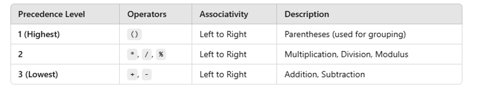

```
So, if you write an expression like:
int result = 10 + 5 - 2 / 2 * 3; 
10 + 5 – 1 * 3
10 + 5 – 3
15 – 3
12
Final result = 12
```

### 1.1.8. Escape sequence:
An escape sequence is a special character combination that starts with a backslash `\` and represents a character or action that is difficult to write directly in the printf function.

| Escape Sequence | Meaning | Example Output |
|-----|-----|-----|
| `\n` | New line | Moves to the next line |
| `\t` | Horizontal tab | Adds a tab space |
| `\\` | Backslash | `\` |
| `\"` | Double quotation mark | `"` |
| `\'` | Single quotation mark | `'` |
| `\?` | Question mark | `?` |
| `\b` | Backspace | Moves back one character position |
| `\a` | Alert/bell | Requests an alert sound |
| `\v` | Vertical tab | Adds a vertical tab |

```c
#include <stdio.h>

int main()
{
    // 1. New line (\n)
    printf("1. New line: Hello\nWorld\n\n");

    // 2. Horizontal tab (\t)
    printf("2. Horizontal tab: Name:\tTamim\n\n");

    // 3. Backslash (\\)
    printf("3. Backslash: C:\\Program Files\\Code\n\n");

    // 4. Double quotation mark (\")
    printf("4. Double quote: \"Hello World\"\n\n");

    // 5. Single quotation mark (\')
    printf("5. Single quote: \'Hello World\'\n\n");

    // 6. Question mark (\?)
    printf("6. Question mark: What is C\\?\n\n");

    // 7. Backspace (\b)
    printf("7. Backspace: ABC\bD\n\n");

    // 8. Alert or bell (\a)
    printf("8. Alert: Hello\a World\n\n");

    // 9. Vertical tab (\v)
    printf("9. Vertical tab: Hello\vWorld\n");

    return 0;
}
```

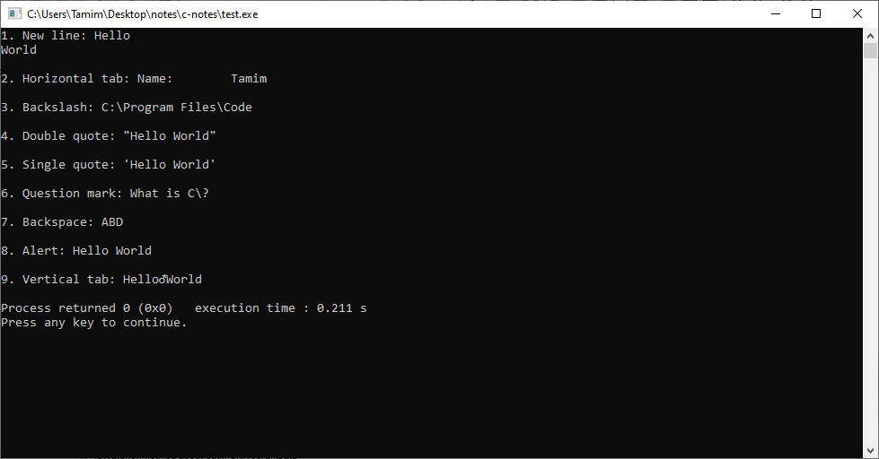

## 1.2. Chapter 2: Operators and Conditional Statement(if-else):
### 1.2.1. Operators: 
#### 1.2.1.1. Arithmetic Operators(+, -, *, /, %):

```c
#include <stdio.h>

int main()
{
    int a = 10;
    int b = 3;

    printf("Addition: %d\n", a + b); // Addition: 13
    printf("Subtraction: %d\n", a - b); // Subtraction: 7
    printf("Multiplication: %d\n", a * b); // Multiplication: 30
    printf("Division: %d\n", a / b); // Division: 3 
    printf("Modulus: %d\n", a % b); // Modulus: 1 

    return 0;
}
```

```c
#include <stdio.h>
int main()
{
    int a = 7;
    int b = 2;

    int quotient = a / b;
    int remainder = a % b;

    printf("%d / %d = %d\n", a, b, quotient);
    printf("%d %% %d = %d\n", a, b, remainder);

    return 0;
}
```

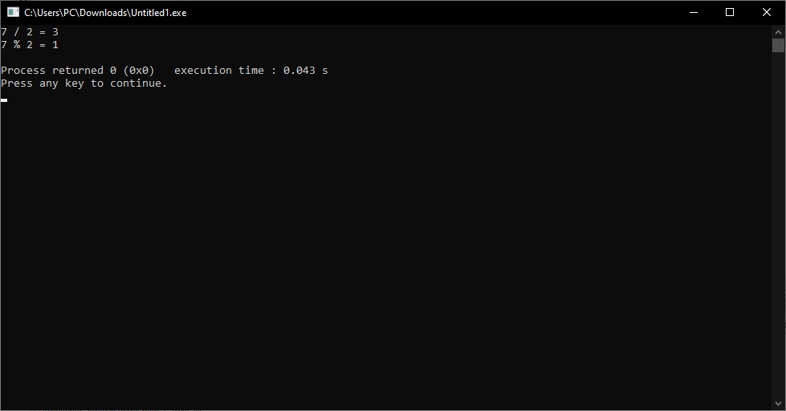
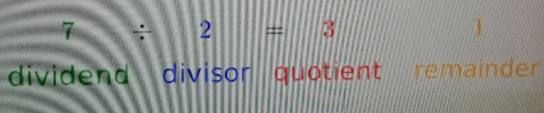
- Dividend = 7 (যাকে ভাগ করা হবে)
- Divisor = ২ (যা দিয়ে ভাগ করা হবে)
- Quotient = 3 (ভাগফল)
- Remainder = 1 (ভাগশেষ)

#### 1.2.1.2. Relational Operators(>, <, >=, <=, ==, !=):

```c
#include <stdio.h>

int main()
{
    int a = 10;
    int b = 5;

    printf("Greater than: %d\n", a > b); // Greater than: 1 
    printf("Less than: %d\n", a < b); // Less than: 0
    printf("Greater than or equal to: %d\n", a >= b); // Greater than or equal to: 1
    printf("Less than or equal to: %d\n", a <= b); // Less than or equal to: 0
    printf("Equal to: %d\n", a == b); // Equal to: 0
    printf("Not equal to: %d\n", a != b); // Not equal to: 1

    return 0;
}
```

#### 1.2.1.3. Logical Operators(&&, ||, !):

```c
#include <stdio.h>

int main()
{
    int a = 10;
    int b = 5;

    printf("Logical AND: %d\n", (a > 5) && (b < 10)); // Logical AND: 1
    printf("Logical OR: %d\n", (a < 5) || (b < 10)); // Logical OR: 1
    printf("Logical NOT: %d\n", !(a > 5)); // Logical NOT: 0

    return 0;
}
```

Note: For logical not operator, if the condition is true then it will return false(0) and if the condition is false then it will return true(1).

```c
#include <stdio.h>
int main()
{
    int x = 5; // x = true
    if (!x)
        printf("X is zero\n");
    else
        printf("X is not zero\n"); // X is not zero

    x = 0; // x = false
    if (!x)
        printf("X is zero\n"); // X is zero
    else
        printf("X is not zero");

    return 0;
}

// note: Any value other than 0 is considered true, and 0 is considered false.
```

### 1.2.2. Conditional Statement: 
#### 1.2.2.1. If-Else:
- syntax:

```c
If(condition == true){
	Statement 1;
}
Else{
	Statement 2;
}
```
#### 1.2.2.2. If-Else Ladder:
- Syntax:

```c
If(condition == ture){
	Statement 1;
}
Else if(condition == ture){
	Statement 2;
}
Else if(condition == ture){
	Statemtn 3;
}
Else{
	Statement 4;
}
```

#### 1.2.2.3. Nested If-Else:

- Syntax:

```c
If(condition == ture){
	Statement 1;
	If(condition == ture){
		Statement 2;
	}
	Else{
		Statement 3;
	}
}
Else{
	Statement 4;
}
```

## 1.3. Chapter 3: Loop: 
### 1.3.1. For-Loop:

```c
for(initialization; condition; increment/decrement) {
	Statement;
}
```

```c
#include <stdio.h>

int main(){
    for(int i = 1; i <= 5; i++){
        /*
        i += 1;
        i = i + 1; 
        */ 
        printf("%d ", i); // 1 2 3 4 5
    }

    return 0;
}
```

### 1.3.2. While Loop: 
```c
Initialization;

While(condition){
  Statement;
  Increment/decrement;
}
```

```c
#include <stdio.h>

int main()
{
    int i = 1;
    while (i <= 5)
    {
        printf("%d ", i); // 1 2 3 4 5  
        i++;
    }

    return 0;
}
```

### 1.3.3. Do-While Loop:
```c
Initialization;
do{
	Statement;
	Increment/ decrement;
}
While(condition);
```

```c
#include <stdio.h>

int main()
{
    int i = 1;
    do
    {
        printf("%d ", i); // 1 2 3 4 5
        i++;
    } while (i <= 5);

    return 0;
}
```

### 1.3.4. Break and Continue Statement:
Note:
- Break = Stop
- Continue = Skip

```c
#include <stdio.h>

int main()
{
    for (int i = 1; i <= 10; i++)
    {
        if (i == 6)
        {
            break;
        }
        printf("%d ", i); // 1 2 3 4 5
    } 

    return 0;
}
```

```c
#include <stdio.h>

int main()
{
    for (int i = 1; i <= 5; i++)
    {
        if (i == 3)
        {
            continue;
        }
        printf("%d ", i); // 1 2 4 5
    }

    return 0;
}
```

### 1.3.5. Nested Loop:

Nested loop = loop inside another loop.

- Syntax: 

```c
for(initialization; condition; increment/decrement) {
    for(initialization; condition; increment/decrement) {
        Statement;
        for(initialization; condition; increment/decrement) {
            Statement;
            ........................
            ........................
        }
    }
}
```

```c
#include <stdio.h>

int main()
{
    int n;
    scanf("%d", &n);

    for (int i = 0; i < n; i++)
    {
        for (int j = 0; j <= i; j++)
        {
            printf("*");
        }
        printf("\n");
    }

        return 0;
}
```
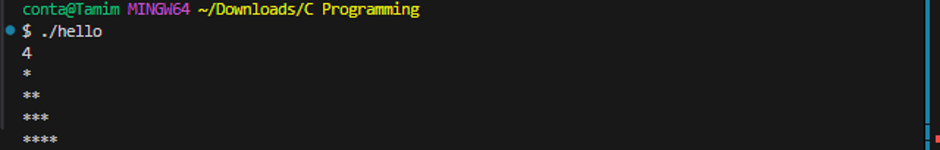

## 1.4. Chapter 4: Array:
An array is a variable that can store multiple values of the same data type.

```c
#include <stdio.h>

int main()
{
    int arr1[5] = {1, 2, 3, 4, 5}; 
    int arr2[] = {1, 2, 3, 4, 5}; 

    for (int i = 0; i < 5; i++)
    {
        printf("%d ", arr1[i]); // 1 2 3 4 5
    }

    for (int i = 0; i < 5; i++)
    {
        printf("%d ", arr2[i]); // 1 2 3 4 5
    }

    return 0;
}
```

[!alt text](./images/array.png)

### 1.4.1. Array Input and Output: 

```c
#include <stdio.h>

int main()
{
    int arr[5];

    arr[0] = 10;
    arr[1] = 20;
    arr[2] = 30;
    arr[3] = 40;
    arr[4] = 50;

    printf("%d %d %d %d %d", arr[0], arr[1], arr[2], arr[3], arr[4]); // 10 20 30 40 50

    return 0;
}
```

```c
#include <stdio.h>

int main()
{
    int arr[5];
    scanf("%d %d %d %d %d", &arr[0], &arr[1], &arr[2], &arr[3], &arr[4]);

    printf("%d %d %d %d %d", arr[0], arr[1], arr[2], arr[3], arr[4]); // 10 20 30 40 50

    return 0;
}
```

```c
#include <stdio.h>

int main()
{
    int arr[5] = {10, 20, 30, 40, 50};

    for (int i = 0; i < 5; i++)
    {
        printf("%d ", arr[i]);
    }

    return 0;
}
```

```c
// most of the time we use this method to take input and output an array.
#include <stdio.h>

int main()
{
    int n;
    scanf("%d", &n);
    int arr[n];

    for (int i = 0; i < n; i++)
    {
        scanf("%d", &arr[i]);
    }
    for (int i = 0; i < n; i++)
    {
        printf("%d ", arr[i]);
    }

    return 0;
}
```

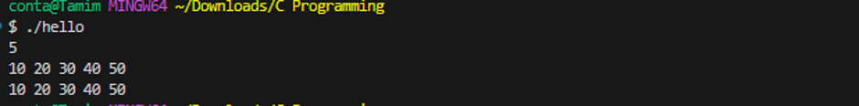

### 1.4.2. Reverse Array Element(Two Pointers Technique):
[!alt text](./images/Array3.png)

```c
#include <stdio.h>

int main()
{
    int n;
    scanf("%d", &n);
    int arr[n];

    for (int i = 0; i < n; i++)
    {
        scanf("%d", &arr[i]);
    }

    int i = 0, j = n - 1;

    while (i < j)
    {
        int temp = arr[i];
        arr[i] = arr[j];
        arr[j] = temp;
        i++;
        j--;
    }

    for (int i = 0; i < n; i++)
    {
        printf("%d ", arr[i]);
    }

    return 0;
}
```
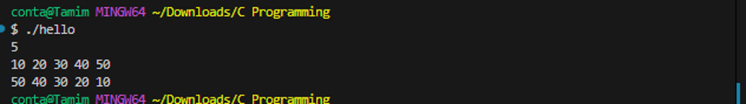
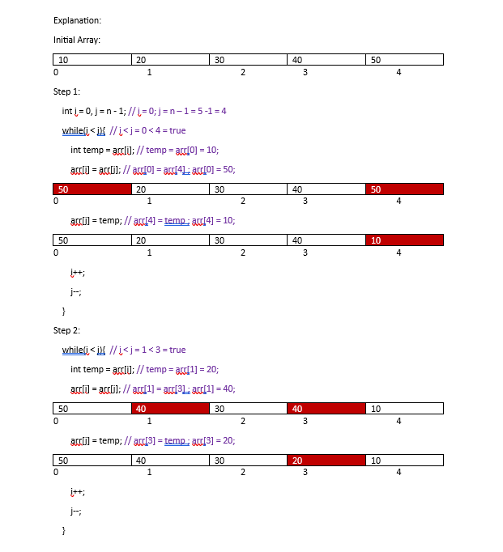

### 1.4.3. Insert Element in Array:
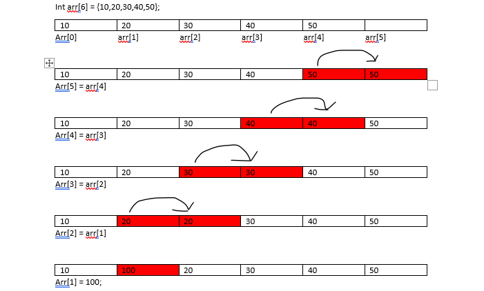

```c
#include <stdio.h>

int main()
{
    int arr[6] = {10, 20, 30, 40, 50}; // here 6 is the array size

    arr[5] = arr[4]; // here 5 is the array index
    arr[4] = arr[3];
    arr[3] = arr[2];
    arr[2] = arr[1];
    arr[1] = 100;

    for (int i = 0; i < 6; i++)
    {
        printf("%d ", arr[i]); // 10 100 20 30 40 50
    }

    return 0;
}
```

```c
#include <stdio.h>

int main()
{
    int n;
    scanf("%d", &n);
    int arr[n + 1];
    for (int i = 0; i < n; i++)
    {
        scanf("%d", &arr[i]);
    }

    int idx, ele;
    scanf("%d %d", &idx, &ele);
    for (int i = n; i > idx; i--)
    {
        arr[i] = arr[i - 1];
    }
    arr[idx] = ele;

    for (int i = 0; i <= n; i++)
    {
        printf("%d ", arr[i]); 
    }

    return 0;
}
```
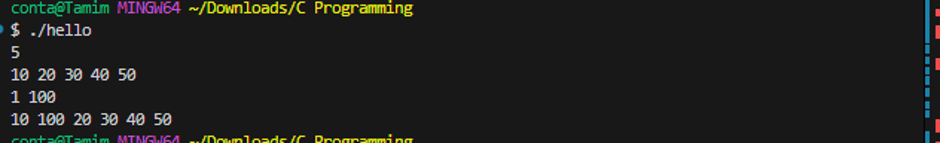


### 1.4.4. Remove Element from an Array:
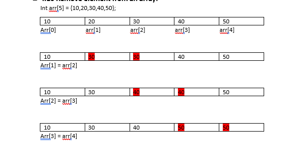

```c
#include <stdio.h>

int main()
{
    int arr[5] = {10, 20, 30, 40, 50};
    arr[1] = arr[2];
    arr[2] = arr[3];
    arr[3] = arr[4];

    for (int i = 0; i < 5 - 1; i++)
    {
        printf("%d ", arr[i]); // 10 30 40 50
    }

    return 0;
}
```

```c
#include <stdio.h>

int main()
{
    int n;
    scanf("%d", &n);
    int arr[n];
    for (int i = 0; i < n; i++)
    {
        scanf("%d", &arr[i]);
    }

    int idx;
    scanf("%d", &idx);

    for (int i = idx; i < n - 1; i++)
    {
        arr[i] = arr[i + 1];
    }

    for (int i = 0; i < n - 1; i++)
    {
        printf("%d ", arr[i]);
    }

    return 0;
}
```

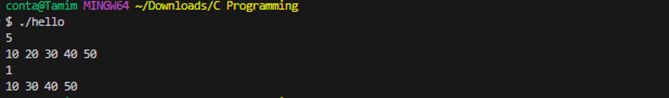


### 1.4.5. Array Concatenation:
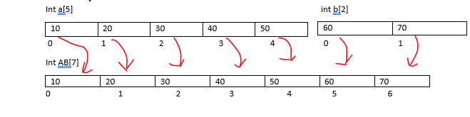

```c
#include <stdio.h>

int main()
{
    int n;
    scanf("%d", &n);
    int a[n];
    for (int i = 0; i < n; i++)
    {
        scanf("%d", &a[i]);
    }

    int m;
    scanf("%d", &m);
    int b[m];
    for (int i = 0; i < m; i++)
    {
        scanf("%d", &b[i]);
    }

    int ab[n + m];
    for (int i = 0; i < n; i++)
    {
        ab[i] = a[i];
    }
    for (int i = 0; i < m; i++)
    {
        ab[n + i] = b[i];
    }

    for (int i = 0; i < n + m; i++)
    {
        printf("%d ", ab[i]);
    }

    return 0;
}
```

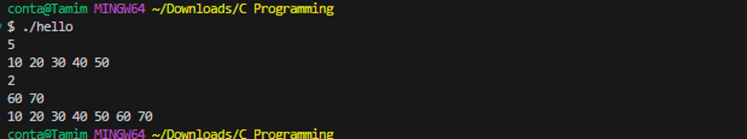

## 1.5. Chapter 5: 2D Array:
A 2D array (two-dimensional array) is an array that stores elements in rows and columns, like a table or a matrix. 

Syntax:
```c
data_type array_name[rows][columns];
```

```c
#include <stdio.h>
int main()
{
    int arr[3][2] = {
        {1, 2}, 
        {3, 4}, 
        {5, 6}
    }; // 3 rows and 2 columns

    for (int i = 0; i < 3; i++)
    {
        for (int j = 0; j < 2; j++)
        {
            printf("%d ", arr[i][j]);
        }
        printf("\n");
    }

    return 0;
}
```

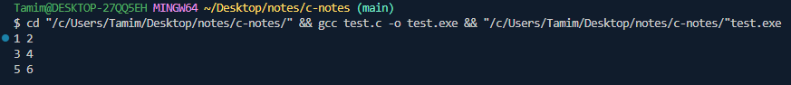

### 1.5.1. 2D Array Input and Output:

```c
#include <stdio.h>

int main()
{
    int row, col;
    scanf("%d %d", &row, &col);

    int arr[row][col];

    for (int i = 0; i < row; i++)
    {
        for (int j = 0; j < col; j++)
        {
            scanf("%d", &arr[i][j]);
        }
    }

    for (int i = 0; i < row; i++)
    {
        for (int j = 0; j < col; j++)
        {
            printf("%d ", arr[i][j]);
        }
        printf("\n");
    }

    return 0;
}
```

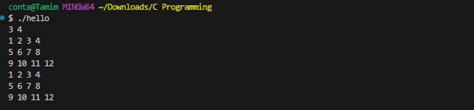


## 1.6. chapter 6: String:
In c, a string is an array of characters terminated by a null character `\0`. 

Note: 
- C uses character arrays to represent strings because it has no built-in string data type.
- The null character ('\0') marks the end of a string. Therefore, a string of length N requires N + 1 elements, where N is the number of characters and +1 is for the null character.


```c
#include <stdio.h>
int main(){
    char str[5] = {'t','a','m','i','m'};

    printf("%c%c%c%c%c", str[0], str[1], str[2],str[3],str[4]); // tamim

    for(int i = 0; i < 5; i++){
        printf("%c", str[i]); // tamim
    }

    return 0;
}
```


### 1.6.2. String Input and Output:
We know string is an array of Characters, but string also have some extra features: 
- `{'t','a','m','i','m'}` = `"tamim"`
- We can use `%s` format specifier is used to take input and output a string.


- Program 1:
- 
```c
#include <stdio.h>
int main(){
    char str[5] = "tamim";  // string extra feature
    for(int i = 0; i < 5; i++){
        printf("%c", str[i]); // tamim
    }
    return 0;
}
```

- Program 2:


```c
#include <stdio.h>

int main(){
    // char str[5] = "tamim"; // Garbage value will be printed after the string because we didn't add the null character `\0` at the end of the string.
    char str[6] = "tamim"; // string extra feature (we will use this method most of the time)
    // or
    char str[6] = "tamim\0"; // string extra feature
    // or
    char str[6] = {'t','a','m','i','m','\0'}; // string extra feature
    
    printf("%s", str);
    
    return 0;
}
```

- Program 3: 

```c
#include <stdio.h>
int main(){
    char str[6];
    scanf("%s", str);
    printf("%s", str); 
}
```

Note: This code has a problem. This code doesn’t take space as an input.  Here scanf() count space as her ending. To solve this problem we can use `gets()` or `fgets()` function.

```c
#include <stdio.h>
int main(){
    char str[12];
    gets(str);
    printf("%s", str);
}
```

Note: gets() reads an entire line of input until Enter is pressed, without checking the size of the buffer, which can lead to overflow. fgets() is safer as it reads up to N - 1 characters or until Enter is pressed, preventing buffer overflow. We should always use fgets() instead of gets().

```c
#include <stdio.h>
int main(){
    char str[12];
    fgets(str,12,stdin);
    printf("%s", str);
}
```

NOTE: gets() and fgets() both accept spaces in the input, but scanf() does not. When you press Enter, both gets() and fgets() stop reading input, but fgets() includes an extra newline (\n) after pressing  Enter.

- Program 4: 
gets() and puts() = gets() reads a string from the user (unsafe), and puts() prints a string by adding an additional newline.

```c
#include <stdio.h>
int main() {
    char str[100];
    printf("Enter a string: ");
    gets(str);  
    puts("You entered: ");
    puts(str);  
    return 0;
}
```

- Program 5:
fgets() and fputs() = fgets() reads a string from the user safely, and fputs() prints a string without adding a newline.  

```c
#include <stdio.h>
int main() {
    char str[100];
    printf("Enter a string: ");
    fgets(str, sizeof(str), stdin);  // Safely reading a string
    fputs("You entered: ", stdout);  // Printing the prompt
    fputs(str, stdout);  // Printing the string without an automatic newline
    return 0;
}
```

## 1.7. Chapter 7: Function:
A Function is a block of code that perform a specific task when it is called.

Syntax:
```c
return_type function_name(parameters type and name) {
    // Code to execute
    return value;
}
```

```c
#include <stdio.h>

int sum(int a, int b) {
    int summation = a + b;
    return summation;
}

int main() {
    int result = sum(5, 10);
    printf("Sum: %d", result);
    return 0;
}
```
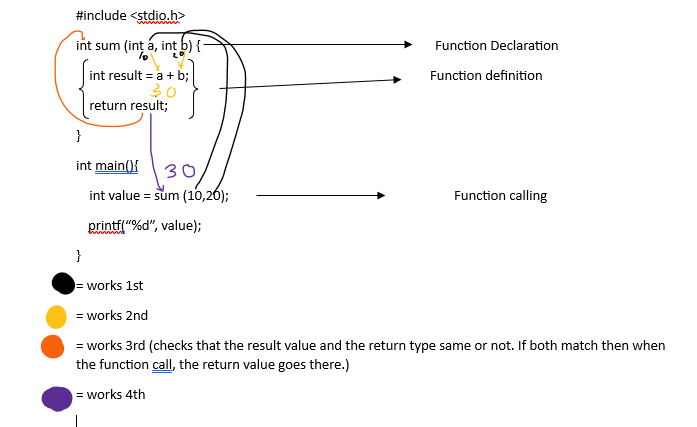


### 1.7.1. Different Way to Write a Function:  
- Return + Parameter:

```c
#include <stdio.h>

int sum(int a, int b) {
    return a + b;
}

int main() {
    int result = sum(5, 10);
    printf("Sum: %d", result); // Sum: 15
    return 0;
}
```

- Return + No Parameter:

```c
#include <stdio.h>

int sum () {
    int a = 5, b = 10;
    int summation = a + b;
    return summation;
}

int main() {
    int result = sum();
    printf("Sum: %d", result); // Sum: 15
    return 0;
}
```

- No Return + Parameter:

```c
#include <stdio.h>

void sum(int a, int b) {
    int summation = a + b;
    printf("Sum: %d", summation); // Sum: 15
}

int main() {
    sum(5, 10);
    return 0;
}
```

- No Return + No Parameter:

```c
#include <stdio.h>
void sum() {
    int a = 5, b = 10;
    int summation = a + b;
    printf("Sum: %d", summation); // Sum: 15
}

int main() {
    sum();
    return 0;
}
```

### 1.7.2. Common Library Functions:
In C, a library function is a predefined function that helps us perform common tasks without writing all the code ourselves. Each library function belongs to a header file, such as stdio.h, string.h, or math.h.

- `<stdio.h>`: Used to read input from the user and display output.
  
| Function | Purpose |
| --------- | ----------- | 
| `printf()` | Prints output | 
| `scanf()` | Reads formatted input | 
| `getchar()` | Reads one character | 
| `putchar()` | Prints one character | 
| `fgets()` | Reads a line of text | 
| `puts()` | Prints a string with a newline |

```c

#include <stdio.h>

int main() {
    int age;
    char ch;
    char name[50];

    printf("Enter your age: ");
    scanf("%d", &age);

    // Clear the newline left by scanf()
    getchar();

    printf("Enter a character: ");
    ch = getchar();

    // Clear the newline left by getchar()
    getchar();


    printf("Enter your name: ");
    fgets(name, sizeof(name), stdin);

    printf("\n");

    puts("Your information:");
    printf("Age: %d\n", age);
    
    printf("Your character is: ");
    putchar(ch);
    printf("\n");
    
    printf("Name: ");
    puts(name);

    return 0;
}
```

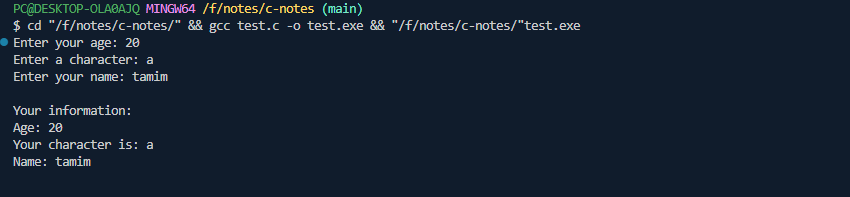

- `<math.h>`: Used to perform mathematical calculations.

| Function | Purpose | Example Result |
| --- | --- | --- |
| `sqrt(x)` | Square root | `sqrt(25) → 5.0` |
| `pow(x, y)` | Raises x to the power y | `pow(2, 3) → 8.0` |
| `ceil(x)` | Rounds upward | `ceil(4.2) → 5.0` |
| `floor(x)` | Rounds downward | `floor(4.8) → 4.0` |
| `round(x)` | Rounds to the nearest integer value | `round(4.6) → 5.0` |
| `fabs(x)` | Absolute value of a floating-point number | `fabs(-4.5) → 4.5` |

```c
#include <stdio.h>
#include <math.h>

int main() {
    // 1. sqrt() - Square root
    printf("Square root: %.1f\n", sqrt(25)); // 5.0

    // 2. pow() - Power
    printf("Power: %.1f\n", pow(2, 3)); // 8.0

    // 3. ceil() - Rounds upward
    printf("Ceil: %.1f\n", ceil(4.2)); // 5.0

    // 4. floor() - Rounds downward
    printf("Floor: %.1f\n", floor(4.8)); // 4.0

    // 5. round() - Rounds to the nearest integer
    printf("Round: %.1f\n", round(4.4)); // 4.0
    printf("Round: %.1f\n", round(4.5)); // 5.0
    printf("Round: %.1f\n", round(4.6)); // 5.0

    // 6. fabs() - Absolute value of a floating-point number
    printf("Absolute value: %.1f\n", fabs(-4.5)); // 4.5

    return 0;
}
```

- `<string.h>`: Used to work with strings.

| Function | Purpose |
| --- | --- | 
| `strlen()` | Gets the string length | 
| `strcpy()` | Copies a string | 
| `strcat()` | Appends one string to another | 
| `strcmp()` | Compares two strings | 
| `strchr()` | Finds a character in a string | 

```c
#include <stdio.h>
#include <string.h>

int main() {
    char str1[50] = "Hello";
    char str2[50] = " World";
    char dest[50] = "Hello";
    char *ptr;

    // 1. strlen() - Gets the string length
    printf("String length: %zu\n", strlen(str1)); // 5

    // 2. strcpy() - Copies a string
    strcpy(dest, "C Programming");
    printf("Copied string: %s\n", dest); // C Programming

    // 3. strcat() - Appends one string to another
    strcat(str1, str2);
    printf("Concatenated string: %s\n", str1); // Hello World

    // 4. strcmp() - Compares two strings
    printf("String comparison: %d\n", strcmp("abc", "abc")); // 0 (0 means 1st string == 2nd string)
    printf("String comparison: %d\n", strcmp("abc", "def")); // -1 (negative means 1st string < 2nd string)
    printf("String comparison: %d\n", strcmp("def", "abc")); // 1 (positive means 1st string > 2nd string)

    // 5. strchr() - Finds a character in a string
    ptr = strchr("Hello", 'e'); 

    if (ptr != NULL) {
        printf("Character found: %c\n", *ptr); // e
    } else {
        printf("Character not found\n");
    }

    return 0;
}
```

Note: here The `strchr()` function searches for a specific character in a string and returns a pointer to the first occurrence of that character. 

```c
Syntax: strchr(string, character);`

- string — the string to search.
- character — the character you want to find.
- Return value — a pointer to the character if found; otherwise, NULL.
```

- `<stdlib.h>`: Used for general purpose functions.

| Function | Purpose |
| --- | --- | 
| `abs()` | Absolute value of an integer | 
| `atoi()` | Converts a string to an integer | 

```c
#include <stdio.h>
#include <stdlib.h>

int main() {
    // 1. abs() - Absolute value of an integer
    printf("Absolute value: %d\n", abs(-10)); // 10

    // 2. atoi() - Converts a string to an integer
    char str[] = "123";
    int num = atoi(str);
    printf("Converted integer: %d\n", num); // 123

    return 0;
}
```

- `<ctype.h>`: Used to check or convert individual characters.

| Function | Purpose | 
| --- | --- | 
| `isalpha()` | Checks whether a character is a letter |
| `isdigit()` | Checks whether a character is a digit | 
| `isalnum()` | Checks whether a character is a letter or digit | 
| `isspace()` | Checks for whitespace | 
| `toupper()` | Converts a lowercase letter to uppercase | 
| `tolower()` | Converts an uppercase letter to lowercase |


```c
#include <stdio.h>
#include <ctype.h>

int main() {
    printf("isalpha: %d\n", isalpha('A')); // 1 (true)
    
    printf("isdigit: %d\n", isdigit('5')); // 1 (true)
    
    printf("isalnum: %d\n", isalnum('A')); // 1 (true)
    printf("isalnum: %d\n", isalnum('5')); // 1 (true)

    printf("isspace: %d\n", isspace(' ')); // 1 (true)
    
    printf("toupper: %c\n", toupper('a')); // A
    
    printf("tolower: %c\n", tolower('A')); // a

    return 0;
}
```

## 1.8. Chapter 8: Recursion:
Recursion in programming is a technique where a function calls itself. It Has two main parts: 
- Base Case: The condition that stops recursion and prevents infinite recursive calls, which can lead to a stack overflow.
- Recursive Case: The part where a function calls itself with modified arguments that move the function toward the base case.

```c
#include <stdio.h>

void great(int count) {
    if (count == 0) { // Base Case
        return;
    }
    printf("Hello\n");
    great(count - 1); // Recursive Case
}

int main() {
    great(5); // Initial Call with a limit
    return 0;
}
```

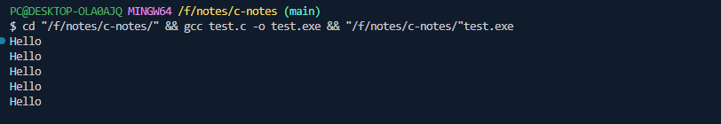
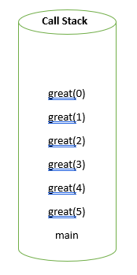

### 1.8.1. Call Stack:
The call stack is a region of memory used to manage function calls. It keeps track of active function calls, including their parameters, local variables, and where execution should resume when a function returns. It follows Last-In-First-Out (LIFO) principle.

```c
#include <stdio.h>

void functionA() {
    int a = 10;
    printf("Inside functionA: a = %d\n", a);
}

void functionB() {
    int b = 20;
    functionA();
    printf("Inside functionB: b = %d\n", b);
}

int main() {
    int c = 30;
    functionB();
    printf("Inside main: c = %d\n", c);
    return 0;
}
```

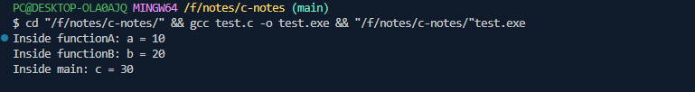
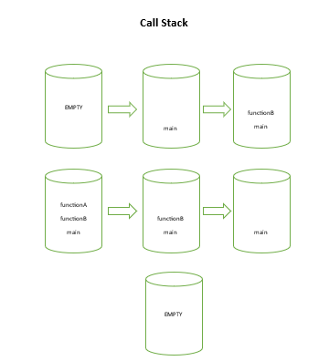

## 1.9. Chapter 9: Pointer:
The pointer is a variable which stores the address of another variable.

```c
#include <stdio.h>

int main()
{
    int num = 10;
    int *ptr = &num;

    printf("Value of num: %d\n", num); // value of num: 10
    printf("Address of num: %p\n", &num); // address of num: 000000000061FE14

    printf("Value of ptr: %p\n", ptr); // value of ptr: 000000000061FE14 
    printf("Address of ptr: %p\n", &ptr); // address of ptr: 000000000061FE10
    printf("Value of the variable that the pointer points to: %d\n", *ptr); // Value of the variable that the pointer points to: 10
    return 0;
}
```

### Dereferencing Pointer:
Dereferencing a pointer means accessing or modifying the value that the pointer points to. This is done using the dereference operator `*`.
  - pointer value means the memory address of the variable that the pointer is points to.

```c
#include <stdio.h>

int main()
{
    int num = 10;
    int *ptr = &num;

    printf("Original value of num: %d\n", num); // Original value of num: 10

    // Access the value of num using dereferencing
    printf("Original value through ptr: %d\n", *ptr); // Original value through ptr: 10

    // Modify the value of num using dereferencing
    *ptr = 50;

    // Access the modified value using dereferencing
    printf("Modified value through ptr: %d\n", *ptr); // Modified value through ptr: 50

    printf("Modified value of num: %d\n", num); // Modified value of num: 50

    return 0;
}
```

Note: We did not change the pointer itself. The pointer ptr still stores the memory address of num; we changed the value of num by dereferencing the pointer.


### Difference between call by value and call by reference.
- Call by Value: In call by value, a copy of the actual parameter's value is passed to the function. Changes made to the parameter inside the function do not affect the original argument.
```c
#include <stdio.h>
void fun(int x){
    x = 100;
}
int main(){
    int x = 10;
    fun(x);
    printf("%d", x); // 10
}
```

- Call by Reference: In call by reference, the address of the actual parameter is passed to the function. Changes made to the parameter inside the function affect the original argument because of the pointer dereferencing.

```c
#include<stdio.h>
void fun(int *p){
    *p = 100;
}
int main(){
    int x = 10;
    fun(&x);
    printf("%d", x); // 100
}
```
### 1.9.4. Relation Between Array and Pointer:
In C, arrays and pointers are closely related because an array name usually converts to a pointer to its first element when used in an expression. This allows us to access array elements using pointer arithmetic and dereferencing.

```c
#include <stdio.h>

int main()
{
    int arr[5] = {10, 20, 30, 40, 50};
    int *ptr = arr;

    printf("First element using array: %d\n", arr[0]); // First element: 10
    printf("Second element using array: %d\n", arr[1]); // Second element: 20
    printf("Third element using array: %d\n", arr[2]); // Third element: 30
    printf("Fourth element using array: %d\n", arr[3]); // Fourth element: 40
    printf("Fifth element using array: %d\n", arr[4]); // Fifth element: 50

    printf("First element using pointer: %d\n", *ptr); // First element using pointer: 10
    printf("Second element using pointer %d\n", *(ptr + 1)); // Second element using pointer: 20
    printf("Third element using pointer %d\n", *(ptr + 2)); // Third element using pointer: 30
    printf("Fourth element using pointer %d\n", *(ptr + 3)); // Fourth element using pointer: 40
    printf("Fifth element using pointer %d\n", *(ptr + 4)); // Fifth element using pointer: 50

    return 0;
}
```

Note: Although arrays and pointers are closely related, an array is not a pointer. 

### 1.9.5. How to Pass Array and String Into a Function:
When we pass an array to a function, it is actually passed as a pointer to the first element of the array. Thats why the size of the array is lost when it is passed to the function. To overcome this issue, we can pass the size of the array as an additional parameter to the function for normal array and if we use string we can also use some built-in functions and operators such as `strlen()` and `%s`.

- Array:

```c
// wrong approach
#include <stdio.h>

void fun(int arr[]){ // int arr[] == int *arr and sizeOf(*arr) = 8 bytes 
    int size = sizeof(arr) / sizeof(int); // 8 / 4 = 2
    printf("Array size in the fun function = %d\n", size); // Array size in the fun function = 2

    printf("%d\n", *arr); // 10

    for(int i = 0; i < size; i++){
        printf("%d ", arr[i]); // 10 20
    }
}

int main(){
    int arr[5] = {10,20,30,40,50};
    int size = sizeof(arr) / sizeof(int); // 20 / 4 = 5
    printf("Array size in the main function = %d\n", size); //  Array size in the main function = 5
    fun(arr);
}
```

```c
// correct approach
#include <stdio.h>
void fun(int *arr, int size){ // int arr[] == int *arr
    for(int i = 0; i < size; i++){
        printf("%d ", arr[i]); // 10 20 30 40 50
    }

}   

int main(){
    int arr[5] = {10,20,30,40,50};
    int size = sizeof(arr) / sizeof(int);
    fun(arr, size);
}
```

- String:

```c
#include <stdio.h>

void fun(char str[], int size){ // char str[] == char *str
    for(int i = 0; i < size; i++){
        printf("%c", str[i]); // Hello
    }

}   

int main(){
    char str[5] = "Hello";
    int size = sizeof(str) / sizeof(char); // 5 / 1 = 5
    fun(str, size);
}
```

```c
#include <stdio.h>
#include <string.h> 

void fun(char s[]) { // char s[] == char *s
    int sz = strlen(s);
    printf("size of string into fun: %d\n", sz);

    for(int i = 0; i < sz; i++) {
        printf("%c", s[i]); // Hello
    }
}

int main() {
    char s[10] = "Hello";
    fun(s);
    int sz = strlen(s);
    printf("size of string into main: %d\n", sz);
    return 0;
} 
```

```c
#include <stdio.h>

void fun(char str[]){ // char str[] == char *str
    printf("%s", str); // Hello
}

int main(){
    char str[] = "Hello";
    fun(str);
}  
```

# 2. Part 2: Problem Solving: