<h1 align="center">C Notes</h1>

- [1. Part 1: Language](#1-part-1-language)
  - [1.1. Chapter 1: Basic Syntax, Variables and Data Types:](#11-chapter-1-basic-syntax-variables-and-data-types)
    - [1.1.1. First C Program:](#111-first-c-program)
    - [1.1.2. Comments:](#112-comments)
    - [1.1.3. Data Types and Variables:](#113-data-types-and-variables)
    - [1.1.4. Data Types Limitations:](#114-data-types-limitations)
    - [1.1.5. How to Take Input:](#115-how-to-take-input)
    - [1.1.6. Difference Between Pre and Post:](#116-difference-between-pre-and-post)
    - [1.1.7. Operator Precedence:](#117-operator-precedence)
    - [1.1.8. Escape sequence:](#118-escape-sequence)
  - [1.2. Chapter 2: Operators and Conditional Statement(if-else):](#12-chapter-2-operators-and-conditional-statementif-else)
    - [1.2.1. Operators:](#121-operators)
      - [1.2.1.1. Arithmetic Operators(+, -, \*, /, %):](#1211-arithmetic-operators-----)
      - [1.2.1.2. Relational Operators(\>, \<, \>=, \<=, ==, !=):](#1212-relational-operators-----)
      - [1.2.1.3. Logical Operators(\&\&, ||, !):](#1213-logical-operators--)
    - [1.2.2. Conditional Statement:](#122-conditional-statement)
      - [1.2.2.1. If-Else:](#1221-if-else)
      - [1.2.2.2. If-Else Ladder:](#1222-if-else-ladder)
      - [1.2.2.3. Nested If-Else:](#1223-nested-if-else)
    - [1.2.3. Ternary Operator:](#123-ternary-operator)
  - [1.3. Chapter 3: Loop:](#13-chapter-3-loop)
    - [1.3.1. For-Loop:](#131-for-loop)
    - [1.3.2. While Loop:](#132-while-loop)
    - [1.3.3. Do-While Loop:](#133-do-while-loop)
    - [1.3.4. Break and Continue Statement:](#134-break-and-continue-statement)
    - [1.3.5. Nested Loop:](#135-nested-loop)
  - [1.4. Chapter 4: Array:](#14-chapter-4-array)
    - [1.4.1. Array Input and Output:](#141-array-input-and-output)
    - [1.4.2. Reverse Array Element(Two Pointers Technique):](#142-reverse-array-elementtwo-pointers-technique)
    - [1.4.3. Insert Element in Array:](#143-insert-element-in-array)
    - [1.4.4. Remove Element from an Array:](#144-remove-element-from-an-array)
    - [1.4.5. Array Concatenation:](#145-array-concatenation)
  - [1.5. Chapter 5: 2D Array:](#15-chapter-5-2d-array)
    - [1.5.1. 2D Array Input and Output:](#151-2d-array-input-and-output)
  - [1.6. chapter 6: String:](#16-chapter-6-string)
    - [1.6.1. `get()/puts()` and `fgets()/fputs()` functions:](#161-getputs-and-fgetsfputs-functions)
    - [1.6.2. Length of a string:](#162-length-of-a-string)
    - [1.6.3. String Copy:](#163-string-copy)
    - [1.6.4. String Lexicographical Comparison:](#164-string-lexicographical-comparison)
    - [1.6.5. String Concatenation:](#165-string-concatenation)
    - [1.6.6. Counting or Frequency String:](#166-counting-or-frequency-string)
  - [1.7. Chapter 7: Function:](#17-chapter-7-function)
    - [1.7.1. Different Way to Write a Function:](#171-different-way-to-write-a-function)
    - [1.7.2. Common Library Functions:](#172-common-library-functions)
  - [1.8. Chapter 8: Recursion:](#18-chapter-8-recursion)
    - [1.8.1. Call Stack:](#181-call-stack)
  - [1.9. Chapter 9: Pointer:](#19-chapter-9-pointer)
    - [1.9.1. Dereferencing Pointer:](#191-dereferencing-pointer)
    - [1.9.2. Difference between call by value and call by reference.](#192-difference-between-call-by-value-and-call-by-reference)
    - [1.9.3. Relation Between Array and Pointer:](#193-relation-between-array-and-pointer)
    - [1.9.4. How to Pass Array and String Into a Function:](#194-how-to-pass-array-and-string-into-a-function)
- [2. Part 2: Problem Solving:](#2-part-2-problem-solving)
  - [2.1. Sheet 1 (Data type and Conditions):](#21-sheet-1-data-type-and-conditions)
    - [2.1.1. A - Say Hello With C++:](#211-a---say-hello-with-c)
    - [2.1.2. B - Basic Data Types:](#212-b---basic-data-types)
    - [2.1.3. C. Simple Calculator:](#213-c-simple-calculator)
    - [2.1.4. D. Difference:](#214-d-difference)
    - [2.1.5. E. Area of a Circle:](#215-e-area-of-a-circle)
    - [2.1.6. F Digits Summation:](#216-f-digits-summation)
    - [2.1.7. G Summation from 1 to N:](#217-g-summation-from-1-to-n)
    - [2.1.8. H Two numbers:](#218-h-two-numbers)
    - [2.1.9. I Welcome for you with Conditions:](#219-i-welcome-for-you-with-conditions)
    - [2.1.10. J Multiples:](#2110-j-multiples)
    - [2.1.11. K Max and Min:](#2111-k-max-and-min)
    - [2.1.12. L The Brothers:](#2112-l-the-brothers)
    - [2.1.13. M Capital or Small or Digit:](#2113-m-capital-or-small-or-digit)
    - [2.1.14. N Char:](#2114-n-char)
    - [2.1.15. O Calculator:](#2115-o-calculator)
    - [2.1.16. P First digit!:](#2116-p-first-digit)
    - [2.1.17. Q Coordinates of a Point:](#2117-q-coordinates-of-a-point)
    - [2.1.18. R Age in Days:](#2118-r-age-in-days)
    - [2.1.19. S Interval:](#2119-s-interval)
    - [2.1.20. T Sort Numbers:](#2120-t-sort-numbers)
    - [2.1.21. U Float or int:](#2121-u-float-or-int)
    - [2.1.22. V Comparison:](#2122-v-comparison)
    - [2.1.23. W Mathematical Expression:](#2123-w-mathematical-expression)
    - [2.1.24. X Two intervals:](#2124-x-two-intervals)
    - [2.1.25. Y The last 2 digits:](#2125-y-the-last-2-digits)
    - [2.1.26. Z Hard Compare:](#2126-z-hard-compare)
  - [2.2. Contest 1:](#22-contest-1)
    - [2.2.1. A. Winter Sale:](#221-a-winter-sale)
    - [2.2.2. B: Memo and Momo:](#222-b-memo-and-momo)
    - [2.2.3. C: Next Alphabet:](#223-c-next-alphabet)
    - [2.2.4. D: Ali Baba and Puzzles:](#224-d-ali-baba-and-puzzles)
    - [2.2.5. E: Interval Sweep:](#225-e-interval-sweep)
    - [2.2.6. F: Adding Bits:](#226-f-adding-bits)
    - [2.2.7. G: Katryoshka: (Hard)](#227-g-katryoshka-hard)
    - [2.2.8. H: Data Type Guessing:](#228-h-data-type-guessing)
    - [2.2.9. I: Lucky Numbers:](#229-i-lucky-numbers)
  - [2.3. Sheet 2 (Loops):](#23-sheet-2-loops)
    - [2.3.1. A. Problem Name: 1 to N](#231-a-problem-name-1-to-n)
    - [2.3.2. B. Problem Name: Even Numbers](#232-b-problem-name-even-numbers)
    - [2.3.3. C. Problem Name: Even, Odd, Positive and Negative](#233-c-problem-name-even-odd-positive-and-negative)
    - [2.3.4. D. Problem Name: Fixed Password](#234-d-problem-name-fixed-password)
    - [2.3.5. E. Problem Name: Max](#235-e-problem-name-max)
    - [2.3.6. F. Problem Name: Multiplication Table](#236-f-problem-name-multiplication-table)
    - [2.3.7. G. Problem Name: Factorial](#237-g-problem-name-factorial)
    - [2.3.8. H. Problem Name: One Prime](#238-h-problem-name-one-prime)
    - [2.3.9. I. Problem Name: Palindrome](#239-i-problem-name-palindrome)
    - [2.3.10. J. Problem Name: Primes from 1 to N](#2310-j-problem-name-primes-from-1-to-n)
    - [2.3.11. K. Problem Name: Divisors](#2311-k-problem-name-divisors)
    - [2.3.12. L. Problem Name: GCD](#2312-l-problem-name-gcd)
    - [2.3.13. M. Problem Name: Lucky Numbers](#2313-m-problem-name-lucky-numbers)
    - [2.3.14. N. Problem Name: Numbers Histogram](#2314-n-problem-name-numbers-histogram)
    - [2.3.15. O. Problem Name: Pyramid](#2315-o-problem-name-pyramid)
    - [2.3.16. P. Problem Name: Shape1](#2316-p-problem-name-shape1)
    - [2.3.17. Q. Problem Name: Digits](#2317-q-problem-name-digits)
    - [2.3.18. R. Problem Name: Sequence of Numbers and Sum](#2318-r-problem-name-sequence-of-numbers-and-sum)
    - [2.3.19. S. Problem Name: Sum of Consecutive Odd Numbers](#2319-s-problem-name-sum-of-consecutive-odd-numbers)
    - [2.3.20. T. Problem Name: Shape2](#2320-t-problem-name-shape2)
    - [2.3.21. U. Problem Name: Some Sums](#2321-u-problem-name-some-sums)
    - [2.3.22. V. Problem Name: PUM](#2322-v-problem-name-pum)
    - [2.3.23. W. Problem Name: Shape3](#2323-w-problem-name-shape3)
    - [2.3.24. X. Problem Name: Convert To Decimal 2](#2324-x-problem-name-convert-to-decimal-2)
    - [2.3.25. Y. Problem Name: Easy Fibonacci](#2325-y-problem-name-easy-fibonacci)
    - [2.3.26. Z. Problem Name: Three Numbers](#2326-z-problem-name-three-numbers)
  - [2.4. Contest 2:](#24-contest-2)
    - [2.4.1. A. Problem Name: Timon and Pumbaa](#241-a-problem-name-timon-and-pumbaa)
    - [2.4.2. B. Problem Name: Drawing `X`](#242-b-problem-name-drawing-x)
    - [2.4.3. C. Problem Name: Finding Minimums](#243-c-problem-name-finding-minimums)
    - [2.4.4. D. Problem Name: Range Sum](#244-d-problem-name-range-sum)
    - [2.4.5. E. Problem Name: Hady Rides the Train](#245-e-problem-name-hady-rides-the-train)
    - [2.4.6. F. Problem Name: Break Number](#246-f-problem-name-break-number)
    - [2.4.7. G. Problem Name: Construct the Sum](#247-g-problem-name-construct-the-sum)
    - [2.4.8. H. Problem Name: Simple Mod](#248-h-problem-name-simple-mod)
  - [2.5. Patterns:](#25-patterns)
    - [2.5.1. Beginner:](#251-beginner)
      - [2.5.1.1. Square Fill Pattern](#2511-square-fill-pattern)
      - [2.5.1.2. Right Half Pyramid](#2512-right-half-pyramid)
      - [2.5.1.3. Reverse Right Half Pyramid](#2513-reverse-right-half-pyramid)
      - [2.5.1.4. Number Triangular](#2514-number-triangular)
      - [2.5.1.5. Number Increasing Pyramid](#2515-number-increasing-pyramid)
      - [2.5.1.6. Number Increasing Reverse Pyramid](#2516-number-increasing-reverse-pyramid)
    - [2.5.2. Intermediate](#252-intermediate)
      - [2.5.2.1. Left Half Pyramid](#2521-left-half-pyramid)
      - [2.5.2.2. Reverse Left Half Pyramid](#2522-reverse-left-half-pyramid)
      - [2.5.2.3. Rhombus Pattern](#2523-rhombus-pattern)
      - [2.5.2.4. Triangle Star Pattern](#2524-triangle-star-pattern)
      - [2.5.2.5. Reverse Number Triangle Pattern](#2525-reverse-number-triangle-pattern)
      - [2.5.2.6. Number Changing Pyramid](#2526-number-changing-pyramid)
      - [2.5.2.7. Zero-One Triangle](#2527-zero-one-triangle)
      - [2.5.2.8. Square Hollow Pattern](#2528-square-hollow-pattern)
      - [2.5.2.9. Palindrome Triangular](#2529-palindrome-triangular)
      - [2.5.2.10. K Pattern](#25210-k-pattern)
      - [2.5.2.11. Right Pascal's Triangle](#25211-right-pascals-triangle)
      - [2.5.2.12. Mirror Image Triangle Pattern](#25212-mirror-image-triangle-pattern)
    - [2.5.3. Advanced](#253-advanced)
      - [2.5.3.1. Diamond Pattern](#2531-diamond-pattern)
      - [2.5.3.2. Butterfly Star Pattern](#2532-butterfly-star-pattern)
      - [2.5.3.3. Hollow Triangle Pattern](#2533-hollow-triangle-pattern)
      - [2.5.3.4. Hollow Reverse Triangle Pattern](#2534-hollow-reverse-triangle-pattern)
      - [2.5.3.5. Hollow Diamond Pattern](#2535-hollow-diamond-pattern)
      - [2.5.3.6. Hollow Hourglass Pattern](#2536-hollow-hourglass-pattern)
      - [2.5.3.7. Pascal's Triangle](#2537-pascals-triangle)
  - [2.6. Sheet 3 (Arrays):](#26-sheet-3-arrays)
    - [2.6.1. A. Problem Name: Summation](#261-a-problem-name-summation)
    - [2.6.2. B. Problem Name: Searching](#262-b-problem-name-searching)
    - [2.6.3. C. Problem Name: Replacement](#263-c-problem-name-replacement)
    - [2.6.4. D. Problem Name: Positions in array](#264-d-problem-name-positions-in-array)
    - [2.6.5. E. Problem Name: Lowest Number](#265-e-problem-name-lowest-number)
    - [2.6.6. F. Problem Name: Reversing](#266-f-problem-name-reversing)
    - [2.6.7. G. Problem Name: Palindrome Array](#267-g-problem-name-palindrome-array)
    - [2.6.8. H. Problem Name: Sorting](#268-h-problem-name-sorting)
    - [2.6.9. I. Problem Name: Smallest Pair](#269-i-problem-name-smallest-pair)
    - [2.6.10. J. Problem Name: Lucky Array](#2610-j-problem-name-lucky-array)
    - [2.6.11. K. Problem Name: Sum Digits](#2611-k-problem-name-sum-digits)
    - [2.6.12. L. Problem Name: Max Subarray](#2612-l-problem-name-max-subarray)
    - [2.6.13. M. Problem Name: Replace MinMax](#2613-m-problem-name-replace-minmax)
    - [2.6.14. N. Problem Name: Check Code](#2614-n-problem-name-check-code)
    - [2.6.15. O. Problem Name: Fibonacci](#2615-o-problem-name-fibonacci)
    - [2.6.16. P. Problem Name: Minimize Number](#2616-p-problem-name-minimize-number)
    - [2.6.17. Q. Problem Name: Count Subarrays](#2617-q-problem-name-count-subarrays)
    - [2.6.18. R. Problem Name: Permutation with arrays](#2618-r-problem-name-permutation-with-arrays)
    - [2.6.19. S. Problem Name: Search In Matrix](#2619-s-problem-name-search-in-matrix)
    - [2.6.20. T. Problem Name: Matrix](#2620-t-problem-name-matrix)
    - [2.6.21. U. Problem Name: Is B a subsequence of A ?](#2621-u-problem-name-is-b-a-subsequence-of-a-)
    - [2.6.22. V. Problem Name: Frequency Array](#2622-v-problem-name-frequency-array)
    - [2.6.23. W. Problem Name: Mirror Array](#2623-w-problem-name-mirror-array)
    - [2.6.24. X. Problem Name: 8 Neighbors](#2624-x-problem-name-8-neighbors)
    - [2.6.25. Y. Problem Name: Range sum query](#2625-y-problem-name-range-sum-query)
    - [2.6.26. Z. Problem Name: Binary Search](#2626-z-problem-name-binary-search)
  - [2.7. Contest 3:](#27-contest-3)
    - [2.7.1. A. Problem Name: Square or rectangle](#271-a-problem-name-square-or-rectangle)
    - [2.7.2. B. Problem Name: Reversing](#272-b-problem-name-reversing)
    - [2.7.3. C. Problem Name: Choose Elements](#273-c-problem-name-choose-elements)
    - [2.7.4. D. Problem Name: Counting Elements](#274-d-problem-name-counting-elements)
    - [2.7.5. E. Problem Name: Alternating Array](#275-e-problem-name-alternating-array)
    - [2.7.6. F. Problem Name: Front - End](#276-f-problem-name-front---end)
    - [2.7.7. G. Problem Name: Even Hate Odd](#277-g-problem-name-even-hate-odd)
  - [2.8. Sheet 4 (Strings):](#28-sheet-4-strings)
    - [2.8.1. A. Problem Name: Create A New String](#281-a-problem-name-create-a-new-string)
    - [2.8.2. B. Problem Name: Let's use Getline](#282-b-problem-name-lets-use-getline)
    - [2.8.3. C. Problem Name: Compare](#283-c-problem-name-compare)
    - [2.8.4. D. Problem Name: Strings](#284-d-problem-name-strings)
    - [2.8.5. E. Problem Name: Count](#285-e-problem-name-count)
    - [2.8.6. F. Problem Name: Way Too Long Words](#286-f-problem-name-way-too-long-words)
    - [2.8.7. G. Problem Name: Conversion](#287-g-problem-name-conversion)
    - [2.8.8. H. Problem Name: Good or Bad](#288-h-problem-name-good-or-bad)
    - [2.8.9. I. Problem Name: Palindrome](#289-i-problem-name-palindrome)
    - [2.8.10. J. Problem Name: Count Letters](#2810-j-problem-name-count-letters)
    - [2.8.11. K. Problem Name: I Love strings](#2811-k-problem-name-i-love-strings)
    - [2.8.12. L. Problem Name: String Functions](#2812-l-problem-name-string-functions)
    - [2.8.13. M. Problem Name: Subsequence String](#2813-m-problem-name-subsequence-string)
    - [2.8.14. N. Problem Name: Max Subsequence](#2814-n-problem-name-max-subsequence)
    - [2.8.15. O. Problem Name: Sort String](#2815-o-problem-name-sort-string)
    - [2.8.16. P. Problem Name: Count Words](#2816-p-problem-name-count-words)
    - [2.8.17. Q. Problem Name: Reverse Words](#2817-q-problem-name-reverse-words)
    - [2.8.18. R. Problem Name: String Score](#2818-r-problem-name-string-score)
    - [2.8.19. S. Problem Name: Max Split](#2819-s-problem-name-max-split)
    - [2.8.20. T. Problem Name: URL](#2820-t-problem-name-url)
    - [2.8.21. U. Problem Name: New Words](#2821-u-problem-name-new-words)
    - [2.8.22. V. Problem Name: Replace Word](#2822-v-problem-name-replace-word)
    - [2.8.23. W. Problem Name: Encrypt \& Decrypt Message](#2823-w-problem-name-encrypt--decrypt-message)
    - [2.8.24. X. Problem Name: Comparison](#2824-x-problem-name-comparison)
    - [2.8.25. Y. Problem Name: Min Cost String](#2825-y-problem-name-min-cost-string)
    - [2.8.26. Z. Problem Name: Clean Code](#2826-z-problem-name-clean-code)
  - [2.9. Sheet 5 (Functions):](#29-sheet-5-functions)
    - [2.9.1. A. Problem Name: Add](#291-a-problem-name-add)
    - [2.9.2. B. Problem Name: Print](#292-b-problem-name-print)
    - [2.9.3. C. Problem Name: Wonderful Number](#293-c-problem-name-wonderful-number)
    - [2.9.4. D. Problem Name: Prime Function](#294-d-problem-name-prime-function)
    - [2.9.5. E. Problem Name: Swap](#295-e-problem-name-swap)
    - [2.9.6. F. Problem Name: Equation](#296-f-problem-name-equation)
    - [2.9.7. G. Problem Name: Max and MIN](#297-g-problem-name-max-and-min)
    - [2.9.8. H. Problem Name: N Times](#298-h-problem-name-n-times)
    - [2.9.9. I. Problem Name: Swapping With Matrix](#299-i-problem-name-swapping-with-matrix)
    - [2.9.10. J. Problem Name: Average](#2910-j-problem-name-average)
    - [2.9.11. K. Problem Name: Shift Right](#2911-k-problem-name-shift-right)
    - [2.9.12. L. Problem Name: New Array](#2912-l-problem-name-new-array)
    - [2.9.13. M. Problem Name: Distinct Numbers](#2913-m-problem-name-distinct-numbers)
    - [2.9.14. N. Problem Name: Shift Zeros](#2914-n-problem-name-shift-zeros)
    - [2.9.15. O. Problem Name: Five in One](#2915-o-problem-name-five-in-one)
  - [2.10. Sheet 6 (Math - Geometry):](#210-sheet-6-math---geometry)
    - [2.10.1. A. Problem Name: Power Of Two](#2101-a-problem-name-power-of-two)
    - [2.10.2. B. Problem Name: Prime checking](#2102-b-problem-name-prime-checking)
    - [2.10.3. C. Problem Name: Sum of Range](#2103-c-problem-name-sum-of-range)
    - [2.10.4. D. Problem Name: Xor](#2104-d-problem-name-xor)
    - [2.10.5. E. Problem Name: Maximum Distinct Numbers](#2105-e-problem-name-maximum-distinct-numbers)
    - [2.10.6. F. Problem Name: Multiplication of Matrices](#2106-f-problem-name-multiplication-of-matrices)
    - [2.10.7. G. Problem Name: Summation of its divisors](#2107-g-problem-name-summation-of-its-divisors)
    - [2.10.8. H. Problem Name: GCD](#2108-h-problem-name-gcd)
    - [2.10.9. I. Problem Name: Divisability](#2109-i-problem-name-divisability)
    - [2.10.10. J. Problem Name: Prime Factors](#21010-j-problem-name-prime-factors)
    - [2.10.11. K. Problem Name: Combination and Permutation](#21011-k-problem-name-combination-and-permutation)
    - [2.10.12. L. Problem Name: Pascal Triangle](#21012-l-problem-name-pascal-triangle)
    - [2.10.13. M. Problem Name: Divisible](#21013-m-problem-name-divisible)
    - [2.10.14. N. Problem Name: Convert to Base](#21014-n-problem-name-convert-to-base)
    - [2.10.15. O. Problem Name: Big Add and Multiply](#21015-o-problem-name-big-add-and-multiply)
    - [2.10.16. P. Problem Name: Factorial Digits](#21016-p-problem-name-factorial-digits)
    - [2.10.17. Q. Problem Name: Product](#21017-q-problem-name-product)
    - [2.10.18. R. Problem Name: Distance points](#21018-r-problem-name-distance-points)
    - [2.10.19. S. Problem Name: Is Triangle](#21019-s-problem-name-is-triangle)
    - [2.10.20. T. Problem Name: Circle Task](#21020-t-problem-name-circle-task)
    - [2.10.21. U. Problem Name: Straight Line](#21021-u-problem-name-straight-line)
    - [2.10.22. V. Problem Name: Two Lines](#21022-v-problem-name-two-lines)
    - [2.10.23. W. Problem Name: Circles](#21023-w-problem-name-circles)
    - [2.10.24. X. Problem Name: Rectangle](#21024-x-problem-name-rectangle)
    - [2.10.25. Y. Problem Name: Common Area](#21025-y-problem-name-common-area)
    - [2.10.26. Z. Problem Name: Geometry Test](#21026-z-problem-name-geometry-test)
  - [2.11. Sheet 7 (Recursion):](#211-sheet-7-recursion)
    - [2.11.1. A. Problem Name: Print Recursion](#2111-a-problem-name-print-recursion)
    - [2.11.2. B. Problem Name: Print from 1 to N](#2112-b-problem-name-print-from-1-to-n)
    - [2.11.3. C. Problem Name: Print from N to 1](#2113-c-problem-name-print-from-n-to-1)
    - [2.11.4. D. Problem Name: Print Digits using Recursion](#2114-d-problem-name-print-digits-using-recursion)
    - [2.11.5. E. Problem Name: Base Converssion](#2115-e-problem-name-base-converssion)
    - [2.11.6. F. Problem Name: Print Even Indices](#2116-f-problem-name-print-even-indices)
    - [2.11.7. G. Problem Name: Pyramid](#2117-g-problem-name-pyramid)
    - [2.11.8. H. Problem Name: Inverted Pyramid](#2118-h-problem-name-inverted-pyramid)
    - [2.11.9. I. Problem Name: Count Vowels](#2119-i-problem-name-count-vowels)
    - [2.11.10. J. Problem Name: Factorial](#21110-j-problem-name-factorial)
    - [2.11.11. K. Problem Name: Max Number](#21111-k-problem-name-max-number)
    - [2.11.12. L. Problem Name: Summation](#21112-l-problem-name-summation)
    - [2.11.13. M. Problem Name: Suffix Sum](#21113-m-problem-name-suffix-sum)
    - [2.11.14. N. Problem Name: Sum of a Matrix](#21114-n-problem-name-sum-of-a-matrix)
    - [2.11.15. O. Problem Name: Fibonacci](#21115-o-problem-name-fibonacci)
    - [2.11.16. P. Problem Name: Log2](#21116-p-problem-name-log2)
    - [2.11.17. Q. Problem Name: 3n + 1 sequence](#21117-q-problem-name-3n--1-sequence)
    - [2.11.18. R. Problem Name: Palindrome Array](#21118-r-problem-name-palindrome-array)
    - [2.11.19. S. Problem Name: Array Average](#21119-s-problem-name-array-average)
    - [2.11.20. T. Problem Name: Combination](#21120-t-problem-name-combination)
    - [2.11.21. U. Problem Name: Knapsack](#21121-u-problem-name-knapsack)
    - [2.11.22. V. Problem Name: Creating Expression1](#21122-v-problem-name-creating-expression1)
    - [2.11.23. W. Problem Name: Reach Value](#21123-w-problem-name-reach-value)
    - [2.11.24. X. Problem Name: The maximum path-sum](#21124-x-problem-name-the-maximum-path-sum)
    - [2.11.25. Y. Problem Name: Number of Ways](#21125-y-problem-name-number-of-ways)
    - [2.11.26. Z. Problem Name: Left Max](#21126-z-problem-name-left-max)
  - [2.12. Sheet 8 (General easy):](#212-sheet-8-general-easy)
    - [2.12.1. A Palindromes Replace:](#2121-a-palindromes-replace)
    - [2.12.2. B Watermelon:](#2122-b-watermelon)
    - [2.12.3. C Koko And The Transformation:](#2123-c-koko-and-the-transformation)
    - [2.12.4. D Bear and Big Brother:](#2124-d-bear-and-big-brother)
    - [2.12.5. E George and Accommodation:](#2125-e-george-and-accommodation)
    - [2.12.6. F Fox And Snake:](#2126-f-fox-and-snake)
    - [2.12.7. G Magnets:](#2127-g-magnets)
    - [2.12.8. H Presents:](#2128-h-presents)
    - [2.12.9. I Colorful Stones (Simplified Edition)1:](#2129-i-colorful-stones-simplified-edition1)
    - [2.12.10. J Lucky Division:](#21210-j-lucky-division)
    - [2.12.11. K Prime Fibonacci:](#21211-k-prime-fibonacci)
    - [2.12.12. L Sereja and Dima:](#21212-l-sereja-and-dima)
    - [2.12.13. M The New Year: Meeting Friends:](#21213-m-the-new-year-meeting-friends)
    - [2.12.14. N Cakeminator:](#21214-n-cakeminator)
    - [2.12.15. O Free Ice Cream:](#21215-o-free-ice-cream)
    - [2.12.16. P Police Recruits:](#21216-p-police-recruits)
    - [2.12.17. Q Night at the Museum:](#21217-q-night-at-the-museum)
    - [2.12.18. R Arrival of the General:](#21218-r-arrival-of-the-general)
    - [2.12.19. S Good Number:](#21219-s-good-number)
    - [2.12.20. T Helpful Maths:](#21220-t-helpful-maths)
    - [2.12.21. U Ilya and Bank Account1:](#21221-u-ilya-and-bank-account1)
    - [2.12.22. V Is it rated:](#21222-v-is-it-rated)
    - [2.12.23. W Mahmoud and Longest Uncommon Subsequence:](#21223-w-mahmoud-and-longest-uncommon-subsequence)
    - [2.12.24. X Panoramix's Prediction:](#21224-x-panoramixs-prediction)
    - [2.12.25. Y Team Olympiad:](#21225-y-team-olympiad)
    - [2.12.26. Z Decoding:](#21226-z-decoding)
  - [2.13. Sheet 9 (General medium):](#213-sheet-9-general-medium)
    - [2.13.1. A. Problem Name: Drawing Task](#2131-a-problem-name-drawing-task)
    - [2.13.2. B. Problem Name: Arpa’s hard exam and Mehrdad’s naive cheat](#2132-b-problem-name-arpas-hard-exam-and-mehrdads-naive-cheat)
    - [2.13.3. C. Problem Name: Dragons1](#2133-c-problem-name-dragons1)
    - [2.13.4. D. Problem Name: Juicer](#2134-d-problem-name-juicer)
    - [2.13.5. E. Problem Name: Keyboard](#2135-e-problem-name-keyboard)
    - [2.13.6. F. Problem Name: Puzzles1](#2136-f-problem-name-puzzles1)
    - [2.13.7. G. Problem Name: Twins1](#2137-g-problem-name-twins1)
    - [2.13.8. H. Problem Name: Launch of Collider](#2138-h-problem-name-launch-of-collider)
    - [2.13.9. I. Problem Name: Lineland Mail](#2139-i-problem-name-lineland-mail)
    - [2.13.10. J. Problem Name: Shaass and Oskols1](#21310-j-problem-name-shaass-and-oskols1)
    - [2.13.11. K. Problem Name: Stars Drawing (Easy Edition)](#21311-k-problem-name-stars-drawing-easy-edition)
    - [2.13.12. L. Problem Name: Announcement !](#21312-l-problem-name-announcement-)
    - [2.13.13. M. Problem Name: !Palindromes](#21313-m-problem-name-palindromes)
    - [2.13.14. N. Problem Name: Pumbaa And Apples](#21314-n-problem-name-pumbaa-and-apples)
    - [2.13.15. O. Problem Name: Yaroslav and Permutations1](#21315-o-problem-name-yaroslav-and-permutations1)
    - [2.13.16. P. Problem Name: Calculating Function](#21316-p-problem-name-calculating-function)
    - [2.13.17. Q. Problem Name: Dreamoon and Stairs](#21317-q-problem-name-dreamoon-and-stairs)
    - [2.13.18. R. Problem Name: Ksenia and Pan Scales](#21318-r-problem-name-ksenia-and-pan-scales)
    - [2.13.19. S. Problem Name: Mahmoud and a Triangle](#21319-s-problem-name-mahmoud-and-a-triangle)
    - [2.13.20. T. Problem Name: Olesya and Rodion](#21320-t-problem-name-olesya-and-rodion)
    - [2.13.21. U. Problem Name: T-primes1](#21321-u-problem-name-t-primes1)
    - [2.13.22. V. Problem Name: Balanced Rating Changes](#21322-v-problem-name-balanced-rating-changes)
    - [2.13.23. W. Problem Name: Football1](#21323-w-problem-name-football1)
    - [2.13.24. X. Problem Name: Mountain Scenery1](#21324-x-problem-name-mountain-scenery1)
    - [2.13.25. Y. Problem Name: Polo the Penguin and Segments 1](#21325-y-problem-name-polo-the-penguin-and-segments-1)
    - [2.13.26. Z. Problem Name: Fraction](#21326-z-problem-name-fraction)
  - [2.14. Sheet 10 (General Hard):](#214-sheet-10-general-hard)
    - [2.14.1. A. Problem Name: Palindromes Replace](#2141-a-problem-name-palindromes-replace)
    - [2.14.2. B. Problem Name: Delete from the Left](#2142-b-problem-name-delete-from-the-left)
    - [2.14.3. C. Problem Name: Koko And The Transformation](#2143-c-problem-name-koko-and-the-transformation)
    - [2.14.4. D. Problem Name: Hussien and Strings](#2144-d-problem-name-hussien-and-strings)
    - [2.14.5. E. Problem Name: Construct The Sum](#2145-e-problem-name-construct-the-sum)
    - [2.14.6. F. Problem Name: Marks](#2146-f-problem-name-marks)
    - [2.14.7. G. Problem Name: Smallest Product](#2147-g-problem-name-smallest-product)
    - [2.14.8. H. Problem Name: Chewbaсca and Number](#2148-h-problem-name-chewbaсca-and-number)
    - [2.14.9. I. Problem Name: Coins1](#2149-i-problem-name-coins1)
    - [2.14.10. J. Problem Name: Help Vasilisa the Wise 21](#21410-j-problem-name-help-vasilisa-the-wise-21)
    - [2.14.11. K. Problem Name: Snacktower](#21411-k-problem-name-snacktower)
    - [2.14.12. L. Problem Name: Two Squares](#21412-l-problem-name-two-squares)
    - [2.14.13. M. Problem Name: Postcard](#21413-m-problem-name-postcard)
    - [2.14.14. N. Problem Name: Katryoshka](#21414-n-problem-name-katryoshka)
    - [2.14.15. O. Problem Name: Help Koko](#21415-o-problem-name-help-koko)
    - [2.14.16. P. Problem Name: No Time for Dragons](#21416-p-problem-name-no-time-for-dragons)
    - [2.14.17. Q. Problem Name: Bulbs](#21417-q-problem-name-bulbs)
    - [2.14.18. R. Problem Name: Cut Ribbon](#21418-r-problem-name-cut-ribbon)
    - [2.14.19. S. Problem Name: DZY Loves Chessboard](#21419-s-problem-name-dzy-loves-chessboard)
    - [2.14.20. T. Problem Name: Easter Eggs1](#21420-t-problem-name-easter-eggs1)
    - [2.14.21. U. Problem Name: From S To T](#21421-u-problem-name-from-s-to-t)
    - [2.14.22. V. Problem Name: New Password](#21422-v-problem-name-new-password)
    - [2.14.23. W. Problem Name: Hussien and Arrays 2](#21423-w-problem-name-hussien-and-arrays-2)
    - [2.14.24. X. Problem Name: Strange Addition1](#21424-x-problem-name-strange-addition1)
    - [2.14.25. Y. Problem Name: Spiral](#21425-y-problem-name-spiral)
    - [2.14.26. Z. Problem Name: Triangle1](#21426-z-problem-name-triangle1)

# 1. Part 1: Language
## 1.1. Chapter 1: Basic Syntax, Variables and Data Types:
### 1.1.1. First C Program: 

```c
#include <stdio.h> 
int main() { 
    
    printf("Hello World"); // Hello World 

    return 0; 
}
```

Behind the Code:
- `#include <stdio.h>`: It is a preprocessor directive. It tells the preprocessor to include the contents of the stdio.h file before the actual compilation of the program.
  - Preprocessor: A program/tool that processes the source code before the actual compilation begins.
  - Directive: A special instruction for the preprocessor. Directives start
  with the # symbol. Common examples are #include, #define, #ifdef etc.
- `int main()`: The main() function is the starting point of every C program. No matter how much code we write, program execution starts from the main() function. 
  - `printf("Hello World");`: printf() function is used to display output on the screen. Its comes from `<stdio.h>` library.
  - `return 0;`: return sends a value back from the function and 0 in the main function usually means the program finished successfully. 

### 1.1.2. Comments:

```c
#include <stdio.h> 
 
int main() 
{ 
    // This is a single line comment 
    /* 
        This is a 
        Multiline 
        Comment 
    */ 
 
    return 0; 
} 
```

### 1.1.3. Data Types and Variables:
- Data Types: 
A data type defines what kind of data a variable can store.

| Data Type       | Examples                        | Format Specifier                |
| --------------- | ------------------------------- | ------------------------------- |
| `int`           | `-4, -3, -2, -1, 0, 1, 2, 3, 4` | `%d`                            |
| `long long int` | `-4, -3, -2, -1, 0, 1, 2, 3, 4` | `%lld`                          |
| `float`         | `-4.53, -3.45, 1.5, 3.1416`     | `%f`                            |
| `double`        | `-4.53, -3.45, 1.5, 3.1416`     | `%lf`                           |
| `char`          | `'1', '5', 'A', '@'`            | `%c`                            |
| `bool`          | `true(1)` or `false(0)`         | `%d` *(requires `<stdbool.h>`)* |

- Variables: 
A variable is a named memory location that store data based on its `date types`.

```c
int a = 10;

// or

int b; 
b = 20; 
```

```c
#include <stdio.h> 
#include <stdbool.h> 
 
int main() { 
    int myInt = 2147483647; 
    long long int myLongLongInt = 9223372036854775807; 
    float myFloat = 1.123456; 
    double myDouble = 1.12345678912345; 
    char myChar = 'a'; 
    bool myBool = true; 
 
    printf("myInt: %d\n", myInt); // 2147483647
    printf("myLongLongInt: %lld\n", myLongLongInt); // 9223372036854775807 
    printf("myFloat: %f\n", myFloat); // 1.123456
    printf("myFloat: %.2f\n", myFloat); // 1.12
    printf("myDouble: %.15lf\n", myDouble); // 1.123456789123450
    printf("myChar: %c\n", myChar); // a
    printf("myBool: %d\n", myBool); // 1 (true)
 
    return 0; 
}
```

### 1.1.4. Data Types Limitations:

Easy To Remember: 
- Int = `10^9` = `it allows up to approximately 10 digits` 
- long long int = `10^18` = `it allows up to approximately 19 digits`
- float = `10^6` = `it allows up to approximately 7 digits precision (1.123456 = 7 digits)`
- double = `10^14` = `it allows up to approximately 15 digits precision (1.12345678912345 = 15 digits)`
- char = `-128 to 127 (65 = A, 90 = Z, 97 = a, 122 = z)`

Full Explanation:
- Int = 4 bytes = 32 bits = 2^32 = 4,294,967,296 = −2,147,483,648 to 2,147,483,647 = `10^9` = `it allows up to approximately 10 digits` 
- long long int = 8 bytes = 64 bits = 2^64 = 18,446,744,073,709,551,616 = -9,223,372,036,854,775,808 to 9,223,372,036,854,775,807 = `10^18` = `it allows up to approximately 19 digits`
- float = 4 bytes = 32 bits = `10^6` = `it allows up to approximately 7 digits precision (1.123456 = 7 digits)` 
- double = 8 bytes = 64 bits = `10^14` = `it allows up to approximately 15 digits precision (1.12345678912345 = 15 digits)`
- char = 1 byte = 8 bits = `2^8` = `256` = `-128 to 127 (65 = A, 90 = Z, 97 = a, 122 = z)` 

Note: 
- 0 or 1 = 1 bit
- 8 bit = 1 byte
- 1024 bytes = 1 KB
- 1024 KB = 1 MB
- 1024 MB = 1GB
- 1024 GB = 1 TB

```c
#include <stdio.h>
#include <limits.h>
#include <float.h>

int main(){
    printf("int: %d bytes, range %d to %d\n",
           sizeof(int), INT_MIN, INT_MAX); // int: 4 bytes, range -2147483648 to 2147483647

    printf("long long int: %d bytes, range %lld to %lld\n",
           sizeof(long long int), LLONG_MIN, LLONG_MAX); // long long int: 8 bytes, range -9223372036854775808 to 9223372036854775807

    printf("float: %d bytes, range %e to %e\n",
           sizeof(float), -FLT_MAX, FLT_MAX); // float: 4 bytes, range -3.402823e+38 to 3.402823e+38

    printf("double: %d bytes, range %e to %e\n",
           sizeof(double), -DBL_MAX, DBL_MAX); // double: 8 bytes, range -1.797693e+308 to 1.797693e+308

    printf("char: %d bytes, range %d to %d\n",
           sizeof(char), CHAR_MIN, CHAR_MAX); // char: 1 bytes, range -128 to 127
 
    return 0;
}
```

### 1.1.5. How to Take Input:

```c
#include <stdio.h>
int main()
{
    int myInt;
    float myFloat;
    char myChar;

    scanf("%d", &myInt); // & = address of operator or ampersand operator. Its gives the memory address of the variable.
    scanf("%f", &myFloat);
    scanf(" %c", &myChar); //The space before %c to consume any leftover newline character

    printf("Integer: %d\n", myInt);
    printf("Float: %f\n", myFloat);
    printf("Float: %.2f\n", myFloat);
    printf("Character: %c\n", myChar);

    return 0;
}
```

Alternatively, We can also use `getchar()` and `putchar()` functions to take input and output for single character only.

```c
#include <stdio.h>

int main()
{
    printf("%c\n", getchar());

    return 0;
}
```


```c
#include <stdio.h>

int main()
{
    putchar(getchar()); 

    return 0;
}
```

```c
#include <stdio.h>
int main()
{
    char myChar;
    myChar = getchar();
    putchar(myChar);

    return 0;
}
```

### 1.1.6. Difference Between Pre and Post:
`Pre (++i/--i):` First increments/decrements the value, then assigns it.

`Post (i++/i--):` First assigns the value, then increments/decrements.


- Pre: 
```c
#include <stdio.h>
int main(){
    int i = 10;
    int x = ++i;

    printf("x = %d\n", x); // x = 11
    printf("i = %d", i); // i = 11

    return 0;
}
```

- Post: 
```c
#include <stdio.h>
int main(){
    int i = 10;
    int x = i++;

    printf("x = %d\n", x); // x = 10
    printf("i = %d", i); // i = 11

    return 0;
}
```

### 1.1.7. Operator Precedence:
Operator precedence is the rule that determines which operator is evaluated first when an expression contains multiple operators.
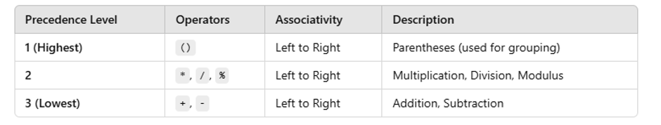

```
So, if you write an expression like:
int result = 10 + 5 - 2 / 2 * 3; 
10 + 5 – 1 * 3
10 + 5 – 3
15 – 3
12
Final result = 12
```

### 1.1.8. Escape sequence:
An escape sequence is a special character combination that starts with a backslash `\` and represents a character or action that is difficult to write directly in the printf function.

| Escape Sequence | Meaning | Example Output |
|-----|-----|-----|
| `\n` | New line | Moves to the next line |
| `\t` | Horizontal tab | Adds a tab space |
| `\\` | Backslash | `\` |
| `\"` | Double quotation mark | `"` |
| `\'` | Single quotation mark | `'` |
| `\?` | Question mark | `?` |
| `\b` | Backspace | Moves back one character position |
| `\a` | Alert/bell | Requests an alert sound |
| `\v` | Vertical tab | Adds a vertical tab |

```c
#include <stdio.h>

int main()
{
    // 1. New line (\n)
    printf("1. New line: Hello\nWorld\n\n");

    // 2. Horizontal tab (\t)
    printf("2. Horizontal tab: Name:\tTamim\n\n");

    // 3. Backslash (\\)
    printf("3. Backslash: C:\\Program Files\\Code\n\n");

    // 4. Double quotation mark (\")
    printf("4. Double quote: \"Hello World\"\n\n");

    // 5. Single quotation mark (\')
    printf("5. Single quote: \'Hello World\'\n\n");

    // 6. Question mark (\?)
    printf("6. Question mark: What is C\\?\n\n");

    // 7. Backspace (\b)
    printf("7. Backspace: ABC\bD\n\n");

    // 8. Alert or bell (\a)
    printf("8. Alert: Hello\a World\n\n");

    // 9. Vertical tab (\v)
    printf("9. Vertical tab: Hello\vWorld\n");

    return 0;
}
```
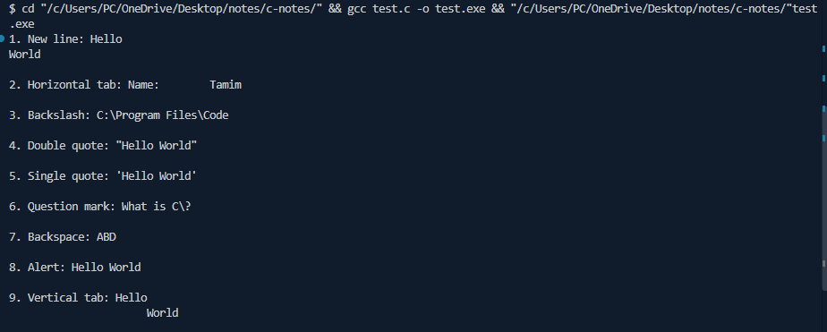

## 1.2. Chapter 2: Operators and Conditional Statement(if-else):
### 1.2.1. Operators: 
#### 1.2.1.1. Arithmetic Operators(+, -, *, /, %):

```c
#include <stdio.h>

int main()
{
    int a = 10;
    int b = 3;

    printf("Addition: %d\n", a + b); // Addition: 13
    printf("Subtraction: %d\n", a - b); // Subtraction: 7
    printf("Multiplication: %d\n", a * b); // Multiplication: 30
    printf("Division: %d\n", a / b); // Division: 3 
    printf("Modulus: %d\n", a % b); // Modulus: 1 

    return 0;
}
```

```c
#include <stdio.h>
int main()
{
    int a = 7;
    int b = 2;

    int quotient = a / b;
    int remainder = a % b;

    printf("%d / %d = %d\n", a, b, quotient);
    printf("%d %% %d = %d\n", a, b, remainder);

    return 0;
}
```

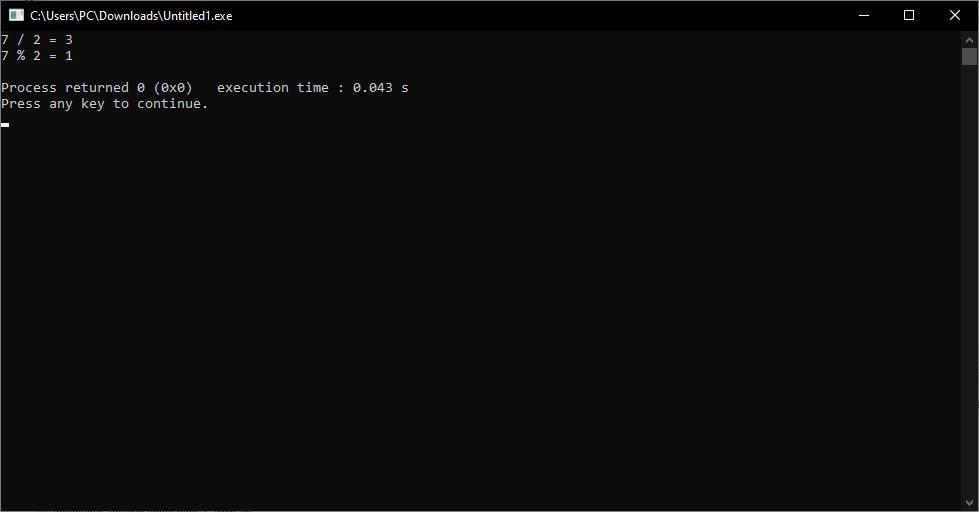
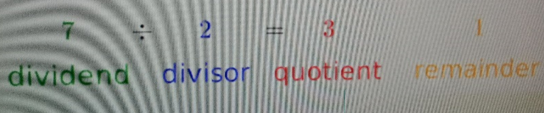
- Dividend = 7 (যাকে ভাগ করা হবে)
- Divisor = ২ (যা দিয়ে ভাগ করা হবে)
- Quotient = 3 (ভাগফল)
- Remainder = 1 (ভাগশেষ)

Note: ভাগ এর ক্ষেত্রে সব সময় Dividend বড় হতে হবে।

#### 1.2.1.2. Relational Operators(>, <, >=, <=, ==, !=):

```c
#include <stdio.h>

int main()
{
    int a = 10;
    int b = 5;

    printf("Greater than: %d\n", a > b); // Greater than: 1 
    printf("Less than: %d\n", a < b); // Less than: 0
    printf("Greater than or equal to: %d\n", a >= b); // Greater than or equal to: 1
    printf("Less than or equal to: %d\n", a <= b); // Less than or equal to: 0
    printf("Equal to: %d\n", a == b); // Equal to: 0
    printf("Not equal to: %d\n", a != b); // Not equal to: 1

    return 0;
}
```

#### 1.2.1.3. Logical Operators(&&, ||, !):

```c
#include <stdio.h>

int main()
{
    int a = 10;
    int b = 5;

    printf("Logical AND: %d\n", (a > 5) && (b < 10)); // Logical AND: 1
    printf("Logical OR: %d\n", (a < 5) || (b < 10)); // Logical OR: 1
    printf("Logical NOT: %d\n", !(a > 5)); // Logical NOT: 0

    return 0;
}
```

Note: For logical not operator, if the condition is true then it will return false(0) and if the condition is false then it will return true(1).

```c
#include <stdio.h>
int main()
{
    int x = 5; // x = true
    if (!x)
        printf("X is zero\n");
    else
        printf("X is not zero\n"); // X is not zero

    x = 0; // x = false
    if (!x)
        printf("X is zero\n"); // X is zero
    else
        printf("X is not zero");

    return 0;
}

// note: Any value other than 0 is considered true, and 0 is considered false.
```

### 1.2.2. Conditional Statement: 
#### 1.2.2.1. If-Else:
- syntax:

```c
If(condition == true){
	Statement 1;
}
Else{
	Statement 2;
}
```
#### 1.2.2.2. If-Else Ladder:
- Syntax:

```c
If(condition == ture){
	Statement 1;
}
Else if(condition == ture){
	Statement 2;
}
Else if(condition == ture){
	Statemtn 3;
}
Else{
	Statement 4;
}
```

#### 1.2.2.3. Nested If-Else:

- Syntax:

```c
If(condition == ture){
	Statement 1;
	If(condition == ture){
		Statement 2;
	}
	Else{
		Statement 3;
	}
}
Else{
	Statement 4;
}
```

### 1.2.3. Ternary Operator:
The ternary operator is a shorthand way of writing an if-else statement. 

Syntax: 
```c
condition ? expression_if_true : expression_if_false;
```

```c
#include <stdio.h>

int main(void) {
    int num;
    scanf("%d", &num);

/*
    if (num % 2 == 0) {
        printf("Even");
    } else {
        printf("Odd");
    }
*/

    (num % 2 == 0) ? printf("Even") : printf("Odd");

    return 0;
}
```

## 1.3. Chapter 3: Loop: 
### 1.3.1. For-Loop:

```c
for(initialization; condition; increment/decrement) {
	Statement;
}
```

```c
#include <stdio.h>

int main(){
    for(int i = 1; i <= 5; i++){
        /*
        i += 1;
        i = i + 1; 
        */ 
        printf("%d ", i); // 1 2 3 4 5
    }

    return 0;
}
```

### 1.3.2. While Loop: 
```c
Initialization;

While(condition){
  Statement;
  Increment/decrement;
}
```

```c
#include <stdio.h>

int main()
{
    int i = 1;
    while (i <= 5)
    {
        printf("%d ", i); // 1 2 3 4 5  
        i++;
    }

    return 0;
}
```

### 1.3.3. Do-While Loop:
```c
Initialization;
do{
	Statement;
	Increment/ decrement;
}
While(condition);
```

```c
#include <stdio.h>

int main()
{
    int i = 1;
    do
    {
        printf("%d ", i); // 1 2 3 4 5
        i++;
    } while (i <= 5);

    return 0;
}
```

### 1.3.4. Break and Continue Statement:
Note:
- Break = Stop
- Continue = Skip

```c
#include <stdio.h>

int main()
{
    for (int i = 1; i <= 10; i++)
    {
        if (i == 6)
        {
            break;
        }
        printf("%d ", i); // 1 2 3 4 5
    } 

    return 0;
}
```

```c
#include <stdio.h>

int main()
{
    for (int i = 1; i <= 5; i++)
    {
        if (i == 3)
        {
            continue;
        }
        printf("%d ", i); // 1 2 4 5
    }

    return 0;
}
```

### 1.3.5. Nested Loop:

Nested loop = loop inside another loop.

- Syntax: 

```c
for(initialization; condition; increment/decrement) {
    for(initialization; condition; increment/decrement) {
        Statement;
        for(initialization; condition; increment/decrement) {
            Statement;
            ........................
            ........................
        }
    }
}
```

```c
#include <stdio.h>

int main()
{
    int n;
    scanf("%d", &n);

    for (int i = 0; i < n; i++)
    {
        for (int j = 0; j <= i; j++)
        {
            printf("*");
        }
        printf("\n");
    }

        return 0;
}
```
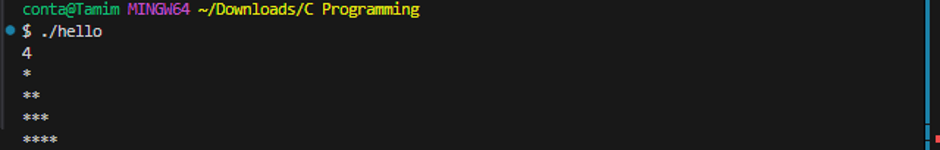

## 1.4. Chapter 4: Array:
An array is a variable that can store multiple values of the same data type.

```c
#include <stdio.h>

int main()
{
    int arr1[5] = {1, 2, 3, 4, 5}; 
    int arr2[] = {1, 2, 3, 4, 5}; 

    for (int i = 0; i < 5; i++)
    {
        printf("%d ", arr1[i]); // 1 2 3 4 5
    }

    for (int i = 0; i < 5; i++)
    {
        printf("%d ", arr2[i]); // 1 2 3 4 5
    }

    return 0;
}
```

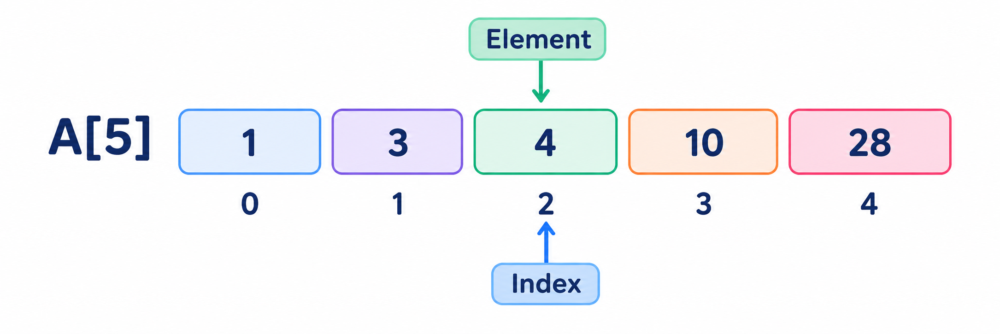

### 1.4.1. Array Input and Output: 

```c
#include <stdio.h>

int main()
{
    int arr[5];

    arr[0] = 10;
    arr[1] = 20;
    arr[2] = 30;
    arr[3] = 40;
    arr[4] = 50;

    printf("%d %d %d %d %d", arr[0], arr[1], arr[2], arr[3], arr[4]); // 10 20 30 40 50

    return 0;
}
```

```c
#include <stdio.h>

int main()
{
    int arr[5];
    scanf("%d %d %d %d %d", &arr[0], &arr[1], &arr[2], &arr[3], &arr[4]);

    printf("%d %d %d %d %d", arr[0], arr[1], arr[2], arr[3], arr[4]); // 10 20 30 40 50

    return 0;
}
```

```c
#include <stdio.h>

int main()
{
    int arr[5] = {10, 20, 30, 40, 50};

    for (int i = 0; i < 5; i++)
    {
        printf("%d ", arr[i]);
    }

    return 0;
}
```

```c
// most of the time we use this method to take input and output an array.
#include <stdio.h>

int main()
{
    int n;
    scanf("%d", &n);
    int arr[n];

    for (int i = 0; i < n; i++)
    {
        scanf("%d", &arr[i]);
    }
    for (int i = 0; i < n; i++)
    {
        printf("%d ", arr[i]);
    }

    return 0;
}
```

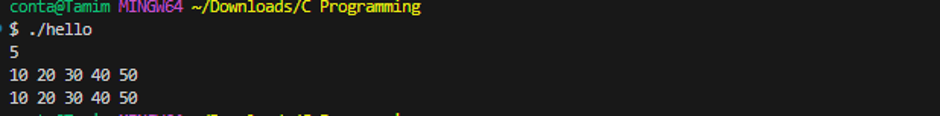

### 1.4.2. Reverse Array Element(Two Pointers Technique):
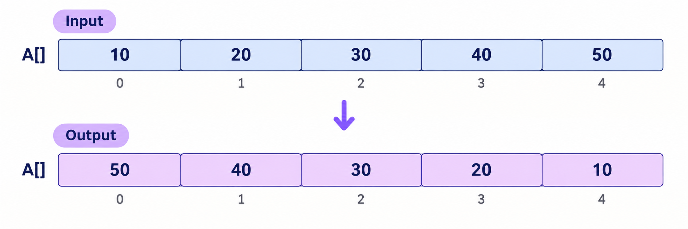

```c
#include <stdio.h>

int main()
{
    int n;
    scanf("%d", &n);
    int arr[n];

    for (int i = 0; i < n; i++)
    {
        scanf("%d", &arr[i]);
    }

    int i = 0, j = n - 1;

    while (i < j)
    {
        int temp = arr[i];
        arr[i] = arr[j];
        arr[j] = temp;
        i++;
        j--;
    }

    for (int i = 0; i < n; i++)
    {
        printf("%d ", arr[i]);
    }

    return 0;
}
```
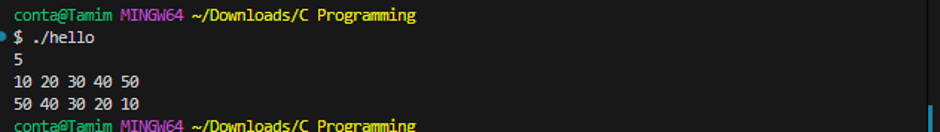
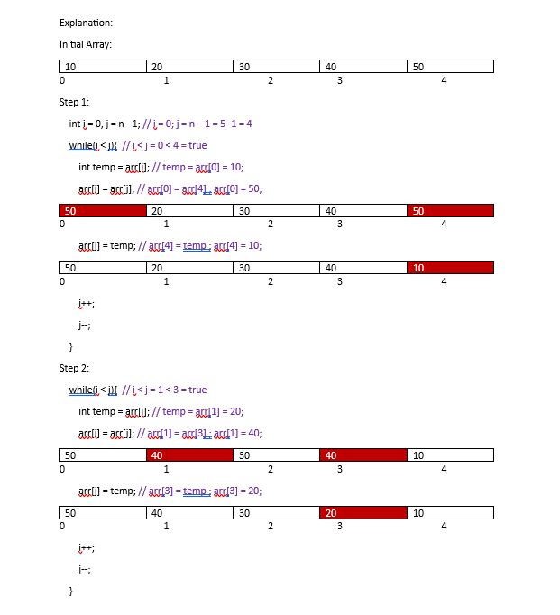

### 1.4.3. Insert Element in Array:
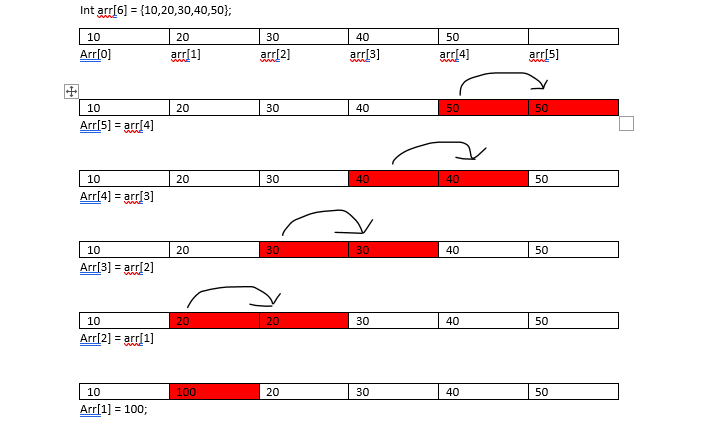

```c
#include <stdio.h>

int main()
{
    int arr[6] = {10, 20, 30, 40, 50}; // here 6 is the array size

    arr[5] = arr[4]; // here 5 is the array index
    arr[4] = arr[3];
    arr[3] = arr[2];
    arr[2] = arr[1];
    arr[1] = 100;

    for (int i = 0; i < 6; i++)
    {
        printf("%d ", arr[i]); // 10 100 20 30 40 50
    }

    return 0;
}
```

```c
#include <stdio.h>

int main()
{
    int n;
    scanf("%d", &n);
    int arr[n + 1];
    for (int i = 0; i < n; i++)
    {
        scanf("%d", &arr[i]);
    }

    int idx, ele;
    scanf("%d %d", &idx, &ele);
    for (int i = n; i > idx; i--)
    {
        arr[i] = arr[i - 1];
    }
    arr[idx] = ele;

    for (int i = 0; i <= n; i++)
    {
        printf("%d ", arr[i]); 
    }

    return 0;
}
```
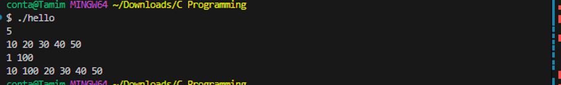


### 1.4.4. Remove Element from an Array:
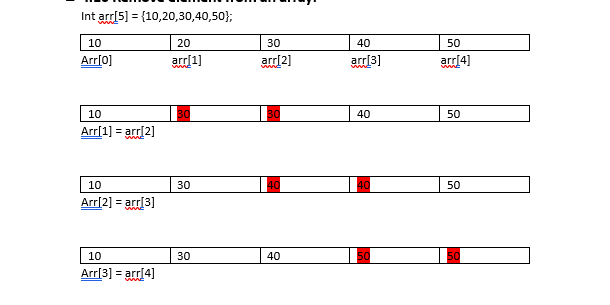

```c
#include <stdio.h>

int main()
{
    int arr[5] = {10, 20, 30, 40, 50};
    arr[1] = arr[2];
    arr[2] = arr[3];
    arr[3] = arr[4];

    for (int i = 0; i < 5 - 1; i++)
    {
        printf("%d ", arr[i]); // 10 30 40 50
    }

    return 0;
}
```

```c
#include <stdio.h>

int main()
{
    int n;
    scanf("%d", &n);
    int arr[n];
    for (int i = 0; i < n; i++)
    {
        scanf("%d", &arr[i]);
    }

    int idx;
    scanf("%d", &idx);

    for (int i = idx; i < n - 1; i++)
    {
        arr[i] = arr[i + 1];
    }

    for (int i = 0; i < n - 1; i++)
    {
        printf("%d ", arr[i]);
    }

    return 0;
}
```

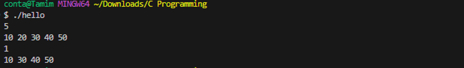


### 1.4.5. Array Concatenation:
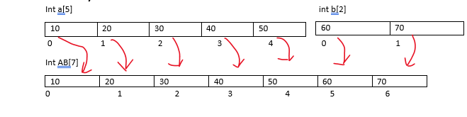

```c
#include <stdio.h>

int main()
{
    int n;
    scanf("%d", &n);
    int a[n];
    for (int i = 0; i < n; i++)
    {
        scanf("%d", &a[i]);
    }

    int m;
    scanf("%d", &m);
    int b[m];
    for (int i = 0; i < m; i++)
    {
        scanf("%d", &b[i]);
    }

    int ab[n + m];
    for (int i = 0; i < n; i++)
    {
        ab[i] = a[i];
    }
    for (int i = 0; i < m; i++)
    {
        ab[n + i] = b[i];
    }

    for (int i = 0; i < n + m; i++)
    {
        printf("%d ", ab[i]);
    }

    return 0;
}
```

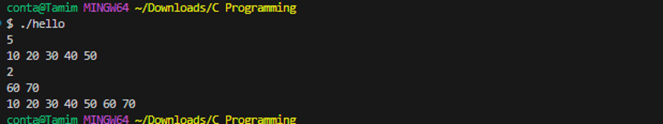

## 1.5. Chapter 5: 2D Array:
A 2D array (two-dimensional array) is an array that stores elements in rows and columns, like a table or a matrix. 

Syntax:
```c
data_type array_name[rows][columns];
```

```c
#include <stdio.h>
int main()
{
    int arr[3][2] = {
        {1, 2}, 
        {3, 4}, 
        {5, 6}
    }; // 3 rows and 2 columns

    for (int i = 0; i < 3; i++)
    {
        for (int j = 0; j < 2; j++)
        {
            printf("%d ", arr[i][j]);
        }
        printf("\n");
    }

    return 0;
}
```

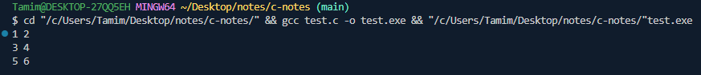

### 1.5.1. 2D Array Input and Output:

```c
#include <stdio.h>

int main()
{
    int row, col;
    scanf("%d %d", &row, &col);

    int arr[row][col];

    for (int i = 0; i < row; i++)
    {
        for (int j = 0; j < col; j++)
        {
            scanf("%d", &arr[i][j]);
        }
    }

    for (int i = 0; i < row; i++)
    {
        for (int j = 0; j < col; j++)
        {
            printf("%d ", arr[i][j]);
        }
        printf("\n");
    }

    return 0;
}
```

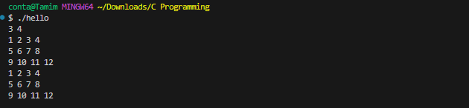


## 1.6. chapter 6: String:
In c, a string is a characters array terminated by a null character `\0`. 

Note: 
- C uses character arrays to represent strings because it has no built-in string data type.
- The null character ('\0') marks the end of a string. Therefore, a string of length N requires N + 1 elements, where N is the number of characters and +1 is for the null character.
- `{'t','a','m','i','m'}` = `"tamim"`
- We can use `%s` format specifier is used to take input and output a string.

```c
#include <stdio.h>
int main(){
    char str[6] = {'t','a','m','i','m','\0'};

    printf("%c%c%c%c%c", str[0], str[1], str[2],str[3],str[4]); // tamim

    for(int i = 0; i < 5; i++){
        printf("%c", str[i]); // tamim
    }

    return 0;
}
```

```c
#include <stdio.h>
int main(){
    char str[6] = "tamim";  // string extra feature
    for(int i = 0; i < 5; i++){
        printf("%c", str[i]); // tamim
    }
    return 0;
}
```

```c
#include <stdio.h>

int main(){
    // char str[5] = "tamim"; // Garbage value will be printed after the string because we didn't add the null character `\0` at the end of the string.
    char str[6] = "tamim"; // string extra feature (we will use this method most of the time)
    // or
    char str[6] = "tamim\0"; // string extra feature
    // or
    char str[6] = {'t','a','m','i','m','\0'}; // string extra feature
    
    printf("%s", str);
    
    return 0;
}
```

```c
#include <stdio.h>
int main(){
    char str[6];
    scanf("%s", str);
    printf("%s", str); 
}
```

Note: Above code has a problem. This code doesn’t take space as an input.  Here scanf() count space as her ending. To solve this problem we can use `gets()` or `fgets()` function.


### 1.6.1. `get()/puts()` and `fgets()/fputs()` functions:
This function is an alternative to scanf() and printf() functions. These functions are only used to read and write strings.

- gets() and puts() = gets() reads a string from the user (unsafe), and puts() prints a string by adding an additional newline.

```c
#include <stdio.h>
int main() {
    char str[100];
    printf("Enter a string: ");
    gets(str);  
    puts("You entered: ");
    puts(str);  
    return 0;
}
```

```c
#include <stdio.h>
int main(){
    char str[12];
    gets(str);
    printf("%s", str);
}
```

- fgets() and fputs() = fgets() reads a string from the user safely, and fputs() prints a string without adding a newline.  

```c
#include <stdio.h>
int main() {
    char str[100];
    printf("Enter a string: ");
    fgets(str, sizeof(str), stdin);  // Safely reading a string
    fputs("You entered: ", stdout);  // Printing the prompt
    fputs(str, stdout);  // Printing the string without an automatic newline
    return 0;
}
```

```c
#include <stdio.h>
int main(){
    char str[12];
    fgets(str,12,stdin);
    printf("%s", str);
}
```

### 1.6.2. Length of a string:


```c
#include <stdio.h>
int main(){
    char str[100];
    scanf("%s", str);
    //scanf(“%s   “, str);    error
    
    int i = 0;
    int count = 0;
    while(str[i] != '\0'){
        count++;
        i++;
    }
    printf("%d", count);
    return 0;
}
```

```c
#include<stdio.h>
int main(){
    char str[100];
    scanf("%s", str);
    int count = 0;
    for(int i = 0; str[i] != '\0'; i++){
        count++;
    }
    printf("%d", count);

    return 0;
}
```

```c
#include <stdio.h>
#include <string.h>
int main(){
    char str[100];
    scanf("%s", str);
    printf("%d", strlen(str));
    return 0;
}
```

### 1.6.3. String Copy:

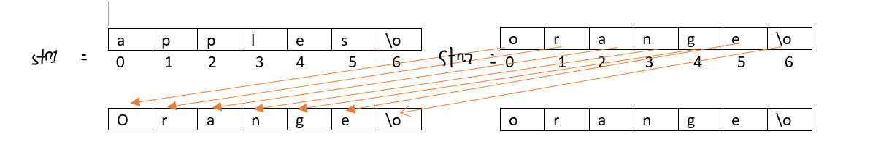

```c
#include <stdio.h>
#include <string.h>
int main(){
    char str1[100], str2[100];
    scanf("%s %s", str1, str2);
    for(int i = 0; i <= strlen(str2); i++){
        str1[i] = str2[i];
    }
    printf("%s %s", str1, str2);
}
```

```c
#include <stdio.h>
#include <string.h>
int main(){
    char str1[100], str2[100];
    scanf("%s %s", str1, str2);
    strcpy(str1,str2);
    printf("%s %s", str1, str2);
}
```

### 1.6.4. String Lexicographical Comparison:
Explanation:
  
```
apple < apply
apple < applicant
acde > abcdegdf 
abcd > abc
abd < abde
abd == abd
abc < edf
abcd < adef

so here we get 4 cases: 

Case 1: if both strings have reached their end (\0) at the same time it means they are the same.
Case 2: If str1 ends first (reaches \0 before str2), it means that str1 is shorter than `str2
Case 3: If str2 ends first (reaches \0 before str1), it means that str2 is shorter than str1.
Case 4: If the characters at the current position are the same, we move to the next character by incrementing i.
Case 5: If str1 is less than str2, it means that str1 is shorter than str2
Case 6: If str2 is less than str1, it means that str2 is shorter than str1

```

pseudo code: 

```
str1[i] == '\0' && str2[i] == '\0'---> str1 and str2 are same
str1[i] == '\0' ---> str1 is small
str2[i] == '\0' ---> str2 is small
str1[i] == str2[i] ---> i++
str1[i] < str2[i] ---> str1 is small
str2[i] < str1[i] ---> str2 is small
```


```c
#include <stdio.h>
int main(){
    char str1[100], str2[100];
    scanf("%s %s", str1, str2);
    int i = 0;

    while(1){
        // Case 1
        if(str1[i] == '\0' && str2[i] == '\0'){
            printf("str1 == str2");
            break;
        }

        // Case 2
        else if(str1[i] == '\0'){
            printf("str1 is smaller");
            break;
        }
        // case 3
        else if(str2[i] == '\0'){
            printf("str2 is smaller");
            break;
        }

        // case 4
        if(str1[i] == str2[i]){
            i++;
        }
        // case 5
        else if(str1[i] < str2[i]){
            printf("str1 is smaller");
            break;
        }
        // case 6
        else if(str2[i] < str1[i]){
            printf("str2 is smaller");
            break;
        }
    }
    return 0;
}
```

```c
#include <stdio.h>
#include <string.h>
int main(){
    char str1[100], str2[200];
    scanf("%s %s", str1, str2);

    int check = strcmp(str1, str2);
    if(check < 0){
        printf("str1 is small");
    }
    else if(check > 0){
        printf("str2 is small");
    }
    else{
        printf("Str1 == str2");
    }
    return 0;
}
```

Note: here strcmp(str1,str2) function return 3 values:
1.	Value of strcmp == 0 ---> str1 == str2
2.	Value of strcmp < 0 --->str1 is small
3.	Value of strcmp > 0 ---> str2 is small

### 1.6.5. String Concatenation:


```c
#include <stdio.h>
#include <string.h>
int main(){
    char str1[100], str2[100];
    scanf("%s %s", str1, str2);

    char str[strlen(str1) + strlen(str2)];

    for(int i = 0; i < strlen(str1); i++){
        str[i] =str1[i];
    }
    for(int i = 0; i <= strlen(str2); i++){
        str[strlen(str1) + i] = str2[i];
    }

    printf("%s", str);
    return 0;
}
```

```c
#include <stdio.h>
#include <string.h>
int main(){
    char a[200], b[100];
    scanf("%s %s", a,b);
    int len_a = strlen(a);
    for(int i = 0; i <= strlen(b); i++){
        a[len_a] = b[i];
        len_a++;
    }
    printf("%s", a);
    return 0;
}
```

```c
#include <stdio.h>
#include <string.h>
int main(){
    char a[200], b[100];
    scanf("%s %s", a,b);
    strcat(a,b);
    printf("%s", a); // printf("%s", strcat(a, b));
    return 0;
}
```

### 1.6.6. Counting or Frequency String:
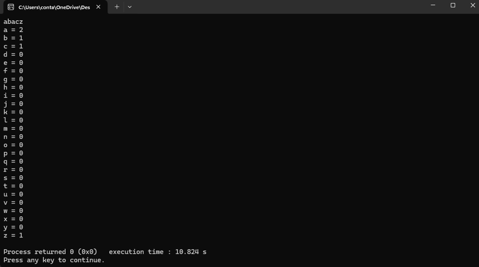

```c
#include <stdio.h>
#include <string.h>
int main(){
    char str[100];
    scanf("%s", str);
    int cnt[26] = {0};

    for(int i = 0; i < strlen(str); i++){
        cnt[str[i] - 'a']++;  // or str[i] - 97; 
    }
    for(int i = 0; i < 26; i++){
        printf("%c = %d\n", i + 'a', cnt[i]);
    }

    return 0; 
}
```

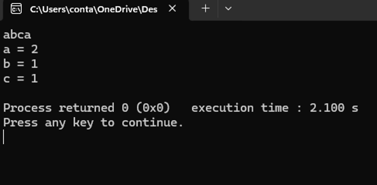

```c
#include <stdio.h>
#include <string.h>
int main(){
    char str[100];
    scanf("%s", str);
    int cnt[26] = {0};

    for(int i = 0; i < strlen(str); i++){
        int value = str[i] - 'a';
        cnt[value]++;
    }
    for(int i = 0; i < 26; i++){
        if(cnt[i] != 0){
            printf("%c = %d\n", i + 97, cnt[i]);
        }
    }

    return 0;
}
```

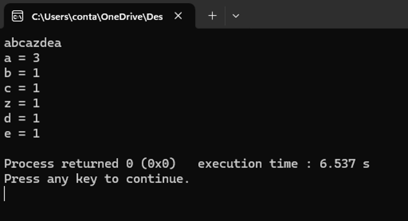

```c
#include <stdio.h>
#include <string.h>
int main(){
    char str[100];
    scanf("%s", str);
    int cnt[26] = {0};

    for(int i = 0; i < strlen(str); i++){
        int value = str[i] - 'a';
        cnt[value]++;
    }
    for(int i = 0; i < strlen(str); i++){
        int value = str[i] - 97;
        if(cnt[value] != 0){
            printf("%c = %d\n", value + 97, cnt[value]);
        }
        cnt[value] = 0;
    }
    return 0;
}
```

## 1.7. Chapter 7: Function:
A Function is a block of code that perform a specific task when it is called.

Syntax:
```c
return_type function_name(parameters type and name) {
    // Code to execute
    return value;
}
```

```c
#include <stdio.h>

int sum(int a, int b) {
    int summation = a + b;
    return summation;
}

int main() {
    int result = sum(5, 10);
    printf("Sum: %d", result);
    return 0;
}
```
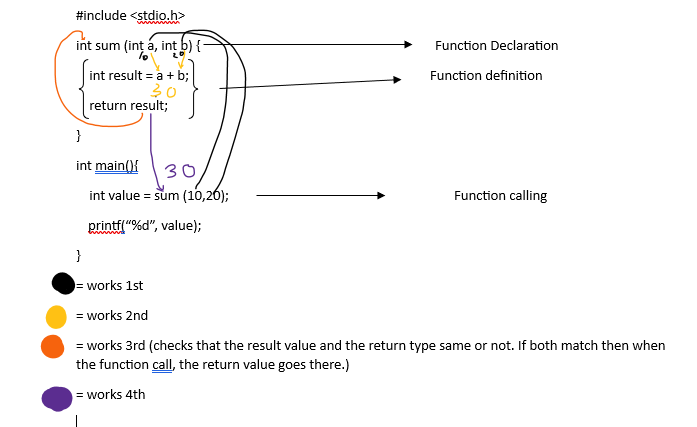


### 1.7.1. Different Way to Write a Function:  

```c
#include <stdio.h>

int sum(int a, int b) {
    return a + b;
}

int main() {
    int result = sum(5, 10);
    printf("Sum: %d", result); // Sum: 15
    return 0;
}
```

```c
#include <stdio.h>

int sum () {
    int a = 5, b = 10;
    int summation = a + b;
    return summation;
}

int main() {
    int result = sum();
    printf("Sum: %d", result); // Sum: 15
    return 0;
}
```


```c
#include <stdio.h>

void sum(int a, int b) {
    int summation = a + b;
    printf("Sum: %d", summation); // Sum: 15
}

int main() {
    sum(5, 10);
    return 0;
}
```


```c
#include <stdio.h>
void sum() {
    int a = 5, b = 10;
    int summation = a + b;
    printf("Sum: %d", summation); // Sum: 15
}

int main() {
    sum();
    return 0;
}
```

### 1.7.2. Common Library Functions:
In C, a library function is a predefined function that helps us perform common tasks without writing all the code ourselves. Each library function belongs to a header file, such as stdio.h, string.h, or math.h.

- `<stdio.h>`: Used to read input from the user and display output.
  
| Function | Purpose |
| --- | --- |
| `scanf()` | Reads input |
| `printf()` | Prints output |
| `getchar()` | Reads one character |
| `putchar()` | Prints one character |
| `fgets()` | Reads a line of text with a specified buffer size |
| `puts()` | Prints a string followed by a newline |
| `fputs()` | Writes a string to an output stream without automatically adding a newline |
| `gets()` | Reads a line of text without checking buffer size (**unsafe; removed in C11**) |

```c
#include <stdio.h>

int main() {
    int age;
    char ch;
    char name[50];

    printf("Enter your age: ");
    scanf("%d", &age);

    // Clear the newline left by scanf()
    getchar();

    printf("Enter a character: ");
    ch = getchar();

    // Clear the newline left by getchar()
    getchar();

    printf("Enter your name: ");
    fgets(name, sizeof(name), stdin);

    puts("\nYour information:");
    printf("Age: %d\n", age);

    printf("Your character is: ");
    putchar(ch);
    putchar('\n');

    printf("Name: ");
    fputs(name, stdout);

    return 0;
}
```
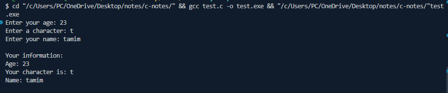

- `<math.h>`: Used to perform mathematical calculations.

| Function | Purpose | Example Result |
| --- | --- | --- |
| `sqrt(x)` | Square root | `sqrt(25) → 5.0` |
| `pow(x, y)` | Raises x to the power y | `pow(2, 3) → 8.0` |
| `ceil(x)` | Rounds upward | `ceil(4.2) → 5.0` |
| `floor(x)` | Rounds downward | `floor(4.8) → 4.0` |
| `round(x)` | Rounds to the nearest integer value | `round(4.6) → 5.0` |
| `fabs(x)` | Absolute value of a floating-point number | `fabs(-4.5) → 4.5` |

```c
#include <stdio.h>
#include <math.h>

int main() {
    // 1. sqrt() - Square root
    printf("Square root: %.1f\n", sqrt(25)); // 5.0

    // 2. pow() - Power
    printf("Power: %.1f\n", pow(2, 3)); // 8.0

    // 3. ceil() - Rounds upward
    printf("Ceil: %.1f\n", ceil(4.2)); // 5.0

    // 4. floor() - Rounds downward
    printf("Floor: %.1f\n", floor(4.8)); // 4.0

    // 5. round() - Rounds to the nearest integer
    printf("Round: %.1f\n", round(4.4)); // 4.0
    printf("Round: %.1f\n", round(4.5)); // 5.0
    printf("Round: %.1f\n", round(4.6)); // 5.0

    // 6. fabs() - Absolute value of a floating-point number
    printf("Absolute value: %.1f\n", fabs(-4.5)); // 4.5

    return 0;
}
```

- `<string.h>`: Used to work with strings.

| Function | Purpose |
| --- | --- | 
| `strlen()` | Gets the string length | 
| `strcpy()` | Copies a string | 
| `strcat()` | Appends one string to another | 
| `strcmp()` | Compares two strings | 
| `strchr()` | Finds a character in a string | 

```c
#include <stdio.h>
#include <string.h>

int main() {
    char str1[50] = "Hello";
    char str2[50] = " World";
    char dest[50] = "Hello";
    char *ptr;

    // 1. strlen() - Gets the string length
    printf("String length: %zu\n", strlen(str1)); // 5

    // 2. strcpy() - Copies a string
    strcpy(dest, "C Programming");
    printf("Copied string: %s\n", dest); // C Programming

    // 3. strcat() - Appends one string to another
    strcat(str1, str2);
    printf("Concatenated string: %s\n", str1); // Hello World

    // 4. strcmp() - Compares two strings
    printf("String comparison: %d\n", strcmp("abc", "abc")); // 0 (0 means 1st string == 2nd string)
    printf("String comparison: %d\n", strcmp("abc", "def")); // -1 (negative means 1st string < 2nd string)
    printf("String comparison: %d\n", strcmp("def", "abc")); // 1 (positive means 1st string > 2nd string)

    // 5. strchr() - Finds a character in a string
    ptr = strchr("Hello", 'e'); 

    if (ptr != NULL) {
        printf("Character found: %c\n", *ptr); // e
    } else {
        printf("Character not found\n");
    }

    return 0;
}
```

Note: here The `strchr()` function searches for a specific character in a string and returns a pointer to the first occurrence of that character. 

```c
Syntax: strchr(string, character);`

- string — the string to search.
- character — the character you want to find.
- Return value — a pointer to the character if found; otherwise, NULL.
```

- `<stdlib.h>`: Used for general purpose functions.

| Function | Purpose |
| --- | --- | 
| `abs()` | Absolute value of an integer | 
| `atoi()` | Converts a string to an integer | 

```c
#include <stdio.h>
#include <stdlib.h>

int main() {
    // 1. abs() - Absolute value of an integer
    printf("Absolute value: %d\n", abs(-10)); // 10

    // 2. atoi() - Converts a string to an integer
    char str[] = "123";
    int num = atoi(str);
    printf("Converted integer: %d\n", num); // 123

    return 0;
}
```

- `<ctype.h>`: Used to check or convert individual characters.

| Function | Purpose | 
| --- | --- | 
| `isalpha()` | Checks whether a character is a letter |
| `isdigit()` | Checks whether a character is a digit | 
| `isalnum()` | Checks whether a character is a letter or digit | 
| `isspace()` | Checks for whitespace | 
| `toupper()` | Converts a lowercase letter to uppercase | 
| `tolower()` | Converts an uppercase letter to lowercase |


```c
#include <stdio.h>
#include <ctype.h>

int main() {
    printf("isalpha: %d\n", isalpha('A')); // 1 (true)
    
    printf("isdigit: %d\n", isdigit('5')); // 1 (true)
    
    printf("isalnum: %d\n", isalnum('A')); // 1 (true)
    printf("isalnum: %d\n", isalnum('5')); // 1 (true)

    printf("isspace: %d\n", isspace(' ')); // 1 (true)
    
    printf("toupper: %c\n", toupper('a')); // A
    
    printf("tolower: %c\n", tolower('A')); // a

    return 0;
}
```

## 1.8. Chapter 8: Recursion:
Recursion in programming is a technique where a function calls itself. It Has two main parts: 
- Base Case: The condition that stops recursion and prevents infinite recursive calls, which can lead to a stack overflow.
- Recursive Case: The part where a function calls itself with modified arguments that move the function toward the base case.

```c
#include <stdio.h>

void great(int count) {
    if (count == 0) { // Base Case
        return;
    }
    printf("Hello\n");
    great(count - 1); // Recursive Case
}

int main() {
    great(5); // Initial Call with a limit
    return 0;
}
```

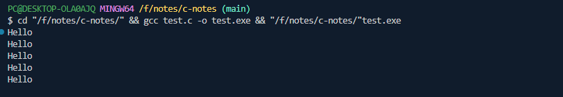
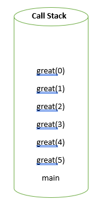

### 1.8.1. Call Stack:
The call stack is a region of memory used to manage function calls. It keeps track of active function calls, including their parameters, local variables, and where execution should resume when a function returns. It follows Last-In-First-Out (LIFO) principle.

```c
#include <stdio.h>

void functionA() {
    int a = 10;
    printf("Inside functionA: a = %d\n", a);
}

void functionB() {
    int b = 20;
    functionA();
    printf("Inside functionB: b = %d\n", b);
}

int main() {
    int c = 30;
    functionB();
    printf("Inside main: c = %d\n", c);
    return 0;
}
```

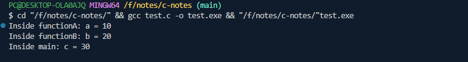
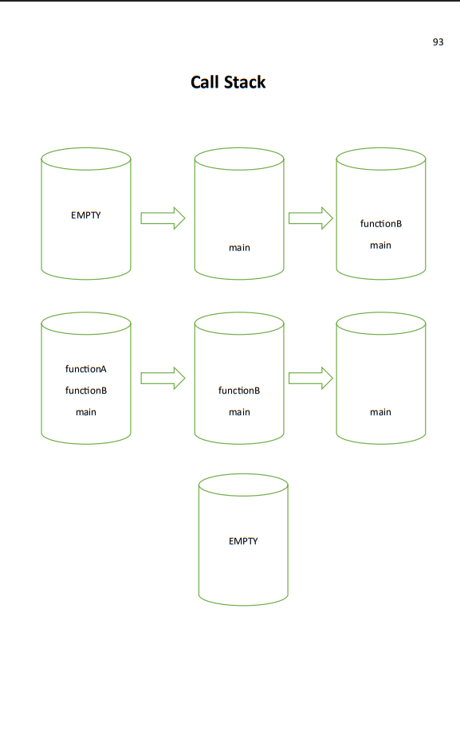

## 1.9. Chapter 9: Pointer:
The pointer is a variable which stores the address of another variable.

```c
#include <stdio.h>

int main()
{
    int num = 10;
    int *ptr = &num;

    printf("Value of num: %d\n", num); // value of num: 10
    printf("Address of num: %p\n", &num); // address of num: 000000000061FE14

    printf("Value of ptr: %p\n", ptr); // value of ptr: 000000000061FE14 
    printf("Address of ptr: %p\n", &ptr); // address of ptr: 000000000061FE10
    printf("Value of the variable that the pointer points to: %d\n", *ptr); 
    // Value of the variable that the pointer points to: 10
    return 0;
}
```

### 1.9.1. Dereferencing Pointer:
Dereferencing a pointer means accessing or modifying the value that the pointer points to. This is done using the dereference operator `*`.
  - pointer value means the memory address of the variable that the pointer is points to.

```c
#include <stdio.h>

int main()
{
    int num = 10;
    int *ptr = &num;

    printf("Original value of num: %d\n", num); // Original value of num: 10

    // Access the value of num using dereferencing
    printf("Original value through ptr: %d\n", *ptr); // Original value through ptr: 10

    // Modify the value of num using dereferencing
    *ptr = 50;

    // Access the modified value using dereferencing
    printf("Modified value through ptr: %d\n", *ptr); // Modified value through ptr: 50

    printf("Modified value of num: %d\n", num); // Modified value of num: 50

    return 0;
}
```

Note: We did not change the pointer itself. The pointer ptr still stores the memory address of num; we changed the value of num by dereferencing the pointer.


### 1.9.2. Difference between call by value and call by reference.
- Call by Value: In call by value, a copy of the actual parameter's value is passed to the function. Changes made to the parameter inside the function do not affect the original argument.
```c
#include <stdio.h>
void fun(int x){
    x = 100;
}
int main(){
    int x = 10;
    fun(x);
    printf("%d", x); // 10
}
```

- Call by Reference: In call by reference, the address of the actual parameter is passed to the function. Changes made to the parameter inside the function affect the original argument because of the pointer dereferencing.

```c
#include<stdio.h>
void fun(int *p){
    *p = 100;
}
int main(){
    int x = 10;
    fun(&x);
    printf("%d", x); // 100
}
```
### 1.9.3. Relation Between Array and Pointer:
In C, arrays and pointers are closely related because an array name usually converts to a pointer to its first element when used in an expression. This allows us to access array elements using pointer arithmetic and dereferencing.

```c
#include <stdio.h>

int main()
{
    int arr[5] = {10, 20, 30, 40, 50};
    int *ptr = arr;

    printf("First element using array: %d\n", arr[0]); // First element: 10
    printf("Second element using array: %d\n", arr[1]); // Second element: 20
    printf("Third element using array: %d\n", arr[2]); // Third element: 30
    printf("Fourth element using array: %d\n", arr[3]); // Fourth element: 40
    printf("Fifth element using array: %d\n", arr[4]); // Fifth element: 50

    printf("First element using pointer: %d\n", *ptr); // First element using pointer: 10
    printf("Second element using pointer %d\n", *(ptr + 1)); // Second element using pointer: 20
    printf("Third element using pointer %d\n", *(ptr + 2)); // Third element using pointer: 30
    printf("Fourth element using pointer %d\n", *(ptr + 3)); // Fourth element using pointer: 40
    printf("Fifth element using pointer %d\n", *(ptr + 4)); // Fifth element using pointer: 50

    return 0;
}
```

Note: Although arrays and pointers are closely related, an array is not a pointer. 

### 1.9.4. How to Pass Array and String Into a Function:
When we pass an array to a function, it is actually passed as a pointer to the first element of the array. Thats why the size of the array is lost when it is passed to the function. To overcome this issue, we can pass the size of the array as an additional parameter to the function for normal array and if we use string we can also use some built-in functions and operators such as `strlen()` and `%s`.

- Array:

```c
// wrong approach
#include <stdio.h>

void fun(int arr[]){ // int arr[] == int *arr and sizeOf(*arr) = 8 bytes 
    int size = sizeof(arr) / sizeof(int); // 8 / 4 = 2
    printf("Array size in the fun function = %d\n", size); // Array size in the fun function = 2

    printf("%d\n", *arr); // 10

    for(int i = 0; i < size; i++){
        printf("%d ", arr[i]); // 10 20
    }
}

int main(){
    int arr[5] = {10,20,30,40,50};
    int size = sizeof(arr) / sizeof(int); // 20 / 4 = 5
    printf("Array size in the main function = %d\n", size); //  Array size in the main function = 5
    fun(arr);
}
```

```c
// correct approach
#include <stdio.h>
void fun(int *arr, int size){ // int arr[] == int *arr
    for(int i = 0; i < size; i++){
        printf("%d ", arr[i]); // 10 20 30 40 50
    }

}   

int main(){
    int arr[5] = {10,20,30,40,50};
    int size = sizeof(arr) / sizeof(int);
    fun(arr, size);
}
```

- String:

```c
#include <stdio.h>

void fun(char str[], int size){ // char str[] == char *str
    for(int i = 0; i < size; i++){
        printf("%c", str[i]); // Hello
    }

}   

int main(){
    char str[5] = "Hello";
    int size = sizeof(str) / sizeof(char); // 5 / 1 = 5
    fun(str, size);
}
```

```c
#include <stdio.h>
#include <string.h> 

void fun(char s[]) { // char s[] == char *s
    int sz = strlen(s);
    printf("size of string into fun: %d\n", sz); // 5

    for(int i = 0; i < sz; i++) {
        printf("%c", s[i]); // Hello
    }
}

int main() {
    char s[10] = "Hello";`
    fun(s);
    int sz = strlen(s);
    printf("size of string into main: %d\n", sz); // 5
    return 0;
} 
```

```c
#include <stdio.h>

void fun(char str[]){ // char str[] == char *str
    printf("%s", str); // Hello
}

int main(){
    char str[] = "Hello";
    fun(str);
}  
```

# 2. Part 2: Problem Solving:
## 2.1. Sheet 1 (Data type and Conditions):

### 2.1.1. A - Say Hello With C++:
https://codeforces.com/group/MWSDmqGsZm/contest/219158/problem/A

```c
#include <stdio.h>

int main(void) {
    char name[101];

    scanf("%100s", name);

    printf("Hello, %s\n", name);

    return 0;
}
```

### 2.1.2. B - Basic Data Types:

https://codeforces.com/group/MWSDmqGsZm/contest/219158/problem/B

```c
#include <stdio.h>

int main() {
    int a;
    long long int b;
    char c;
    float d;
    double e;

    scanf("%d %lld %c %f %lf", &a, &b, &c, &d, &e);

    printf("%d\n", a);
    printf("%lld\n", b);
    printf("%c\n", c);
    printf("%.2f\n", d);
    printf("%.1lf", e);

    return 0;
}
```


### 2.1.3. C. Simple Calculator:

https://codeforces.com/group/MWSDmqGsZm/contest/219158/problem/C

```c
#include <stdio.h>

int main() {
    int x, y;
    scanf("%d %d", &x, &y);

    printf("%d + %d = %d\n", x, y, x + y); // 10^5 + 10^5 = 2*10^5 = 200000  
    printf("%d * %d = %lld\n", x, y, (long long int) x * y); // 10^5 * 10^5 = 10^10
    printf("%d - %d = %d\n", x, y, x - y); // 10^5 - 10^5 = 0

    return 0;
}
```

### 2.1.4. D. Difference:

https://codeforces.com/group/MWSDmqGsZm/contest/219158/problem/D

```c
#include <stdio.h>

int main() {
    int a, b, c, d;
    scanf("%d %d %d %d", &a, &b, &c, &d);
    printf("Difference = %lld", (long long int) ((long long int) a * b) - ( (long long int) c * d)); 

    return 0;
}
```

```c
#include <stdio.h>

int main() {
    long long int a, b, c, d;
    scanf("%lld %lld %lld %lld", &a, &b, &c, &d);
    long long int result = (a * b) - (c * d);
    printf("Difference = %lld\n", result);

    return 0;
}
```

### 2.1.5. E. Area of a Circle:
https://codeforces.com/group/MWSDmqGsZm/contest/219158/problem/E

```c
#include <stdio.h>

int main() {
    float x;
    scanf("%f", &x);

    double area = 3.141592653 * x * x; // pow(x, 2) = x * x

    printf("%.9lf\n", area);

    return 0;
} 
```

### 2.1.6. F Digits Summation:
https://codeforces.com/group/MWSDmqGsZm/contest/219158/problem/F

```c
#include <stdio.h>

int main() {
    long long int a, b;
    scanf("%lld %lld", &a, &b);

    int lastDigitOfA = a % 10;
    int lastDigitOfB = b % 10;

    int sum = lastDigitOfA + lastDigitOfB;

    printf("%d", sum);

    return 0;
}
```

### 2.1.7. G Summation from 1 to N:
https://codeforces.com/group/MWSDmqGsZm/contest/219158/problem/G

```c
#include <stdio.h>

int main() {
    long long int n;
    scanf("%lld", &n);

    long long int summation1toN = n * (n + 1) / 2;

    printf("%lld", summation1toN);

    return 0;
}
```

### 2.1.8. H Two numbers:
https://codeforces.com/group/MWSDmqGsZm/contest/219158/problem/H

```c
#include <stdio.h>
#include <math.h>

int main() {
    int num1, num2;
    scanf("%d %d", &num1, &num2);

    printf("floor %d / %d = %.0f\n", num1, num2, floor((float)num1 / (float)num2));
    printf("ceil %d / %d = %.0f\n", num1, num2, ceil((float)num1 / (float)num2));
    printf("round %d / %d = %.0f\n", num1, num2, round((float)num1 / (float)num2));

    return 0;
}
```

```c
#include <stdio.h>
#include <math.h>

int main() {
    int num1, num2;
    scanf("%d %d", &num1, &num2);

    float division = (float)num1 / (float)num2;

    if(num1 % num2 == 0){
        printf("floor %d / %d = %d\n", num1, num2, (int)division);    
        printf("ceil %d / %d = %d\n", num1, num2, (int)division);    
        printf("round %d / %d = %d\n", num1, num2, (int)division);    
    }
    else{
        printf("floor %d / %d = %d\n", num1, num2, (int)division);
        printf("ceil %d / %d = %d\n", num1, num2, (int)division + 1);
        if(division >= ((int)division + 0.5)) {
            printf("round %d / %d = %d\n", num1, num2, (int)division + 1);
        } 
        else {
            printf("round %d / %d = %d\n", num1, num2, (int)division);
        }
    }

    return 0;
}
```

### 2.1.9. I Welcome for you with Conditions:
https://codeforces.com/group/MWSDmqGsZm/contest/219158/problem/I

```c
#include <stdio.h>

int main() {
    int a, b;
    scanf("%d %d", &a, &b);

    if(a >= b){
        printf("Yes");
    }
    else{
        printf("No");
    }

    return 0;
}
```

### 2.1.10. J Multiples:
https://codeforces.com/group/MWSDmqGsZm/contest/219158/problem/J

```c
#include <stdio.h>

int main() {
    int a, b;
    scanf("%d %d", &a, &b);

    if(a % b == 0 || b % a == 0) {
        printf("Multiples");
    } else {
        printf("No Multiples");
    }

    return 0;
}
```

### 2.1.11. K Max and Min:
https://codeforces.com/group/MWSDmqGsZm/contest/219158/problem/K

```c
#include <stdio.h>

int main(void) {
    int a, b, c;
    scanf("%d %d %d", &a, &b, &c);

    int min = a;
    int max = a;

    if (b < min) min = b;
    if (c < min) min = c;

    if (b > max) max = b;
    if (c > max) max = c;

    printf("%d %d\n", min, max);

    return 0;
}
```

### 2.1.12. L The Brothers:
https://codeforces.com/group/MWSDmqGsZm/contest/219158/problem/L

```c
#include <stdio.h>
#include <string.h>

int main(void) {
    char firstName1[100000], secondName1[100000];
    char firstName2[100000], secondName2[100000];

    scanf("%s %s", firstName1, secondName1);
    scanf("%s %s", firstName2, secondName2);

    if(strcmp(secondName1, secondName2) == 0) {
        printf("ARE Brothers");
    } 
    else {
        printf("NOT");
    }

    return 0;
}
```

```c
#include <stdio.h>

int main() {
    char firstName1[100000], secondName1[100000];
    char firstName2[100000], secondName2[100000];

    scanf("%s %s", firstName1, secondName1);
    scanf("%s %s", firstName2, secondName2);

    int i = 0;

    while (secondName1[i] != '\0' && secondName2[i] != '\0' && secondName1[i] == secondName2[i]) {
        i++;
    }

    if (secondName1[i] == secondName2[i]) {
        printf("ARE Brothers");
    } else {
        printf("NOT");
    }

    return 0;
}
```

### 2.1.13. M Capital or Small or Digit:
https://codeforces.com/group/MWSDmqGsZm/contest/219158/problem/M


```C
#include <stdio.h>

int main() {
    char c;
    scanf("%c", &c);

    if(c >= 48 && c <= 57) {
        printf("IS DIGIT\n");
    }
    else if(c >= 65 && c <= 90) {
        printf("ALPHA\n");
        printf("IS CAPITAL\n");
    }
    else if(c >= 97 && c <= 122) {
        printf("ALPHA\n");
        printf("IS SMALL\n");
    }

    return 0;
}
```

### 2.1.14. N Char:
https://codeforces.com/group/MWSDmqGsZm/contest/219158/problem/N

```c
#include <stdio.h>

int main() {
    char c;
    scanf("%c", &c);

    if(c >= 97 && c <= 122){
        printf("%c", c - 32);
    }
    else if(c >= 65 && c <= 90){
        printf("%c", c + 32);
    }

    return 0;
}
```

### 2.1.15. O Calculator:
https://codeforces.com/group/MWSDmqGsZm/contest/219158/problem/O

```c
#include <stdio.h>

int main() {
    int a, b;
    char c;
    scanf("%d %c %d", &a, &c, &b);

   if(c == '+') {
        printf("%d\n", a + b);
    } 
    else if(c == '-') {
        printf("%d\n", a - b);
    } 
    else if(c == '*') {
        printf("%d\n", a * b);
    } 
    else if(c == '/') {
            printf("%d\n", a / b);
    }
    return 0;
}
```

```c
#include <stdio.h>

int main() {
    int a, b;
    char c;
    scanf("%d %c %d", &a, &c, &b);

    switch (c) {
        case '+':
            printf("%d\n", a + b);
            break;
        case '-':
            printf("%d\n", a - b);
            break;
        case '*':
            printf("%d\n", a * b);
            break;
        case '/':
            printf("%d\n", a / b); 
            break;
    }

    return 0;
}
```

### 2.1.16. P First digit!:
https://codeforces.com/group/MWSDmqGsZm/contest/219158/problem/P

```c
#include <stdio.h>

int main() {
    int num; 
    scanf("%d", &num);

    int firstDigit = num / 1000;

    if(firstDigit % 2 == 0){
        printf("EVEN");
    }
    else{
        printf("ODD");
    }

    return 0;
}
```

### 2.1.17. Q Coordinates of a Point:
https://codeforces.com/group/MWSDmqGsZm/contest/219158/problem/Q

```c
#include <stdio.h>

int main() {
    float num1, num2;
    scanf("%f %f", &num1, &num2);

    if(num1 == 0 && num2 == 0){
        printf("Origem\n");
    }
    else if(num1 == 0){
        printf("Eixo Y\n");
    }
    else if(num2 == 0){
        printf("Eixo X\n");
    }
    else if(num1 > 0 && num2 > 0){
        printf("Q1\n");
    }
    else if(num1 < 0 && num2 > 0){
        printf("Q2\n");
    }
    else if(num1 < 0 && num2 < 0){
        printf("Q3\n");
    }
    else if(num1 > 0 && num2 < 0){
        printf("Q4\n");
    }

    return 0;
}
```

### 2.1.18. R Age in Days:
https://codeforces.com/group/MWSDmqGsZm/contest/219158/problem/R

```c
#include <stdio.h>

int main() {
    int days;
    scanf("%d", &days);

    int years = days / 365;
    int remainingDays = days % 365;
    int months = remainingDays / 30;
    remainingDays = remainingDays % 30;
    
    printf("%d years\n", years);
    printf("%d months\n", months);
    printf("%d days\n", remainingDays);

    return 0;
}
```

### 2.1.19. S Interval:
https://codeforces.com/group/MWSDmqGsZm/contest/219158/problem/S

```c
#include <stdio.h>

int main() {
    float interval;
    scanf("%f", &interval);

    if(interval >= 0 && interval <= 25){
        printf("Interval [0,25]\n");
    }
    else if(interval > 25 && interval <= 50){
        printf("Interval (25,50]\n");
    }
    else if(interval > 50 && interval <= 75){
        printf("Interval (50,75]\n");
    }
    else if(interval > 75 && interval <= 100){
        printf("Interval (75,100]\n");
    }
    else{
        printf("Out of Intervals\n");
    }

    return 0;
}
```

### 2.1.20. T Sort Numbers:
https://codeforces.com/group/MWSDmqGsZm/contest/219158/problem/T

```c
#include <stdio.h>

int main() {
    int num1, num2, num3;
    scanf("%d %d %d", &num1, &num2, &num3);

    int smallest = num1;
    if(num2 < smallest) {
        smallest = num2;
    }
    if(num3 < smallest) {
        smallest = num3;
    }

    int largest = num1;
    if(num2 > largest) {
        largest = num2;
    }
    if(num3 > largest) {
        largest = num3;
    }

    int middle = num1 + num2 + num3 - smallest - largest;

    printf("%d\n%d\n%d\n", smallest, middle, largest);
    printf("\n");
    printf("%d\n%d\n%d\n", num1, num2, num3);

    return 0;
}
```

### 2.1.21. U Float or int:
https://codeforces.com/group/MWSDmqGsZm/contest/219158/problem/U

```c
#include <stdio.h>

int main(void) {
    float x;
    scanf("%f", &x);

    int integerPart = x; // (int)x
    float decimalPart = x - integerPart;

    if (decimalPart == 0) {
        printf("int %d\n", integerPart);
    } 
    else {
        printf("float %d %.3f\n", integerPart, decimalPart);
    }

    return 0;
}
```

### 2.1.22. V Comparison:
https://codeforces.com/group/MWSDmqGsZm/contest/219158/problem/V

```c
#include <stdio.h>

int main() {
    int num1, num2;
    char sign;
    scanf("%d %c %d", &num1, &sign, &num2);

    if(sign == '<'){
        if(num1 < num2){
            printf("Right");
        }
        else{
            printf("Wrong");
        }
    }
    else if(sign == '>'){
        if(num1 > num2){
            printf("Right");
        }
        else{
            printf("Wrong");
        }
    }
    else if(sign == '='){
        if(num1 == num2){
            printf("Right");
        }
        else{
            printf("Wrong");
        }
    }

    return 0;
}
```

### 2.1.23. W Mathematical Expression:
https://codeforces.com/group/MWSDmqGsZm/contest/219158/problem/W

```c
#include <stdio.h>

int main() {
    int num1, num2, num3;
    char sign, sign2;
    scanf("%d %c %d %c %d", &num1, &sign, &num2, &sign2, &num3);

    if(sign == '+'){
        if(num1 + num2 == num3){
            printf("Yes");
        }
        else{
            printf("%d", num1 + num2);
        }
    }
    else if(sign == '-'){
        if(num1 - num2 == num3){
            printf("Yes");
        }
        else{
            printf("%d", num1 - num2);
        }
    }
    else if(sign == '*'){
        if(num1 * num2 == num3){
            printf("Yes");
        }
        else{
            printf("%d", num1 * num2);
        }
    }
    

    return 0;
}
```

### 2.1.24. X Two intervals:
https://codeforces.com/group/MWSDmqGsZm/contest/219158/problem/X

```C
#include <stdio.h>

int main() {
    int l1, r1, l2, r2;
    scanf("%d %d %d %d", &l1, &r1, &l2, &r2);

    int start, end;

    // Find the bigger starting number
    if (l1 > l2) {
        start = l1;
    } else {
        start = l2;
    }

    // Find the smaller ending number
    if (r1 < r2) {
        end = r1;
    } else {
        end = r2;
    }

    // Check whether the intervals overlap
    if (start <= end) {
        printf("%d %d\n", start, end);
    } else {
        printf("-1\n");
    }

    return 0;
}
```

### 2.1.25. Y The last 2 digits:
https://codeforces.com/group/MWSDmqGsZm/contest/219158/problem/Y

```c
#include <stdio.h>

int main() {
    long long int num1, num2, num3, num4;
    scanf("%lld %lld %lld %lld", &num1, &num2, &num3, &num4);

    long long int multiplication = num1 * num2 * num3 * num4;

    // Print the last two digits of the multiplication
    printf("%lld\n", multiplication % 100);

    return 0;
}
```

```c
#include <stdio.h>

int main() {
    int num1, num2, num3, num4;
    scanf("%d %d %d %d", &num1, &num2, &num3, &num4);

    long long int multiplication = (long long int)num1 * num2 * num3 * num4;

    // Print the last two digits of the multiplication
    printf("%lld\n", multiplication % 100);

    return 0;
}
```

### 2.1.26. Z Hard Compare:
https://codeforces.com/group/MWSDmqGsZm/contest/219158/problem/Z

```c
#include <stdio.h>
#include <math.h>

int main() {
    long long int a,b,c,d;
    scanf("%lld %lld %lld %lld", &a, &b, &c, &d);

    if(b*log(a) > d*log(c)){
        printf("YES");
    }
    else{
        printf("NO");
    }

    return 0;
}
```


## 2.2. Contest 1:
### 2.2.1. A. Winter Sale:
https://codeforces.com/group/MWSDmqGsZm/contest/326175/problem/A

```c
#include <stdio.h>

int main() {
    float discountedParcentage, newPrice;
    scanf("%f %f", &discountedParcentage, &newPrice);

    float originalPrice =  newPrice / (1 - discountedParcentage / 100);
    printf("%.2f", originalPrice);

    return 0;
}
```
s
Universal Parcentage formula: 
N = O * (1 +- D / 100)  
Where:
- N = New Price
- O = Original Price
- D = Discounted Percentage


### 2.2.2. B: Memo and Momo:
https://codeforces.com/group/MWSDmqGsZm/contest/326175/problem/B

```c
#include <stdio.h>

int main() {
    long long int num1, num2, num3;
    scanf("%lld %lld %lld", &num1, &num2, &num3);

    if(num1 % num3 == 0 && num2 % num3 != 0) {
        printf("Memo");
    }
    else if(num1 % num3 != 0 && num2 % num3 == 0) {
        printf("Momo");
    }
    else if(num1 % num3 == 0 && num2 % num3 == 0) {
        printf("Both");
    }
    else {
        printf("No One");
    }

    return 0;
}
```

### 2.2.3. C: Next Alphabet:
https://codeforces.com/group/MWSDmqGsZm/contest/326175/problem/C

```c
#include <stdio.h>

int main() {
    char c;
    scanf("%c", &c);


    if(c == 'z'){
        printf("a\n");
    }
    else{
        printf("%c\n", c + 1);
    }

    return 0;
}
```

### 2.2.4. D: Ali Baba and Puzzles:
https://codeforces.com/group/MWSDmqGsZm/contest/326175/problem/D

```c
#include <stdio.h>

int main() {
    long long int num1, num2, num3, num4;
    scanf("%lld %lld %lld %lld", &num1, &num2, &num3, &num4);

    if(num1 + num2 - num3 == num4){
        printf("YES");
    }
    else if(num1 + num2 * num3 == num4){
        printf("YES");
    }
    else if(num1 - num2 * num3 == num4){
        printf("YES");
    }
    else if(num1 - num2 + num3 == num4){
        printf("YES");
    }
    else if(num1 * num2 + num3 == num4){
        printf("YES");
    }
    else if(num1 * num2 - num3 == num4){
        printf("YES");
    }
    else{
        printf("NO");
    }

    return 0;
}
```

### 2.2.5. E: Interval Sweep:
https://codeforces.com/group/MWSDmqGsZm/contest/326175/problem/E

```c
#include <stdio.h>

int main() {
    int a, b;
    scanf("%d %d", &a, &b);

    if (a + b == 0) {
        printf("NO\n");
        return 0;
    }

    int odd = 0, even = 0;

    // Start with an odd number
    for (int i = 1; i <= a + b; i++) {
        if (i % 2 == 0) {
            even++;
        } else {
            odd++;
        }
    }

    if (odd == a && even == b) {
        printf("YES\n");
        return 0;
    }

    odd = 0;
    even = 0;

    // Start with an even number
    for (int i = 2; i <= a + b + 1; i++) {
        if (i % 2 == 0) {
            even++;
        } else {
            odd++;
        }
    }

    if (odd == a && even == b) {
        printf("YES\n");
    } else {
        printf("NO\n");
    }

    return 0;
}
```

### 2.2.6. F: Adding Bits: 
https://codeforces.com/group/MWSDmqGsZm/contest/326175/problem/F

```c
#include <stdio.h>

int main() {
    int num1, num2;
    scanf("%d %d", &num1, &num2);

    int result = num1 ^ num2;
    printf("%d", result);

    return 0;
}
```
Note: In XOR operation: 
- If both bits are the same = 0
- If bits are different = 1

### 2.2.7. G: Katryoshka: (Hard)
https://codeforces.com/group/MWSDmqGsZm/contest/326175/problem/G

```c

#include <stdio.h>

int main() {
    long long int eyes, mouths, bodies;
    scanf("%lld %lld %lld", &eyes, &mouths, &bodies);

    long long int number_of_katryoshkas = 0;

    long long int min_value = eyes;

    if (mouths < min_value) {
        min_value = mouths;
    }

    if (bodies < min_value) {
        min_value = bodies;
    }

    // Make Type 3 Katryoshkas
    number_of_katryoshkas = min_value;

    eyes -= min_value;
    bodies -= min_value;

    // Make Type 1 Katryoshkas
    eyes /= 2;

    if (eyes > bodies) {
        eyes = bodies;
    }

    number_of_katryoshkas += eyes;

    printf("%lld\n", number_of_katryoshkas);

    return 0;
}
```

### 2.2.8. H: Data Type Guessing:
https://codeforces.com/group/MWSDmqGsZm/contest/326175/problem/H

```c
#include <stdio.h>
#include <limits.h>

int main() {
    long long n, k, a;
    scanf("%lld %lld %lld", &n, &k, &a);

    long long product = n * k;

    if (product % a != 0) {
        printf("double\n");
    }
    else {
        long long result = product / a;

        if (result >= INT_MIN && result <= INT_MAX) {
            printf("int\n");
        }
        else {
            printf("long long\n");
        }
    }

    return 0;
}
```

### 2.2.9. I: Lucky Numbers:
https://codeforces.com/group/MWSDmqGsZm/contest/326175/problem/I

```c 
#include <stdio.h>

int main() {
    int num;
    scanf("%d", &num);

    int firstDigit = num / 10;
    int lastDigit = num % 10;

    if ((lastDigit != 0 && firstDigit % lastDigit == 0) || lastDigit % firstDigit == 0) {
        printf("YES\n");
    }
    else {
        printf("NO\n");
    }

    return 0;
}
```

Note: In c: 
```c
// Modulo
any_number % 0          // Undefined behavior or runtime error
0 % any_nonzero_number  // 0

// Division
any_number / 0          // Undefined behavior or runtime error
0 / any_nonzero_number  // 0
```

## 2.3. Sheet 2 (Loops):
### 2.3.1. A. Problem Name: 1 to N

https://codeforces.com/group/MWSDmqGsZm/contest/219432/problem/A

### 2.3.2. B. Problem Name: Even Numbers

https://codeforces.com/group/MWSDmqGsZm/contest/219432/problem/B

### 2.3.3. C. Problem Name: Even, Odd, Positive and Negative

https://codeforces.com/group/MWSDmqGsZm/contest/219432/problem/C

### 2.3.4. D. Problem Name: Fixed Password

https://codeforces.com/group/MWSDmqGsZm/contest/219432/problem/D

### 2.3.5. E. Problem Name: Max

https://codeforces.com/group/MWSDmqGsZm/contest/219432/problem/E

### 2.3.6. F. Problem Name: Multiplication Table

https://codeforces.com/group/MWSDmqGsZm/contest/219432/problem/F

### 2.3.7. G. Problem Name: Factorial

https://codeforces.com/group/MWSDmqGsZm/contest/219432/problem/G

### 2.3.8. H. Problem Name: One Prime

https://codeforces.com/group/MWSDmqGsZm/contest/219432/problem/H

### 2.3.9. I. Problem Name: Palindrome

https://codeforces.com/group/MWSDmqGsZm/contest/219432/problem/I

### 2.3.10. J. Problem Name: Primes from 1 to N

https://codeforces.com/group/MWSDmqGsZm/contest/219432/problem/J

### 2.3.11. K. Problem Name: Divisors

https://codeforces.com/group/MWSDmqGsZm/contest/219432/problem/K

### 2.3.12. L. Problem Name: GCD

https://codeforces.com/group/MWSDmqGsZm/contest/219432/problem/L

### 2.3.13. M. Problem Name: Lucky Numbers

https://codeforces.com/group/MWSDmqGsZm/contest/219432/problem/M

### 2.3.14. N. Problem Name: Numbers Histogram

https://codeforces.com/group/MWSDmqGsZm/contest/219432/problem/N

### 2.3.15. O. Problem Name: Pyramid

https://codeforces.com/group/MWSDmqGsZm/contest/219432/problem/O

### 2.3.16. P. Problem Name: Shape1

https://codeforces.com/group/MWSDmqGsZm/contest/219432/problem/P

### 2.3.17. Q. Problem Name: Digits

https://codeforces.com/group/MWSDmqGsZm/contest/219432/problem/Q

### 2.3.18. R. Problem Name: Sequence of Numbers and Sum

https://codeforces.com/group/MWSDmqGsZm/contest/219432/problem/R

### 2.3.19. S. Problem Name: Sum of Consecutive Odd Numbers

https://codeforces.com/group/MWSDmqGsZm/contest/219432/problem/S

### 2.3.20. T. Problem Name: Shape2

https://codeforces.com/group/MWSDmqGsZm/contest/219432/problem/T

### 2.3.21. U. Problem Name: Some Sums

https://codeforces.com/group/MWSDmqGsZm/contest/219432/problem/U

### 2.3.22. V. Problem Name: PUM

https://codeforces.com/group/MWSDmqGsZm/contest/219432/problem/V

### 2.3.23. W. Problem Name: Shape3

https://codeforces.com/group/MWSDmqGsZm/contest/219432/problem/W

### 2.3.24. X. Problem Name: Convert To Decimal 2

https://codeforces.com/group/MWSDmqGsZm/contest/219432/problem/X

### 2.3.25. Y. Problem Name: Easy Fibonacci

https://codeforces.com/group/MWSDmqGsZm/contest/219432/problem/Y

### 2.3.26. Z. Problem Name: Three Numbers

https://codeforces.com/group/MWSDmqGsZm/contest/219432/problem/Z

## 2.4. Contest 2:
### 2.4.1. A. Problem Name: Timon and Pumbaa

https://codeforces.com/group/MWSDmqGsZm/contest/326907/problem/A

### 2.4.2. B. Problem Name: Drawing `X`

https://codeforces.com/group/MWSDmqGsZm/contest/326907/problem/B

### 2.4.3. C. Problem Name: Finding Minimums

https://codeforces.com/group/MWSDmqGsZm/contest/326907/problem/C

### 2.4.4. D. Problem Name: Range Sum

https://codeforces.com/group/MWSDmqGsZm/contest/326907/problem/D

### 2.4.5. E. Problem Name: Hady Rides the Train

https://codeforces.com/group/MWSDmqGsZm/contest/326907/problem/E

### 2.4.6. F. Problem Name: Break Number

https://codeforces.com/group/MWSDmqGsZm/contest/326907/problem/F

### 2.4.7. G. Problem Name: Construct the Sum

https://codeforces.com/group/MWSDmqGsZm/contest/326907/problem/G

### 2.4.8. H. Problem Name: Simple Mod

https://codeforces.com/group/MWSDmqGsZm/contest/326907/problem/H


## 2.5. Patterns: 
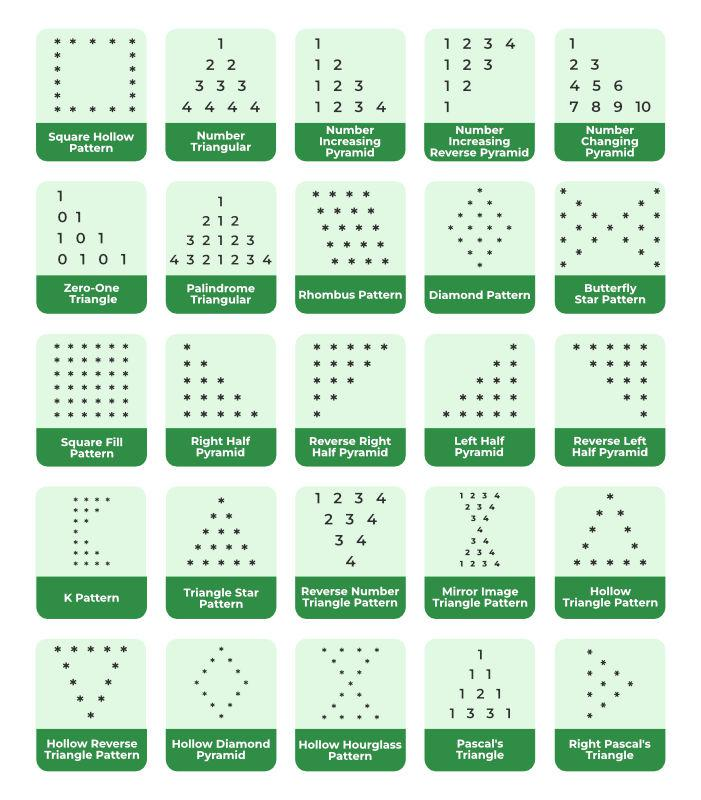

###  2.5.1. Beginner:
#### 2.5.1.1. Square Fill Pattern

```text
* * * *
* * * *
* * * *
* * * *
```

```c
#include <stdio.h>

int main() {
    int n;
    scanf("%d", &n);

    for (int i = 1; i <= n; i++) {
        for (int j = 1; j <= n; j++)
            printf("* ");
        printf("\n");
    }

    return 0;
}
```

#### 2.5.1.2. Right Half Pyramid

```text
*
* *
* * *
* * * *
```

```c
#include <stdio.h>

int main() {
    int n;
    scanf("%d", &n);

    for (int i = 1; i <= n; i++) {
        for (int j = 1; j <= i; j++)
            printf("* ");
        printf("\n");
    }

    return 0;
}
```

#### 2.5.1.3. Reverse Right Half Pyramid

```text
* * * *
* * *
* *
*
```

```c
#include <stdio.h>

int main() {
    int n;
    scanf("%d", &n);

    for (int i = n; i >= 1; i--) {
        for (int j = 1; j <= i; j++)
            printf("* ");
        printf("\n");
    }

    return 0;
}
```

#### 2.5.1.4. Number Triangular

```text
1
2 2
3 3 3
4 4 4 4
```

```c
#include <stdio.h>

int main() {
    int n;
    scanf("%d", &n);

    for (int i = 1; i <= n; i++) {
        for (int j = 1; j <= i; j++) {
            printf("%d ", i);
        }
        printf("\n");
    }

    return 0;
}
```

#### 2.5.1.5. Number Increasing Pyramid

```text
1
1 2
1 2 3
1 2 3 4
```

```c
#include <stdio.h>

int main() {
    int n;
    scanf("%d", &n);

    for(int i = 1; i <= n; i++){
        for(int j = 1; j <= i; j++){
            printf("%d ", j);
        }
        printf("\n");
    }

    return 0;
}
```

#### 2.5.1.6. Number Increasing Reverse Pyramid

```text
1 2 3 4
1 2 3
1 2
1
```

```c
#include <stdio.h>

int main() {
    int n;
    scanf("%d", &n);

    for (int i = n; i >= 1; i--) {
        for (int j = 1; j <= i; j++) {
            printf("%d ", j);
        }
        printf("\n");
    }

    return 0;
}
```

### 2.5.2. Intermediate

#### 2.5.2.1. Left Half Pyramid

```text
      *
    * *
  * * *
* * * *
```

```c
#include <stdio.h>

int main() {
    int n;
    scanf("%d", &n);

    for (int i = 1; i <= n; i++) {
        for (int s = 1; s <= n - i; s++)
            printf("  ");
        for (int j = 1; j <= i; j++)
            printf("* ");
        printf("\n");
    }

    return 0;
}
```

#### 2.5.2.2. Reverse Left Half Pyramid

```text
* * * *
  * * *
    * *
      *
```

```c
#include <stdio.h>

int main() {
    int n;
    scanf("%d", &n);

    for (int i = 1; i <= n; i++) {
        for (int s = 1; s < i; s++)
            printf("  ");
        for (int j = i; j <= n; j++)
            printf("* ");
        printf("\n");
    }

    return 0;
}
```

#### 2.5.2.3. Rhombus Pattern

```text
* * * *
  * * * *
    * * * *
      * * * *
```

```c
#include <stdio.h>

int main() {
    int n;
    scanf("%d", &n);

    for (int i = 1; i <= n; i++) {
        for (int s = 1; s < i; s++)
            printf("  ");
        for (int j = 1; j <= n; j++)
            printf("* ");
        printf("\n");
    }

    return 0;
}
```

#### 2.5.2.4. Triangle Star Pattern

```text
      *
    * * *
  * * * * *
* * * * * * *
```

```c
#include <stdio.h>

int main() {
    int n;
    scanf("%d", &n);

    for (int i = 1; i <= n; i++) {
        for (int s = 1; s <= n - i; s++)
            printf("  ");
        for (int j = 1; j <= 2 * i - 1; j++)
            printf("* ");
        printf("\n");
    }

    return 0;
}
```

#### 2.5.2.5. Reverse Number Triangle Pattern

```text
1 2 3 4
  2 3 4
    3 4
      4
```

```c
#include <stdio.h>

int main() {
    int n;
    scanf("%d", &n);

    for (int i = 1; i <= n; i++) {
        for (int s = 1; s < i; s++)
            printf("  ");
        for (int j = i; j <= n; j++)
            printf("%d ", j);
        printf("\n");
    }

    return 0;
}
```

#### 2.5.2.6. Number Changing Pyramid

```text
1
2 3
4 5 6
7 8 9 10
```

```c
#include <stdio.h>

int main() {
    int n;
    scanf("%d", &n);

   int number = 1;

    for (int i = 1; i <= n; i++) {
        for (int j = 1; j <= i; j++) {
            printf("%d ", number);
            number++;
        }
        printf("\n");
    }

    return 0;
}
```

#### 2.5.2.7. Zero-One Triangle

```text
1
0 1
1 0 1
0 1 0 1
```

```c
#include <stdio.h>

int main() {
    int n;
    scanf("%d", &n);

    for (int i = 1; i <= n; i++) {
        for (int j = 1; j <= i; j++) {
            if ((i + j) % 2 == 0)
            printf("1 ");
            else
            printf("0 ");
        }
        printf("\n");
    }
    
    return 0;
}
```

#### 2.5.2.8. Square Hollow Pattern

```
* * * *
*     *
*     *
* * * *
```

```c
#include <stdio.h>

int main() {
    int n;
    scanf("%d", &n);

    for (int i = 1; i <= n; i++) {
        for (int j = 1; j <= n; j++) {
            if (i == 1 || i == n || j == 1 || j == n){
                printf("* ");
            }
            else{
                printf("  ");
            }
        }
        printf("\n");
    }

    return 0;
}
```

#### 2.5.2.9. Palindrome Triangular

```text
1
2 1 2
3 2 1 2 3
4 3 2 1 2 3 4
```


```c
#include <stdio.h>

int main() {
    int n;
    scanf("%d", &n);

    for (int i = 1; i <= n; i++) {
        for (int j = i; j >= 1; j--)
            printf("%d ", j);
        for (int j = 2; j <= i; j++)
            printf("%d ", j);
        printf("\n");
    }
    
    return 0;
}
```

#### 2.5.2.10. K Pattern

```text
* * * *
* * *
* *
*
* *
* * *
* * * *
```

```c
#include <stdio.h>

int main() {
    int n;
    scanf("%d", &n);

    for (int i = n; i >= 1; i--) {
        for (int j = 1; j <= i; j++)
            printf("* ");
        printf("\n");
    }
    for (int i = 2; i <= n; i++) {
        for (int j = 1; j <= i; j++)
            printf("* ");
        printf("\n");
    }

    return 0;
}
```

#### 2.5.2.11. Right Pascal's Triangle

```text
      *
    * *
  * * *
* * * *
  * * *
    * *
      *
```

```c
#include <stdio.h>

int main() {
    int n;
    scanf("%d", &n);

    for (int i = 1; i <= n; i++) {
        for (int s = 1; s <= n - i; s++)
            printf("  ");
        for (int j = 1; j <= i; j++)
            printf("* ");
        printf("\n");
    }
    for (int i = n - 1; i >= 1; i--) {
        for (int s = 1; s <= n - i; s++)
            printf("  ");
        for (int j = 1; j <= i; j++)
            printf("* ");
        printf("\n");
    }

    return 0;
}
```

#### 2.5.2.12. Mirror Image Triangle Pattern

```text
1 2 3 4
  2 3 4
    3 4
      4
    3 4
  2 3 4
1 2 3 4
```

```c
#include <stdio.h>

int main() {
    int n;
    scanf("%d", &n);

    for (int i = 1; i <= n; i++) {
        for (int s = 1; s < i; s++)
            printf("  ");
        for (int j = i; j <= n; j++)
            printf("%d ", j);
        printf("\n");
    }
    for (int i = n - 1; i >= 1; i--) {
        for (int s = 1; s < i; s++)
            printf("  ");
        for (int j = i; j <= n; j++)
            printf("%d ", j);
        printf("\n");
    }


    return 0;
}
```

### 2.5.3. Advanced

#### 2.5.3.1. Diamond Pattern

```text
      *
    * * *
  * * * * *
* * * * * * *
  * * * * *
    * * *
      *
```

```c
#include <stdio.h>

int main() {
    int n;
    scanf("%d", &n);

    for (int i = 1; i <= n; i++) {
        for (int s = 1; s <= n - i; s++)
            printf("  ");
        for (int j = 1; j <= 2 * i - 1; j++)
            printf("* ");
        printf("\n");
    }
    for (int i = n - 1; i >= 1; i--) {
        for (int s = 1; s <= n - i; s++)
            printf("  ");
        for (int j = 1; j <= 2 * i - 1; j++)
            printf("* ");
        printf("\n");
    }

    return 0;
}
```

#### 2.5.3.2. Butterfly Star Pattern

```text
*             *
* *         * *
* * *     * * *
* * * * * * * *
* * *     * * *
* *         * *
*             *
```

```c
#include <stdio.h>

int main() {
    int n;
    scanf("%d", &n);

    for (int i = 1; i <= n; i++) {
        for (int j = 1; j <= i; j++)
            printf("* ");
        for (int s = 1; s <= 2 * (n - i); s++)
            printf("  ");
        for (int j = 1; j <= i; j++)
            printf("* ");
        printf("\n");
    }
    for (int i = n - 1; i >= 1; i--) {
        for (int j = 1; j <= i; j++)
            printf("* ");
        for (int s = 1; s <= 2 * (n - i); s++)
            printf("  ");
        for (int j = 1; j <= i; j++)
            printf("* ");
        printf("\n");
    }

    return 0;
}
```

#### 2.5.3.3. Hollow Triangle Pattern

```text
      *
    *   *
  *       *
* * * * * * *
```

```c
#include <stdio.h>

int main() {
    int n;
    scanf("%d", &n);

    for (int i = 1; i <= n; i++) {
        for (int s = 1; s <= n - i; s++)
            printf("  ");
        for (int j = 1; j <= 2 * i - 1; j++) {
            if (i == n || j == 1 || j == 2 * i - 1)
                printf("* ");
            else
                printf("  ");
        }
        printf("\n");
    }


    return 0;
}
```

#### 2.5.3.4. Hollow Reverse Triangle Pattern

```text
* * * * * * *
  *       *
    *   *
      *
```

```c
#include <stdio.h>

int main() {
    int n;
    scanf("%d", &n);

    for (int i = n; i >= 1; i--) {
        for (int s = 1; s <= n - i; s++)
            printf("  ");
        for (int j = 1; j <= 2 * i - 1; j++) {
            if (i == n || j == 1 || j == 2 * i - 1)
                printf("* ");
            else
                printf("  ");
        }
        printf("\n");
    }

    return 0;
}
```

#### 2.5.3.5. Hollow Diamond Pattern

```text
      *
    *   *
  *       *
*           *
  *       *
    *   *
      *
```

```c
#include <stdio.h>

int main() {
    int n;
    scanf("%d", &n);

    for (int i = 1; i <= n; i++) {
        for (int s = 1; s <= n - i; s++)
            printf("  ");
        for (int j = 1; j <= 2 * i - 1; j++) {
            if (j == 1 || j == 2 * i - 1)
                printf("* ");
            else
                printf("  ");
        }
        printf("\n");
    }
    for (int i = n - 1; i >= 1; i--) {
        for (int s = 1; s <= n - i; s++)
            printf("  ");
        for (int j = 1; j <= 2 * i - 1; j++) {
            if (j == 1 || j == 2 * i - 1)
                printf("* ");
            else
                printf("  ");
        }
        printf("\n");
    }

    return 0;
}
```

#### 2.5.3.6. Hollow Hourglass Pattern

```text
* * * * * * *
  *       *
    *   *
      *
    *   *
  *       *
* * * * * * *
```

```c
#include <stdio.h>

int main() {
    int n;
    scanf("%d", &n);

    for (int i = n; i >= 1; i--) {
        for (int s = 1; s <= n - i; s++)
            printf("  ");
        for (int j = 1; j <= 2 * i - 1; j++) {
            if (i == n || j == 1 || j == 2 * i - 1)
                printf("* ");
            else
                printf("  ");
        }
        printf("\n");
    }
    for (int i = 2; i <= n; i++) {
        for (int s = 1; s <= n - i; s++)
            printf("  ");
        for (int j = 1; j <= 2 * i - 1; j++) {
            if (i == n || j == 1 || j == 2 * i - 1)
                printf("* ");
            else
                printf("  ");
        }
        printf("\n");
    }

    return 0;
}
```

#### 2.5.3.7. Pascal's Triangle

```text
          1
        1   1
      1   2   1
    1   3   3   1
  1   4   6   4   1
```

```c
#include <stdio.h>

int main() {
    int n;
    scanf("%d", &n);

    for (int i = 0; i < n; i++) {
        for (int s = 0; s < n - i - 1; s++)
            printf("  ");

        long long value = 1;
        for (int j = 0; j <= i; j++) {
            printf("%4lld", value);
            if (j < i)
                value = value * (i - j) / (j + 1);
        }
        printf("\n");
    }

    return 0;
}
```


## 2.6. Sheet 3 (Arrays):
### 2.6.1. A. Problem Name: Summation

https://codeforces.com/group/MWSDmqGsZm/contest/219774/problem/A

### 2.6.2. B. Problem Name: Searching

https://codeforces.com/group/MWSDmqGsZm/contest/219774/problem/B

### 2.6.3. C. Problem Name: Replacement

https://codeforces.com/group/MWSDmqGsZm/contest/219774/problem/C

### 2.6.4. D. Problem Name: Positions in array

https://codeforces.com/group/MWSDmqGsZm/contest/219774/problem/D

### 2.6.5. E. Problem Name: Lowest Number

https://codeforces.com/group/MWSDmqGsZm/contest/219774/problem/E

### 2.6.6. F. Problem Name: Reversing

https://codeforces.com/group/MWSDmqGsZm/contest/219774/problem/F

### 2.6.7. G. Problem Name: Palindrome Array

https://codeforces.com/group/MWSDmqGsZm/contest/219774/problem/G

### 2.6.8. H. Problem Name: Sorting

https://codeforces.com/group/MWSDmqGsZm/contest/219774/problem/H

### 2.6.9. I. Problem Name: Smallest Pair

https://codeforces.com/group/MWSDmqGsZm/contest/219774/problem/I

### 2.6.10. J. Problem Name: Lucky Array

https://codeforces.com/group/MWSDmqGsZm/contest/219774/problem/J

### 2.6.11. K. Problem Name: Sum Digits

https://codeforces.com/group/MWSDmqGsZm/contest/219774/problem/K

### 2.6.12. L. Problem Name: Max Subarray

https://codeforces.com/group/MWSDmqGsZm/contest/219774/problem/L

### 2.6.13. M. Problem Name: Replace MinMax

https://codeforces.com/group/MWSDmqGsZm/contest/219774/problem/M

### 2.6.14. N. Problem Name: Check Code

https://codeforces.com/group/MWSDmqGsZm/contest/219774/problem/N

### 2.6.15. O. Problem Name: Fibonacci

https://codeforces.com/group/MWSDmqGsZm/contest/219774/problem/O

### 2.6.16. P. Problem Name: Minimize Number

https://codeforces.com/group/MWSDmqGsZm/contest/219774/problem/P

### 2.6.17. Q. Problem Name: Count Subarrays

https://codeforces.com/group/MWSDmqGsZm/contest/219774/problem/Q

### 2.6.18. R. Problem Name: Permutation with arrays

https://codeforces.com/group/MWSDmqGsZm/contest/219774/problem/R

### 2.6.19. S. Problem Name: Search In Matrix

https://codeforces.com/group/MWSDmqGsZm/contest/219774/problem/S

### 2.6.20. T. Problem Name: Matrix

https://codeforces.com/group/MWSDmqGsZm/contest/219774/problem/T

### 2.6.21. U. Problem Name: Is B a subsequence of A ?

https://codeforces.com/group/MWSDmqGsZm/contest/219774/problem/U

### 2.6.22. V. Problem Name: Frequency Array

https://codeforces.com/group/MWSDmqGsZm/contest/219774/problem/V

### 2.6.23. W. Problem Name: Mirror Array

https://codeforces.com/group/MWSDmqGsZm/contest/219774/problem/W

### 2.6.24. X. Problem Name: 8 Neighbors

https://codeforces.com/group/MWSDmqGsZm/contest/219774/problem/X

### 2.6.25. Y. Problem Name: Range sum query

https://codeforces.com/group/MWSDmqGsZm/contest/219774/problem/Y

### 2.6.26. Z. Problem Name: Binary Search

https://codeforces.com/group/MWSDmqGsZm/contest/219774/problem/Z

## 2.7. Contest 3:
### 2.7.1. A. Problem Name: Square or rectangle

https://codeforces.com/group/MWSDmqGsZm/contest/329103/problem/A

### 2.7.2. B. Problem Name: Reversing

https://codeforces.com/group/MWSDmqGsZm/contest/329103/problem/B

### 2.7.3. C. Problem Name: Choose Elements

https://codeforces.com/group/MWSDmqGsZm/contest/329103/problem/C

### 2.7.4. D. Problem Name: Counting Elements

https://codeforces.com/group/MWSDmqGsZm/contest/329103/problem/D

### 2.7.5. E. Problem Name: Alternating Array

https://codeforces.com/group/MWSDmqGsZm/contest/329103/problem/E

### 2.7.6. F. Problem Name: Front - End

https://codeforces.com/group/MWSDmqGsZm/contest/329103/problem/F

### 2.7.7. G. Problem Name: Even Hate Odd

https://codeforces.com/group/MWSDmqGsZm/contest/329103/problem/G

## 2.8. Sheet 4 (Strings):
### 2.8.1. A. Problem Name: Create A New String

https://codeforces.com/group/MWSDmqGsZm/contest/219856/problem/A

### 2.8.2. B. Problem Name: Let's use Getline

https://codeforces.com/group/MWSDmqGsZm/contest/219856/problem/B

### 2.8.3. C. Problem Name: Compare

https://codeforces.com/group/MWSDmqGsZm/contest/219856/problem/C

### 2.8.4. D. Problem Name: Strings

https://codeforces.com/group/MWSDmqGsZm/contest/219856/problem/D

### 2.8.5. E. Problem Name: Count

https://codeforces.com/group/MWSDmqGsZm/contest/219856/problem/E

### 2.8.6. F. Problem Name: Way Too Long Words

https://codeforces.com/group/MWSDmqGsZm/contest/219856/problem/F

### 2.8.7. G. Problem Name: Conversion

https://codeforces.com/group/MWSDmqGsZm/contest/219856/problem/G

### 2.8.8. H. Problem Name: Good or Bad

https://codeforces.com/group/MWSDmqGsZm/contest/219856/problem/H

### 2.8.9. I. Problem Name: Palindrome

https://codeforces.com/group/MWSDmqGsZm/contest/219856/problem/I

### 2.8.10. J. Problem Name: Count Letters

https://codeforces.com/group/MWSDmqGsZm/contest/219856/problem/J

### 2.8.11. K. Problem Name: I Love strings

https://codeforces.com/group/MWSDmqGsZm/contest/219856/problem/K

### 2.8.12. L. Problem Name: String Functions

https://codeforces.com/group/MWSDmqGsZm/contest/219856/problem/L

### 2.8.13. M. Problem Name: Subsequence String

https://codeforces.com/group/MWSDmqGsZm/contest/219856/problem/M

### 2.8.14. N. Problem Name: Max Subsequence

https://codeforces.com/group/MWSDmqGsZm/contest/219856/problem/N

### 2.8.15. O. Problem Name: Sort String

https://codeforces.com/group/MWSDmqGsZm/contest/219856/problem/O

### 2.8.16. P. Problem Name: Count Words

https://codeforces.com/group/MWSDmqGsZm/contest/219856/problem/P

### 2.8.17. Q. Problem Name: Reverse Words

https://codeforces.com/group/MWSDmqGsZm/contest/219856/problem/Q

### 2.8.18. R. Problem Name: String Score

https://codeforces.com/group/MWSDmqGsZm/contest/219856/problem/R

### 2.8.19. S. Problem Name: Max Split

https://codeforces.com/group/MWSDmqGsZm/contest/219856/problem/S

### 2.8.20. T. Problem Name: URL

https://codeforces.com/group/MWSDmqGsZm/contest/219856/problem/T

### 2.8.21. U. Problem Name: New Words

https://codeforces.com/group/MWSDmqGsZm/contest/219856/problem/U

### 2.8.22. V. Problem Name: Replace Word

https://codeforces.com/group/MWSDmqGsZm/contest/219856/problem/V

### 2.8.23. W. Problem Name: Encrypt & Decrypt Message

https://codeforces.com/group/MWSDmqGsZm/contest/219856/problem/W

### 2.8.24. X. Problem Name: Comparison

https://codeforces.com/group/MWSDmqGsZm/contest/219856/problem/X

### 2.8.25. Y. Problem Name: Min Cost String

https://codeforces.com/group/MWSDmqGsZm/contest/219856/problem/Y

### 2.8.26. Z. Problem Name: Clean Code

https://codeforces.com/group/MWSDmqGsZm/contest/219856/problem/Z

## 2.9. Sheet 5 (Functions):

### 2.9.1. A. Problem Name: Add

https://codeforces.com/group/MWSDmqGsZm/contest/223205/problem/A

### 2.9.2. B. Problem Name: Print

https://codeforces.com/group/MWSDmqGsZm/contest/223205/problem/B

### 2.9.3. C. Problem Name: Wonderful Number

https://codeforces.com/group/MWSDmqGsZm/contest/223205/problem/C

### 2.9.4. D. Problem Name: Prime Function

https://codeforces.com/group/MWSDmqGsZm/contest/223205/problem/D

### 2.9.5. E. Problem Name: Swap

https://codeforces.com/group/MWSDmqGsZm/contest/223205/problem/E

### 2.9.6. F. Problem Name: Equation

https://codeforces.com/group/MWSDmqGsZm/contest/223205/problem/F

### 2.9.7. G. Problem Name: Max and MIN

https://codeforces.com/group/MWSDmqGsZm/contest/223205/problem/G

### 2.9.8. H. Problem Name: N Times

https://codeforces.com/group/MWSDmqGsZm/contest/223205/problem/H

### 2.9.9. I. Problem Name: Swapping With Matrix

https://codeforces.com/group/MWSDmqGsZm/contest/223205/problem/I

### 2.9.10. J. Problem Name: Average

https://codeforces.com/group/MWSDmqGsZm/contest/223205/problem/J

### 2.9.11. K. Problem Name: Shift Right

https://codeforces.com/group/MWSDmqGsZm/contest/223205/problem/K

### 2.9.12. L. Problem Name: New Array

https://codeforces.com/group/MWSDmqGsZm/contest/223205/problem/L

### 2.9.13. M. Problem Name: Distinct Numbers

https://codeforces.com/group/MWSDmqGsZm/contest/223205/problem/M

### 2.9.14. N. Problem Name: Shift Zeros

https://codeforces.com/group/MWSDmqGsZm/contest/223205/problem/N

### 2.9.15. O. Problem Name: Five in One

https://codeforces.com/group/MWSDmqGsZm/contest/223205/problem/O

## 2.10. Sheet 6 (Math - Geometry): 
### 2.10.1. A. Problem Name: Power Of Two

https://codeforces.com/group/MWSDmqGsZm/contest/223338/problem/A

### 2.10.2. B. Problem Name: Prime checking

https://codeforces.com/group/MWSDmqGsZm/contest/223338/problem/B

### 2.10.3. C. Problem Name: Sum of Range

https://codeforces.com/group/MWSDmqGsZm/contest/223338/problem/C

### 2.10.4. D. Problem Name: Xor

https://codeforces.com/group/MWSDmqGsZm/contest/223338/problem/D

### 2.10.5. E. Problem Name: Maximum Distinct Numbers

https://codeforces.com/group/MWSDmqGsZm/contest/223338/problem/E

### 2.10.6. F. Problem Name: Multiplication of Matrices

https://codeforces.com/group/MWSDmqGsZm/contest/223338/problem/F

### 2.10.7. G. Problem Name: Summation of its divisors

https://codeforces.com/group/MWSDmqGsZm/contest/223338/problem/G

### 2.10.8. H. Problem Name: GCD

https://codeforces.com/group/MWSDmqGsZm/contest/223338/problem/H

### 2.10.9. I. Problem Name: Divisability

https://codeforces.com/group/MWSDmqGsZm/contest/223338/problem/I

### 2.10.10. J. Problem Name: Prime Factors

https://codeforces.com/group/MWSDmqGsZm/contest/223338/problem/J

### 2.10.11. K. Problem Name: Combination and Permutation

https://codeforces.com/group/MWSDmqGsZm/contest/223338/problem/K

### 2.10.12. L. Problem Name: Pascal Triangle

https://codeforces.com/group/MWSDmqGsZm/contest/223338/problem/L

### 2.10.13. M. Problem Name: Divisible

https://codeforces.com/group/MWSDmqGsZm/contest/223338/problem/M

### 2.10.14. N. Problem Name: Convert to Base

https://codeforces.com/group/MWSDmqGsZm/contest/223338/problem/N

### 2.10.15. O. Problem Name: Big Add and Multiply

https://codeforces.com/group/MWSDmqGsZm/contest/223338/problem/O

### 2.10.16. P. Problem Name: Factorial Digits

https://codeforces.com/group/MWSDmqGsZm/contest/223338/problem/P

### 2.10.17. Q. Problem Name: Product

https://codeforces.com/group/MWSDmqGsZm/contest/223338/problem/Q

### 2.10.18. R. Problem Name: Distance points

https://codeforces.com/group/MWSDmqGsZm/contest/223338/problem/R

### 2.10.19. S. Problem Name: Is Triangle

https://codeforces.com/group/MWSDmqGsZm/contest/223338/problem/S

### 2.10.20. T. Problem Name: Circle Task

https://codeforces.com/group/MWSDmqGsZm/contest/223338/problem/T

### 2.10.21. U. Problem Name: Straight Line

https://codeforces.com/group/MWSDmqGsZm/contest/223338/problem/U

### 2.10.22. V. Problem Name: Two Lines

https://codeforces.com/group/MWSDmqGsZm/contest/223338/problem/V

### 2.10.23. W. Problem Name: Circles

https://codeforces.com/group/MWSDmqGsZm/contest/223338/problem/W

### 2.10.24. X. Problem Name: Rectangle

https://codeforces.com/group/MWSDmqGsZm/contest/223338/problem/X

### 2.10.25. Y. Problem Name: Common Area

https://codeforces.com/group/MWSDmqGsZm/contest/223338/problem/Y

### 2.10.26. Z. Problem Name: Geometry Test

https://codeforces.com/group/MWSDmqGsZm/contest/223338/problem/Z

## 2.11. Sheet 7 (Recursion): 
### 2.11.1. A. Problem Name: Print Recursion

https://codeforces.com/group/MWSDmqGsZm/contest/223339/problem/A

### 2.11.2. B. Problem Name: Print from 1 to N

https://codeforces.com/group/MWSDmqGsZm/contest/223339/problem/B

### 2.11.3. C. Problem Name: Print from N to 1

https://codeforces.com/group/MWSDmqGsZm/contest/223339/problem/C

### 2.11.4. D. Problem Name: Print Digits using Recursion

https://codeforces.com/group/MWSDmqGsZm/contest/223339/problem/D

### 2.11.5. E. Problem Name: Base Converssion

https://codeforces.com/group/MWSDmqGsZm/contest/223339/problem/E

### 2.11.6. F. Problem Name: Print Even Indices

https://codeforces.com/group/MWSDmqGsZm/contest/223339/problem/F

### 2.11.7. G. Problem Name: Pyramid

https://codeforces.com/group/MWSDmqGsZm/contest/223339/problem/G

### 2.11.8. H. Problem Name: Inverted Pyramid

https://codeforces.com/group/MWSDmqGsZm/contest/223339/problem/H

### 2.11.9. I. Problem Name: Count Vowels

https://codeforces.com/group/MWSDmqGsZm/contest/223339/problem/I

### 2.11.10. J. Problem Name: Factorial

https://codeforces.com/group/MWSDmqGsZm/contest/223339/problem/J

### 2.11.11. K. Problem Name: Max Number

https://codeforces.com/group/MWSDmqGsZm/contest/223339/problem/K

### 2.11.12. L. Problem Name: Summation

https://codeforces.com/group/MWSDmqGsZm/contest/223339/problem/L

### 2.11.13. M. Problem Name: Suffix Sum

https://codeforces.com/group/MWSDmqGsZm/contest/223339/problem/M

### 2.11.14. N. Problem Name: Sum of a Matrix

https://codeforces.com/group/MWSDmqGsZm/contest/223339/problem/N

### 2.11.15. O. Problem Name: Fibonacci

https://codeforces.com/group/MWSDmqGsZm/contest/223339/problem/O

### 2.11.16. P. Problem Name: Log2

https://codeforces.com/group/MWSDmqGsZm/contest/223339/problem/P

### 2.11.17. Q. Problem Name: 3n + 1 sequence

https://codeforces.com/group/MWSDmqGsZm/contest/223339/problem/Q

### 2.11.18. R. Problem Name: Palindrome Array

https://codeforces.com/group/MWSDmqGsZm/contest/223339/problem/R

### 2.11.19. S. Problem Name: Array Average

https://codeforces.com/group/MWSDmqGsZm/contest/223339/problem/S

### 2.11.20. T. Problem Name: Combination

https://codeforces.com/group/MWSDmqGsZm/contest/223339/problem/T

### 2.11.21. U. Problem Name: Knapsack

https://codeforces.com/group/MWSDmqGsZm/contest/223339/problem/U

### 2.11.22. V. Problem Name: Creating Expression1

https://codeforces.com/group/MWSDmqGsZm/contest/223339/problem/V

### 2.11.23. W. Problem Name: Reach Value

https://codeforces.com/group/MWSDmqGsZm/contest/223339/problem/W

### 2.11.24. X. Problem Name: The maximum path-sum

https://codeforces.com/group/MWSDmqGsZm/contest/223339/problem/X

### 2.11.25. Y. Problem Name: Number of Ways

https://codeforces.com/group/MWSDmqGsZm/contest/223339/problem/Y

### 2.11.26. Z. Problem Name: Left Max

https://codeforces.com/group/MWSDmqGsZm/contest/223339/problem/Z

## 2.12. Sheet 8 (General easy): 
### 2.12.1. A Palindromes Replace:
https://codeforces.com/group/MWSDmqGsZm/contest/223206/problem/A

### 2.12.2. B Watermelon:
https://codeforces.com/group/MWSDmqGsZm/contest/223206/problem/B

### 2.12.3. C Koko And The Transformation:
https://codeforces.com/group/MWSDmqGsZm/contest/223206/problem/C
### 2.12.4. D Bear and Big Brother: 
https://codeforces.com/group/MWSDmqGsZm/contest/223206/problem/D

### 2.12.5. E George and Accommodation: 
https://codeforces.com/group/MWSDmqGsZm/contest/223206/problem/E

### 2.12.6. F Fox And Snake:
https://codeforces.com/group/MWSDmqGsZm/contest/223206/problem/F
### 2.12.7. G Magnets:
https://codeforces.com/group/MWSDmqGsZm/contest/223206/problem/G
### 2.12.8. H Presents:
https://codeforces.com/group/MWSDmqGsZm/contest/223206/problem/H
### 2.12.9. I Colorful Stones (Simplified Edition)1:
https://codeforces.com/group/MWSDmqGsZm/contest/223206/problem/I
### 2.12.10. J Lucky Division:
https://codeforces.com/group/MWSDmqGsZm/contest/223206/problem/J
### 2.12.11. K Prime Fibonacci:
https://codeforces.com/group/MWSDmqGsZm/contest/223206/problem/K
### 2.12.12. L Sereja and Dima:
https://codeforces.com/group/MWSDmqGsZm/contest/223206/problem/L
### 2.12.13. M The New Year: Meeting Friends:
https://codeforces.com/group/MWSDmqGsZm/contest/223206/problem/M
### 2.12.14. N Cakeminator:
https://codeforces.com/group/MWSDmqGsZm/contest/223206/problem/N
### 2.12.15. O Free Ice Cream:
https://codeforces.com/group/MWSDmqGsZm/contest/223206/problem/O
### 2.12.16. P Police Recruits:
https://codeforces.com/group/MWSDmqGsZm/contest/223206/problem/P
### 2.12.17. Q Night at the Museum:
https://codeforces.com/group/MWSDmqGsZm/contest/223206/problem/Q
### 2.12.18. R Arrival of the General:
https://codeforces.com/group/MWSDmqGsZm/contest/223206/problem/R
### 2.12.19. S Good Number:
https://codeforces.com/group/MWSDmqGsZm/contest/223206/problem/S
### 2.12.20. T Helpful Maths:
https://codeforces.com/group/MWSDmqGsZm/contest/223206/problem/T
### 2.12.21. U Ilya and Bank Account1:
https://codeforces.com/group/MWSDmqGsZm/contest/223206/problem/U
### 2.12.22. V Is it rated:
https://codeforces.com/group/MWSDmqGsZm/contest/223206/problem/V
### 2.12.23. W Mahmoud and Longest Uncommon Subsequence:
https://codeforces.com/group/MWSDmqGsZm/contest/223206/problem/W
### 2.12.24. X Panoramix's Prediction:
https://codeforces.com/group/MWSDmqGsZm/contest/223206/problem/X
### 2.12.25. Y Team Olympiad:
https://codeforces.com/group/MWSDmqGsZm/contest/223206/problem/Y
### 2.12.26. Z Decoding:
https://codeforces.com/group/MWSDmqGsZm/contest/223206/problem/Z

## 2.13. Sheet 9 (General medium): 
### 2.13.1. A. Problem Name: Drawing Task

https://codeforces.com/group/MWSDmqGsZm/contest/223207/problem/A

### 2.13.2. B. Problem Name: Arpa’s hard exam and Mehrdad’s naive cheat

https://codeforces.com/group/MWSDmqGsZm/contest/223207/problem/B

### 2.13.3. C. Problem Name: Dragons1

https://codeforces.com/group/MWSDmqGsZm/contest/223207/problem/C

### 2.13.4. D. Problem Name: Juicer

https://codeforces.com/group/MWSDmqGsZm/contest/223207/problem/D

### 2.13.5. E. Problem Name: Keyboard

https://codeforces.com/group/MWSDmqGsZm/contest/223207/problem/E

### 2.13.6. F. Problem Name: Puzzles1

https://codeforces.com/group/MWSDmqGsZm/contest/223207/problem/F

### 2.13.7. G. Problem Name: Twins1

https://codeforces.com/group/MWSDmqGsZm/contest/223207/problem/G

### 2.13.8. H. Problem Name: Launch of Collider

https://codeforces.com/group/MWSDmqGsZm/contest/223207/problem/H

### 2.13.9. I. Problem Name: Lineland Mail

https://codeforces.com/group/MWSDmqGsZm/contest/223207/problem/I

### 2.13.10. J. Problem Name: Shaass and Oskols1

https://codeforces.com/group/MWSDmqGsZm/contest/223207/problem/J

### 2.13.11. K. Problem Name: Stars Drawing (Easy Edition)

https://codeforces.com/group/MWSDmqGsZm/contest/223207/problem/K

### 2.13.12. L. Problem Name: Announcement !

https://codeforces.com/group/MWSDmqGsZm/contest/223207/problem/L

### 2.13.13. M. Problem Name: !Palindromes

https://codeforces.com/group/MWSDmqGsZm/contest/223207/problem/M

### 2.13.14. N. Problem Name: Pumbaa And Apples

https://codeforces.com/group/MWSDmqGsZm/contest/223207/problem/N

### 2.13.15. O. Problem Name: Yaroslav and Permutations1

https://codeforces.com/group/MWSDmqGsZm/contest/223207/problem/O

### 2.13.16. P. Problem Name: Calculating Function

https://codeforces.com/group/MWSDmqGsZm/contest/223207/problem/P

### 2.13.17. Q. Problem Name: Dreamoon and Stairs

https://codeforces.com/group/MWSDmqGsZm/contest/223207/problem/Q

### 2.13.18. R. Problem Name: Ksenia and Pan Scales

https://codeforces.com/group/MWSDmqGsZm/contest/223207/problem/R

### 2.13.19. S. Problem Name: Mahmoud and a Triangle

https://codeforces.com/group/MWSDmqGsZm/contest/223207/problem/S

### 2.13.20. T. Problem Name: Olesya and Rodion

https://codeforces.com/group/MWSDmqGsZm/contest/223207/problem/T

### 2.13.21. U. Problem Name: T-primes1

https://codeforces.com/group/MWSDmqGsZm/contest/223207/problem/U

### 2.13.22. V. Problem Name: Balanced Rating Changes

https://codeforces.com/group/MWSDmqGsZm/contest/223207/problem/V

### 2.13.23. W. Problem Name: Football1

https://codeforces.com/group/MWSDmqGsZm/contest/223207/problem/W

### 2.13.24. X. Problem Name: Mountain Scenery1

https://codeforces.com/group/MWSDmqGsZm/contest/223207/problem/X

### 2.13.25. Y. Problem Name: Polo the Penguin and Segments 1

https://codeforces.com/group/MWSDmqGsZm/contest/223207/problem/Y

### 2.13.26. Z. Problem Name: Fraction

https://codeforces.com/group/MWSDmqGsZm/contest/223207/problem/Z

## 2.14. Sheet 10 (General Hard): 
### 2.14.1. A. Problem Name: Palindromes Replace

https://codeforces.com/group/MWSDmqGsZm/contest/223340/problem/A

### 2.14.2. B. Problem Name: Delete from the Left

https://codeforces.com/group/MWSDmqGsZm/contest/223340/problem/B

### 2.14.3. C. Problem Name: Koko And The Transformation

https://codeforces.com/group/MWSDmqGsZm/contest/223340/problem/C

### 2.14.4. D. Problem Name: Hussien and Strings

https://codeforces.com/group/MWSDmqGsZm/contest/223340/problem/D

### 2.14.5. E. Problem Name: Construct The Sum

https://codeforces.com/group/MWSDmqGsZm/contest/223340/problem/E

### 2.14.6. F. Problem Name: Marks

https://codeforces.com/group/MWSDmqGsZm/contest/223340/problem/F

### 2.14.7. G. Problem Name: Smallest Product

https://codeforces.com/group/MWSDmqGsZm/contest/223340/problem/G

### 2.14.8. H. Problem Name: Chewbaсca and Number

https://codeforces.com/group/MWSDmqGsZm/contest/223340/problem/H

### 2.14.9. I. Problem Name: Coins1

https://codeforces.com/group/MWSDmqGsZm/contest/223340/problem/I

### 2.14.10. J. Problem Name: Help Vasilisa the Wise 21

https://codeforces.com/group/MWSDmqGsZm/contest/223340/problem/J

### 2.14.11. K. Problem Name: Snacktower

https://codeforces.com/group/MWSDmqGsZm/contest/223340/problem/K

### 2.14.12. L. Problem Name: Two Squares

https://codeforces.com/group/MWSDmqGsZm/contest/223340/problem/L

### 2.14.13. M. Problem Name: Postcard

https://codeforces.com/group/MWSDmqGsZm/contest/223340/problem/M

### 2.14.14. N. Problem Name: Katryoshka

https://codeforces.com/group/MWSDmqGsZm/contest/223340/problem/N

### 2.14.15. O. Problem Name: Help Koko

https://codeforces.com/group/MWSDmqGsZm/contest/223340/problem/O

### 2.14.16. P. Problem Name: No Time for Dragons

https://codeforces.com/group/MWSDmqGsZm/contest/223340/problem/P

### 2.14.17. Q. Problem Name: Bulbs

https://codeforces.com/group/MWSDmqGsZm/contest/223340/problem/Q

### 2.14.18. R. Problem Name: Cut Ribbon

https://codeforces.com/group/MWSDmqGsZm/contest/223340/problem/R

### 2.14.19. S. Problem Name: DZY Loves Chessboard

https://codeforces.com/group/MWSDmqGsZm/contest/223340/problem/S

### 2.14.20. T. Problem Name: Easter Eggs1

https://codeforces.com/group/MWSDmqGsZm/contest/223340/problem/T

### 2.14.21. U. Problem Name: From S To T

https://codeforces.com/group/MWSDmqGsZm/contest/223340/problem/U

### 2.14.22. V. Problem Name: New Password

https://codeforces.com/group/MWSDmqGsZm/contest/223340/problem/V

### 2.14.23. W. Problem Name: Hussien and Arrays 2

https://codeforces.com/group/MWSDmqGsZm/contest/223340/problem/W

### 2.14.24. X. Problem Name: Strange Addition1

https://codeforces.com/group/MWSDmqGsZm/contest/223340/problem/X

### 2.14.25. Y. Problem Name: Spiral

https://codeforces.com/group/MWSDmqGsZm/contest/223340/problem/Y

### 2.14.26. Z. Problem Name: Triangle1

https://codeforces.com/group/MWSDmqGsZm/contest/223340/problem/Z